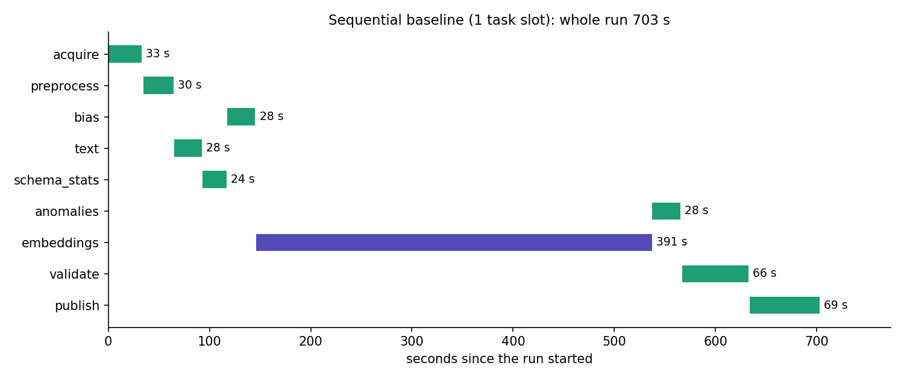
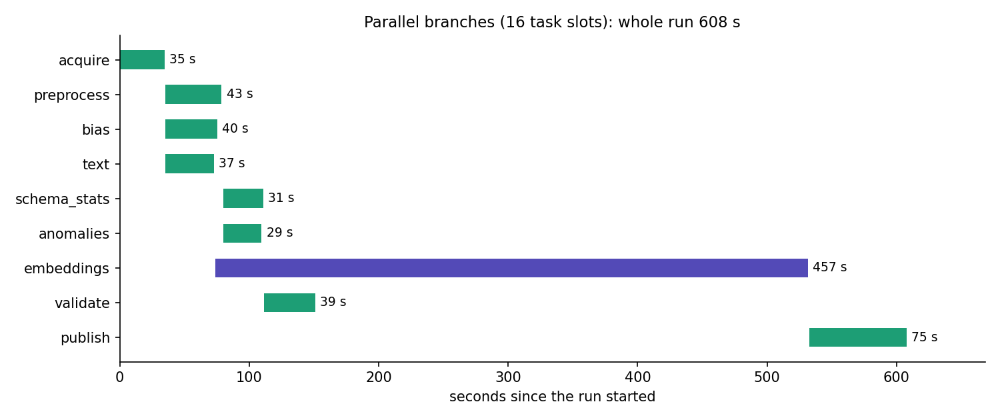

# Pipeline flow optimization (Airflow Gantt chart)

Rubric item 9 asks to find bottlenecks with Airflow's Gantt chart and to
speed up slow parts by parallelizing or improving them. This note records
what was measured, what was changed and the result.

## How it was measured

- Airflow 2.10.5 (LocalExecutor on PostgreSQL) on the Compute Engine VM
  `ctt-airflow` (e2-standard-4), each task in its own copy of the code
  (`gce/run_task.sh`), data and run state in GCS, BioBERT on a Vertex AI T4.
- Test snapshot with 50,000 trials (`"sample_trials": 50000` in the trigger
  config), so every stage has real work to do.
- Each run used a different snapshot and sample size, so DVC re-ran every
  stage (an unchanged stage is skipped and would make a run look faster than
  it is).
- Baseline: Airflow's default pool set to 1 slot, so tasks run one after
  another, the way a chained DAG would run them.
- Optimized: the same DAG with 16 slots, so independent branches run at the
  same time.
- The charts are drawn from the task start and end times Airflow recorded
  for each run (`docs/gantt.py`); Airflow's own Gantt view shows the same.

## Bottleneck found

The baseline Gantt chart shows every task waiting for the one before it,
although most of them do not need each other's output, and one task,
`embeddings`, taking more than half of the run:

| Task | Needs | Sequential run (s) |
|---|---|---|
| acquire | nothing | 33.1 |
| preprocess | raw snapshot | 29.7 |
| text | raw snapshot | 27.5 |
| schema_stats | features | 23.7 |
| bias | raw snapshot only | 27.7 |
| embeddings | text (Vertex AI GPU job) | 391.1 |
| anomalies | features | 28.0 |
| validate | features, schema, statistics | 65.6 |
| publish | everything | 69.0 |
| **whole run** | | **702.5** |



Most of `embeddings` is waiting: Vertex AI has to provision the T4 machine
and pull the BioBERT image before the few minutes of GPU work start. In a
sequential run every other task waits behind it.

## Change

The DAG follows the real data dependencies (`dags/ctt_data_pipeline.py`):

```
               +--> preprocess --+--> schema_stats --> validate --+
               |                 +--> anomalies -------------------+
    acquire ---+--> bias ------------------------------------------+--> publish
               +--> text --> embeddings (Vertex AI GPU) -----------+
```

- `text` and `embeddings` need only the raw snapshot, so the GPU job starts
  right after `acquire` and `text`, and the whole feature and check branch
  runs while Vertex AI provisions the GPU.
- `bias` reads only the raw snapshot, so it runs next to `preprocess`.
- `schema_stats` and `anomalies` both read only the features, so they run
  next to each other.
- Parallel tasks are safe with DVC: each task runs in its own copy of the
  code and merges only its own stage into the shared `dvc.lock` in GCS, with
  a conditional write that is retried when another task wrote first (tested
  in `tests/test_orchestration.py`).

## Result

| Run | Whole run (s) | embeddings (s) |
|---|---|---|
| Sequential baseline | 702.5 | 391.1 |
| Parallel branches | 607.5 | 457.4 |

The parallel run is **95 s (14%) shorter**, even though its GPU job happened
to take 66 s longer (Vertex AI provisioning time varies between runs). With
the same GPU time in both runs it would be about 541 s, **23% shorter**. In
the parallel run every other task has finished by 151 s, inside the GPU
job's window: the run now takes `acquire + text + embeddings + publish`, and
the feature, bias and check work costs no extra time.



## Notes for the real AACT data

- On the full AACT export (about 500,000 trials) `preprocess`, `bias` and
  `validate` take minutes rather than seconds, and the GPU job runs much
  longer, so overlapping the two branches saves more in absolute time.
- About 25 seconds of every task is fixed cost (copying the code, pulling
  its inputs from GCS, importing pandas and Great Expectations, pushing its
  outputs), which caps the gain on small snapshots.
- A second run on the same snapshot is much faster again: DVC skips every
  stage whose code, data and parameters did not change, and `--pull`
  restores their outputs from the remote instead of recomputing them; an
  unchanged text also means no GPU job at all.

## Reproduce

On the VM (`./gce/vm.sh` from `Data-Pipeline/`, then in the scheduler
container through `gcloud compute ssh ctt-airflow`):

```bash
cd /opt/ctt-repo/Data-Pipeline/gce/airflow
alias af='sudo -u ctt docker compose exec -T scheduler airflow'
af pools set default_pool 1 sequential-baseline
af dags trigger ctt_data_pipeline -c '{"snapshot": "20261026", "source": "sample", "sample_trials": 50000}'
# when it has finished:
af pools set default_pool 16 parallel
af dags trigger ctt_data_pipeline -c '{"snapshot": "20261027", "source": "sample", "sample_trials": 50001}'
# then, for each run:
af tasks states-for-dag-run ctt_data_pipeline <run_id> -o json > run.json
```

and draw each chart with `python docs/gantt.py run.json "<title>" <out.png>`.
