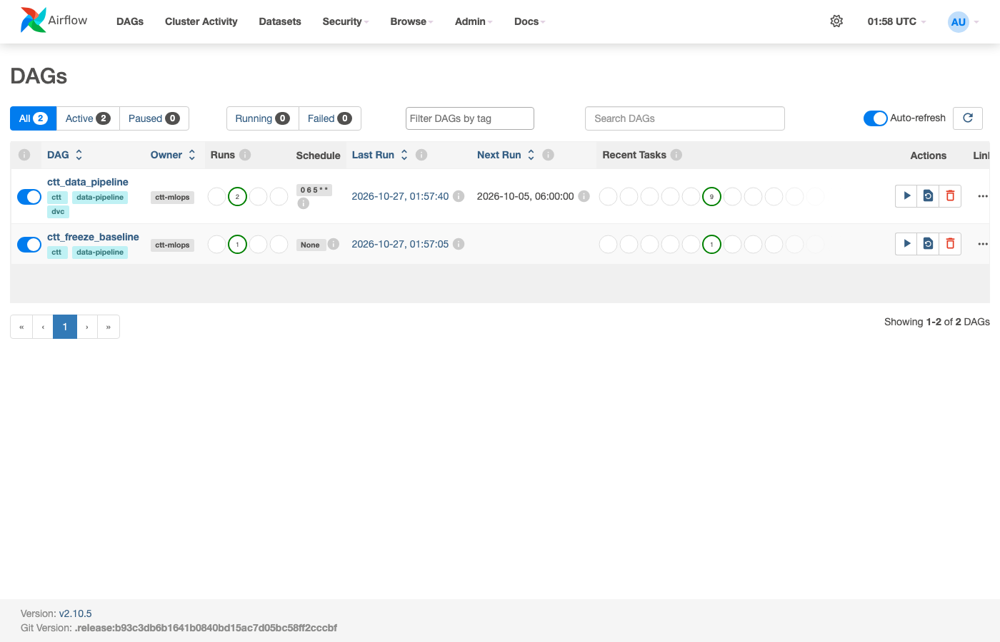
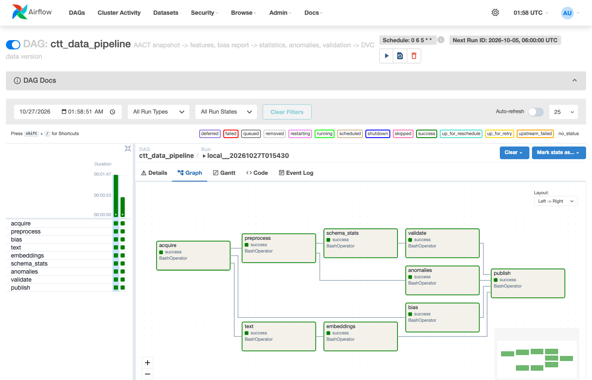
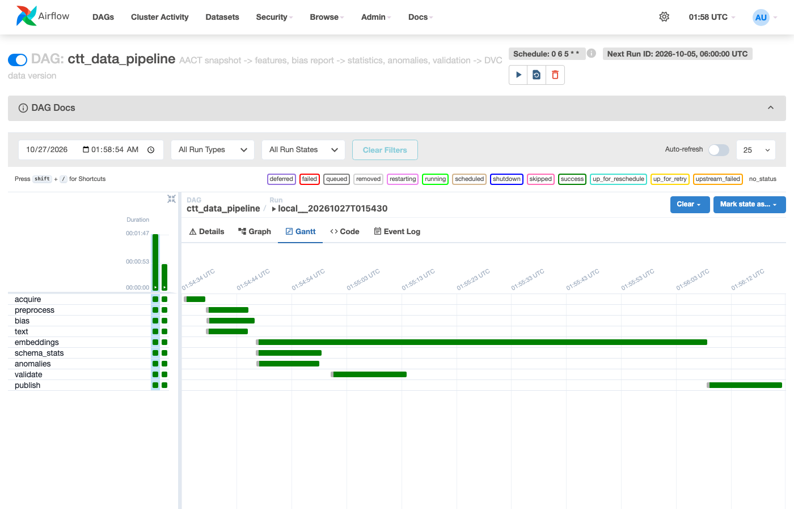

# Run the pipeline on your machine

The whole data pipeline runs on one machine, with no cloud account. It uses
Airflow 2.10.5 in Docker (the same version as our Cloud Composer) and the
same DAG, `dags/ctt_data_pipeline.py`, with its local runner:

| | Google Cloud (`composer/`) | This machine (`local/`) |
|---|---|---|
| Airflow | Cloud Composer 3 | Docker Compose: scheduler, web server, Postgres |
| One task | a pod from the pipeline image | `local/run_task.sh`: the code copied to a fresh temporary folder |
| Run state | `gs://<bucket>/data-pipeline/state` | `local/output/state/` |
| DVC remote | `gs://<bucket>/dvc-store` | `local/output/dvc-store/` |
| BioBERT embeddings | Vertex AI job on a T4 GPU | on this machine's CPU |
| Data | seeded test snapshot, or AACT (`SOURCE=db`) | the same |

Every stage, check, retry, alert and DVC version works as it does on Google
Cloud. Our cloud deployment, and how to repeat it in your own project, is in
[docs/cloud_deployment.md](../../docs/cloud_deployment.md).

## What you need

- Docker with Compose v2: [Docker Desktop](https://www.docker.com/products/docker-desktop/)
  on macOS or Windows, or Docker Engine on Linux.
- About 4 GB of memory for Docker. On Docker Desktop, set this under
  Settings > Resources. You also need about 6 GB of disk for the image.
- Bash. On Windows, use WSL or Git Bash.
- Port 8080 free.

## Run it

From the `Data-Pipeline` folder:

```bash
./local/pipeline.sh up        # first time: builds the image (downloads
                              # about 3 GB), then starts Airflow at
                              # http://localhost:8080
./local/pipeline.sh trigger   # one run on the seeded test snapshot; waits
                              # for it and prints each task's state
```

Open <http://localhost:8080> and sign in as `admin` with password `admin`.
The UI listens on this machine only. Open DAG `ctt_data_pipeline` to follow
the run in the Graph, Gantt and Logs views. You can also trigger it from the
UI (the play button, "Trigger DAG w/ config").

A run on the default test snapshot (500 trials) takes about 2 minutes on a
Docker VM with 2 CPUs and 4 GB of memory. `embeddings` is the longest task
(about 80 s), because BioBERT runs on the CPU.

Options for `trigger`:

```bash
SAMPLE_TRIALS=2000 ./local/pipeline.sh trigger      # a bigger test snapshot
SNAPSHOT=20261101 ./local/pipeline.sh trigger       # another snapshot date
SOURCE=db ./local/pipeline.sh trigger               # live AACT database
```

`SOURCE=db` needs AACT credentials in `Data-Pipeline/.env`. Copy it from
`.env.example`; [docs/SETUP.md](../../docs/SETUP.md) shows how to get them.
The same file can hold SMTP settings for the alert emails. Run
`./local/pipeline.sh up` again after you change `.env`.

## What a run looks like

This is our test of this setup on a MacBook, with Docker limited to 2 CPUs
and 4 GB. Both DAGs are loaded. `ctt_data_pipeline` ran twice and
`ctt_freeze_baseline` once:



All nine tasks succeeded. They are `BashOperator`s here and pods on
Composer:



The Gantt view shows the same parallel branches as on Composer. The whole
run took 1 minute 47 seconds:



The `embeddings` task log shows each step of `run_stage.py`. It points DVC
at the local remote, copies the shared `dvc.lock` and the run's parameters,
pulls the input, runs the stage, pushes the output and merges `dvc.lock`:

```
01:54:49 run_stage: $ dvc remote add --local --force --default pipeline /opt/ctt-output/dvc-store
01:54:51 run_stage: copied /opt/ctt-output/state/dvc.lock
01:54:51 run_stage: copied /opt/ctt-output/state/runs/local__20261027T015430/params.yaml
01:54:51 run_stage: $ dvc pull data/processed/text_all.jsonl
01:54:52 run_stage: $ dvc repro --single-item --pull embeddings
01:55:01 embeddings: BioBERT on cpu for 500 trials
01:55:15 embeddings: title: 500 windows in 14 s
  ...
01:56:06 embeddings: outcomes: 500 windows in 15 s
01:56:07 run_stage: $ dvc push embeddings
01:56:08 run_stage: merged stage embeddings into /opt/ctt-output/state/dvc.lock
```

Then `freeze` made that run the baseline, and a second run on the same
snapshot took 50 seconds. `validate` checked it against the baseline (493 of
493 checks passed). DVC restored the unchanged outputs, for example the
embeddings in 7 seconds, instead of computing them again.

## Where the results are

Everything a run writes is in `local/output/` (not committed):

```
local/output/
|- dvc-store/                       DVC remote: every data version
|- state/
   |- dvc.lock                      latest outputs of every stage
   |- baseline/                     validation baseline (after freeze)
   |- runs/<run_id>/params.yaml     the run's parameters
   |- runs/<run_id>/<task>/logs/    step logs and run records
   |- runs/<run_id>/<task>/reports/ statistics, anomalies, validation, bias
   |- versions/<snapshot>/          the run's dvc.lock and data-version record
```

For example, `runs/<run_id>/validate/reports/validation/validation.md`
holds the validation report, and
`runs/<run_id>/anomalies/reports/anomalies/anomalies.md` holds the anomaly
report.

## Other steps

```bash
REASON="first test run" ./local/pipeline.sh freeze  # this run's schema and
                                                    # statistics become the
                                                    # validation baseline
./local/pipeline.sh status    # list the runs
./local/pipeline.sh down      # stop Airflow; output/ and the run history stay
./local/pipeline.sh clean     # stop and delete the history and output/
```

A second `trigger` with the same snapshot is fast. DVC sees that no
stage's code, data or parameters changed, so it restores the outputs from the
DVC remote instead of running the stages again.

## How it works

- `docker-compose.yaml` builds the image from `local/Dockerfile`: Airflow
  2.10.5 plus a separate virtualenv with the pipeline's libraries, CPU-only
  torch and the BioBERT weights. It mounts the repository read-only at
  `/opt/ctt` and `local/output/` at `/opt/ctt-output`.
- It sets `CTT_RUNNER=local`, so each DAG task is a `BashOperator` that runs
  `local/run_task.sh <stage>`. The script copies the code to a temporary
  folder and runs `python -m scripts.run_stage <stage>` there. This is the
  same command a Composer pod runs.
- It also sets `CTT_STATE_URI` and `CTT_DVC_REMOTE` to the folders in
  `local/output/`, and `CTT_EMBEDDINGS=local`. `run_stage.py` then keeps the
  run state in a folder instead of GCS, points DVC at the local remote, and
  `embeddings` runs BioBERT in the task instead of starting a Vertex AI job.
- At most 3 tasks run at the same time, so the stack fits in 4 GB. With more
  memory, raise this with `CTT_PARALLELISM=6 ./local/pipeline.sh up`.

## Troubleshooting

- **Port 8080 is taken** (`port is already allocated`, or another Airflow
  answers at localhost:8080): start on another port with
  `CTT_UI_PORT=8081 ./local/pipeline.sh up` and open
  <http://localhost:8081>.
- **A task is killed or the run stalls**: Docker has too little memory. Give
  it more, or run fewer tasks at once with `CTT_PARALLELISM=2`.
- **Permission denied on `local/output` (Linux)**: `pipeline.sh` runs the
  containers as your user (`id -u`). If `output/` was created by root, remove
  it and run `up` again.
