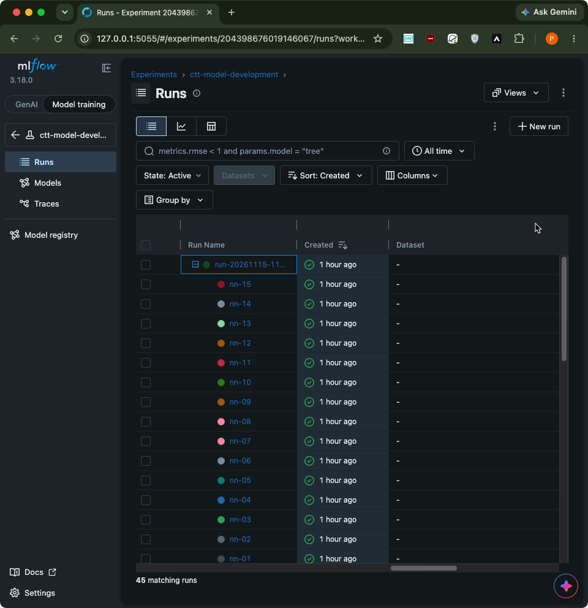
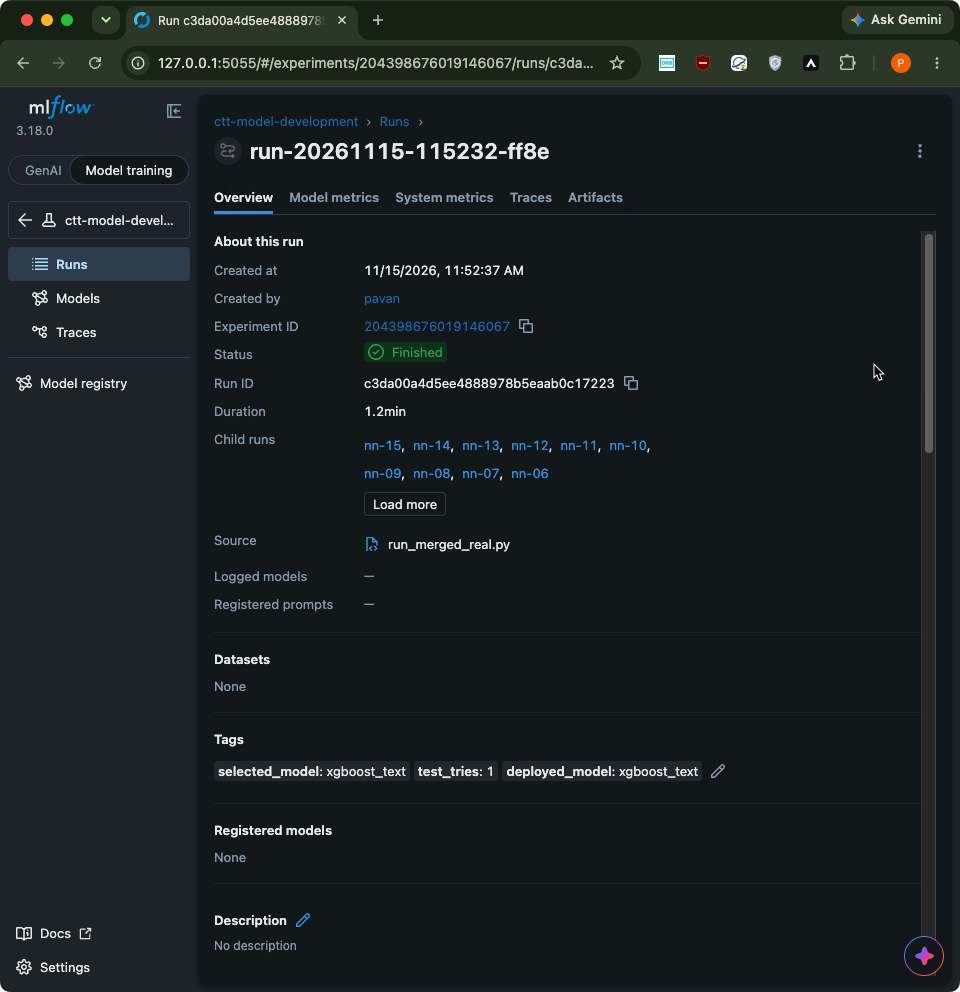
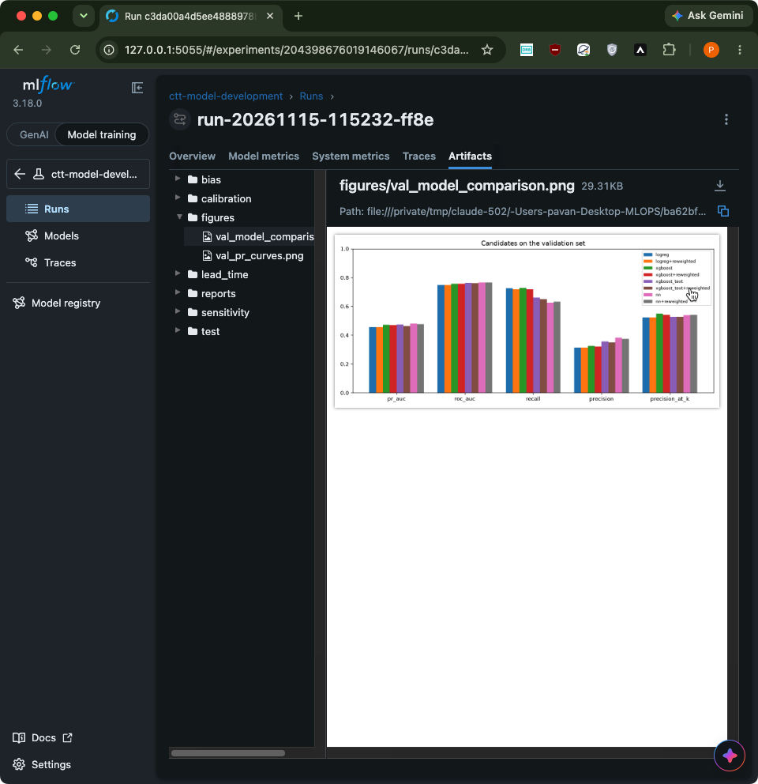
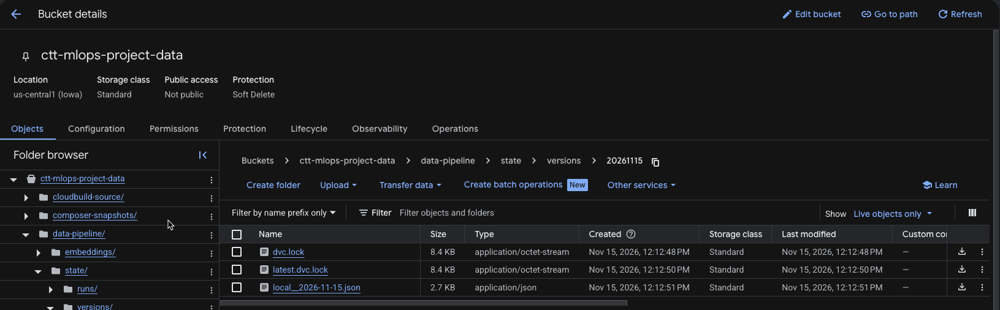
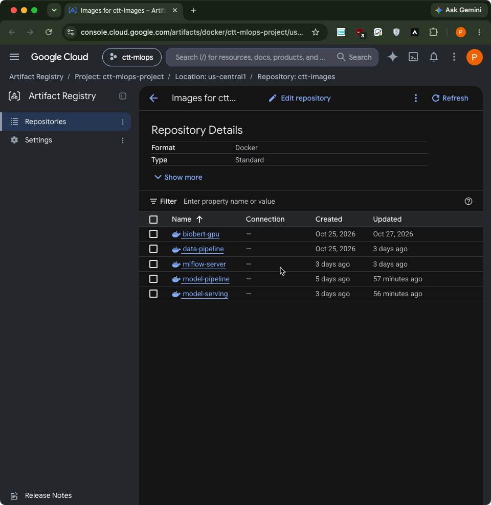

# Model pipeline

Trains, validates, bias-checks, selects and registers the model that
predicts whether a clinical trial will stop early. It reads the exact data
version the [data pipeline](../Data-Pipeline/README.md) published and runs
on Vertex AI as ten stages:

```
load_data → train → validate → bias → select → calibrate → test → register
                                                              ├→ lead_time
                                                              └→ sensitivity
```

| Stage | What it does | Outputs (in the run's work folder) |
|---|---|---|
| `load_data` | Reads a snapshot's `dvc.lock` from the bucket and downloads the features, slices, trial weights, BioBERT embeddings and AACT studies table by md5 from the DVC remote. Splits by registration date: oldest 60% train, next 20% validation, newest 20% test. Reduces each text field's 768-number embedding to 16 PCA components fitted on the training split (`txt_<field>_<i>`). Keeps stop dates and final status beside the features for `lead_time` (never as features). | `data/`, `data/data_version.json`, `data/text_pca.joblib` |
| `train` | Hyperparameter search per entry in `params.yaml` → `models` (LR, XGBoost, XGBoost with text, neural network), every trial logged to MLflow; best per entry kept, plus a version trained with the bias stage's trial weights. | `models/`, `reports/tuning_results.csv` |
| `validate` | Every candidate on the validation set: PR-AUC, ROC-AUC, Brier, precision, recall, F1, Precision@K. | `reports/val_metrics.json`, comparison charts |
| `bias` | Fairlearn per-group metrics on 7 slices (reusing `src/bias/model_slices.py`); gap = overall minus worst qualified group, with a bootstrap interval. Adds per-group threshold candidates (region; region then phase), fitted on the validation set with cross-fitting. | `reports/bias/` (report, tables, charts) |
| `select` | Eligible if PR-AUC and ROC-AUC pass the gate and the bias gate does not block it; ranked by PR-AUC − 0.5 × largest gating-slice gap. Stops the run if none passes. | `reports/selection.md` |
| `calibrate` | Fits sigmoid and isotonic calibrators to the selected model's validation scores, keeps the one with the lower 5-fold cross-validated Brier score. Decisions still use the raw score; the calibrated probability is the risk shown to reviewers. | `models/calibrator.joblib`, `reports/calibration/` |
| `test` | Selected model on the untouched test set; must pass the performance and bias gates again, otherwise the next ranked candidate is tried (up to 3, calibrated on the validation set if it is not the selected one); reports Brier and calibration error before and after calibration; packages the model with its calibrator (and the text PCA if it uses text). | `reports/test/`, `artifact/` |
| `lead_time` | For stopped trials the model flags on the test set: months from registration to stop (median, IQR, share over 12 months). Error analysis: recall per final status and per time to stop, top false positives and negatives. | `reports/lead_time/` |
| `sensitivity` | SHAP feature importance (and per text field for a model with text features); hyperparameter sensitivity from the search. | `reports/sensitivity/` |
| `register` | New version in the Vertex AI Model Registry, served by our own container (`serving/`), alias `challenger`. The current champion is downloaded and scored on this run's test set; `champion` and the default version move to the new version only if its test PR-AUC on the same rows is not worse (plus `min_improvement`). | `reports/registry.json` |

Email alerts (same subscribers as the data pipeline) on: a failed stage,
candidates blocked by the bias gate or without enough data to check, no
model passing the gate, bias above the alert level, a model failing on the
test set (and the fallback to the next one), promotion, a model not
promoted, a manual rollback, and a failed CI pipeline job.

## Bias gate

Settings in `params.yaml` (`bias` and `gate`); code in
`model_pipeline/gaps.py`.

- **Gap** of a metric (recall, PR-AUC) for a group = overall value minus
  the group's value. Only groups with at least `min_group_size` trials and
  `min_stopped` stopped ones count (UNKNOWN never does), and a slice is
  checked only with at least `min_groups` such groups. Worst group against
  overall, because best minus worst grows with the number of groups and
  often hinges on one small group.
- **Interval**: 90% percentile bootstrap (200 seeded resamples of the
  trials). A gap counts as above a level only if its lower bound is.
- **Gating slices** (`region`, `phase`, `sponsor_class`) block a model above
  `block_bias_gap` (0.25); every slice, including the report slices
  (`therapeutic_area`, `gender`, `age_group`, `start_era`), raises an alert
  above `alert_bias_gap` (0.10).
- **Insufficient data**: if no gating slice can be checked, the candidate
  is blocked (`insufficient_bias_data: block`) instead of passing with a
  gap of 0. Small samples need smaller `min_group_size` / `min_stopped`.
- The same rules apply again on the test set.

## Results on the real data

**Data:** data version `20261115` in
`gs://ctt-mlops-project-data/data-pipeline/state/versions/`: the AACT
interventional trials registered in 2019 (24,235 trials; 16,808 finished,
18.4% of them stopped), all 475 validation checks passed, no critical
anomalies, BioBERT embeddings of six text fields per trial. Time split by
registration date: train 10,084 trials (Jan to Jul 2019), validation 3,362
(Jul to Oct), test 3,362 (Oct to Dec). A random model's PR-AUC is 0.185 (the
stop rate).

The pipeline ran twice on this data version: on a laptop (`--source local`,
MLflow in a local folder) and on Google Cloud (Vertex AI Pipelines, shared
MLflow server on Cloud Run, Vertex AI Model Registry).

**Candidates on the validation set** (best tuning trial of each model):

| Model | Features | PR-AUC | ROC-AUC | Precision in top 10% |
|---|---|---|---|---|
| logreg | structured | 0.455 | 0.747 | 0.52 |
| xgboost | structured | 0.472 | 0.758 | 0.55 |
| xgboost_text | structured + BioBERT | 0.475 | 0.764 | 0.53 |
| nn | structured + BioBERT | 0.480 | 0.766 | 0.54 |

Each also has a reweighted version and two per-group threshold versions (16
candidates in all).

**Selection** (score = PR-AUC − 0.5 × largest gating-slice gap): `nn` is the
most accurate but has a larger bias gap (0.190) than `xgboost_text` (0.166),
so `xgboost_text` has the best score (0.392 against 0.385) and is selected.

**Selected model on the test set** (`xgboost_text`, never seen in training or
selection):

| PR-AUC | ROC-AUC | Recall | Precision | Precision in top 10% | Brier raw → calibrated |
|---|---|---|---|---|---|
| 0.470 | 0.785 | 0.77 | 0.33 | 0.55 | 0.204 → 0.126 |

It flags 481 of the 622 stopped test trials, a median of 35 months before
they stop (89% more than a year ahead). Most important features (SHAP):
start year, FDA-regulated drug, the title and brief-summary text,
healthy volunteers.

**Bias** (test set; gap = overall minus the worst group, 90% interval):

| Slice | Role | Worst group | Gap | Status |
|---|---|---|---|---|
| region | gating | non-US only | 0.17 (PR-AUC) | alert, below the 0.25 block level |
| phase | gating | — | ≤ 0.08 | ok |
| sponsor class | gating | — | ≈ 0.04 | ok |
| therapeutic area | report | nutritional and metabolic diseases | 0.29 (recall) | alert |
| start era | report | started 2010 to 2017 | 0.66 (recall) | alert: trials registered in 2019 that started years earlier, a data effect |
| gender, age group | report | — | small | ok |

Mitigation: per-group thresholds narrow the region gap of `xgboost_text`
from 0.166 to 0.134 but cost PR-AUC (0.475 to 0.442); reweighting barely
changes it. The selection score weighs both, so the unmitigated model was
kept. The full report (per-group tables, before and after) is
`reports/bias/bias_report.md` of every run.

### Local run (laptop)

| | |
|---|---|
| MLflow runs: the pipeline run with one child run per tuning trial |  |
| Run overview: selected model, duration |  |
| Candidates compared on the validation set |  |
| Confusion matrix on the test set |  |
| PR-AUC gap per slice with the alert and block levels |  |
| SHAP feature importance |  |

### Google Cloud run

<!-- CLOUD_RESULTS -->

| | |
|---|---|
| Data version `20261115` in the bucket |  |
| Pipeline and serving images built by Cloud Build |  |
| Images in Artifact Registry |  |

## Assignment items

| Guideline item | Where |
|---|---|
| Load data from the data pipeline (2.1, 8.2) | `model_pipeline/data.py` |
| Train and select the best model (2.2, 8.3) | `train.py`, `select.py` |
| Validation on a hold-out set (2.3, 8.4) | `validate.py`, `test_set.py` |
| Bias detection with slicing, Fairlearn (2.4, 2.5, 6, 8.5) | `bias.py`, `reports/bias/bias_report.md` |
| Bias mitigation and trade-offs (6.3, 6.4) | reweighted and group_thresholds candidates, `bias_report.md`, `selection.md` |
| Selection after bias checking (8.6) | `select.py` |
| Push to the Model Registry (2.6, 8.7) | `registry.py` |
| Hyperparameter tuning (3) | `params.yaml` → `models`, `train.py` |
| Neural network with BioBERT text features | `models.py` (`build_nn`), `data.py` (`text_features`) |
| Calibration | `calibrate.py`, `reports/calibration/`, `reports/test/` |
| Lead time and error analysis | `lead_time.py`, `reports/lead_time/` |
| Model development writeup | [`MODEL_DEVELOPMENT.md`](MODEL_DEVELOPMENT.md) |
| Experiment tracking, MLflow (4) | `tracking.py` |
| Comparison charts, confusion matrix (4) | `reports/figures/`, `reports/test/` |
| Sensitivity analysis, SHAP and hyperparameters (5) | `sensitivity.py` |
| CI/CD: train, validate, bias, registry on push (7.1 to 7.4) | `.github/workflows/model-pipeline.yml` |
| Alerts (7.5) | `notify.py` |
| Rollback (7.6) | `registry.py` (champion alias, `rollback` command) |
| Docker (8.1) | `Dockerfile`, `serving/Dockerfile`, `cloudbuild.yaml` |
| Serving the registered model | `serving/app.py`, `model_pipeline/artifact.py` |
| Shared MLflow server | `infra/mlflow/` |

## Run it

**On your machine or Cloud Shell** (no registry):

```bash
cd Data-Pipeline && dvc pull preprocess bias && cd ../Model-Pipeline
pip install -r requirements.txt
python -m model_pipeline.run --stage all --source local --skip-register
```

Reports are in `Model-Pipeline/runs/local/`.

**On Vertex AI:**

```bash
gcloud builds submit --config Model-Pipeline/cloudbuild.yaml \
  --gcs-source-staging-dir gs://ctt-mlops-project-data/cloudbuild-source \
  --substitutions _TAG=$(git rev-parse --short=12 HEAD) .
export MLFLOW_TRACKING_URI=https://ctt-mlflow-...run.app   # optional
python Model-Pipeline/vertex/submit.py --snapshot latest
```

Follow the run in the console (Agent Platform → Pipelines). Each run's
work folder is `gs://ctt-mlops-project-data/model-pipeline/runs/<run_id>/`.

**Registry:**

```bash
cd Model-Pipeline
python -m model_pipeline.registry status
python -m model_pipeline.registry rollback --version 2
```

`rollback` moves the `champion` alias and the default version to that
version (it works forward too, e.g. to promote a version the stage kept
back) and sends an alert.

**Tests:** `cd Model-Pipeline && pip install -r requirements-dev.txt && pytest -q tests`

## Images

Both are built from the repository root by `cloudbuild.yaml`:

| Image | Dockerfile | What |
|---|---|---|
| `model-pipeline` | `Dockerfile` | every Vertex AI stage. Only `requirements.txt` (pinned, `xgboost-cpu`, no torch), not the repository's requirements with CUDA torch and transformers. |
| `model-serving` | `serving/Dockerfile` | the serving container of every registry version |

## Serving

Each registry version points at our own container: FastAPI and uvicorn
(`serving/app.py`), with the same scikit-learn and XGBoost versions as
training. It loads the version's artifact (the test stage's `model.joblib`,
`model_card.json`, `calibrator.joblib` and, for a text model,
`text_pca.joblib`) from `AIP_STORAGE_URI`, listens on `AIP_HTTP_PORT` and
answers on `AIP_HEALTH_ROUTE` and `AIP_PREDICT_ROUTE`:

```json
POST /predict
{"instances": [{"<feature>": 0.3, "...": 1, "region": "US_only", "phase": "PHASE2",
                "text_embeddings": {"title": [768 numbers], "...": []}}]}
{"predictions": [{"probability": 0.71, "score": 0.66, "label": 1, "threshold": 0.5,
                  "calibrated_probability": 0.31,
                  "groups": {"region": "US_only", "phase": "PHASE2"}}]}
```

`probability` is the model's own probability. For a group_thresholds model
`score` and `label` use the per-group thresholds of every step (region,
then phase), exactly as the pipeline scored it. `calibrated_probability` is
the calibrator applied to `score`: the risk to show a reviewer. A text
model takes the data pipeline's BioBERT vectors in `text_embeddings` and
turns them into its `txt_*` features with the packaged PCA (or takes the
`txt_*` features directly). Any model object with `predict_proba` loads the
same way (joblib or pickle). Try it locally:

```bash
docker build -f Model-Pipeline/serving/Dockerfile -t model-serving .
docker run -p 8080:8080 -e MODEL_DIR=/model \
  -v "$PWD/Model-Pipeline/runs/local/artifact:/model:ro" model-serving
```

## CI

`.github/workflows/model-pipeline.yml`: on every push and pull request that
changes `Model-Pipeline/`, `src/bias/` or the bias code it reuses, flake8,
the tests and a compile of the Vertex AI pipeline. On pushes to `main` and
`model-pipeline` (or a manual run) it then builds both images and
runs the pipeline on Vertex AI, waiting for the result. The Google Cloud
steps are skipped when the repository variables `GCP_PROJECT`,
`WIF_PROVIDER` and `CICD_SA` are not set; `MLFLOW_TRACKING_URI` (variable)
and the `SMTP_*` / `ALERT_EMAIL_*` secrets are optional.

## Settings

Everything is in `params.yaml`: data version, split shares, search spaces,
threshold, slices, gate levels and registry names.

## Adding a model

Write a build function in `model_pipeline/models.py` that returns an object
with `fit(X, y, sample_weight)` and `predict_proba(X)`, add it to
`FAMILIES`, and add its search space under `models` in `params.yaml`. It is
then tuned, validated, bias-checked and compared like the others. An entry
can reuse a family under another name (`family: xgboost`) and add the
BioBERT text features (`text_features: true`).
