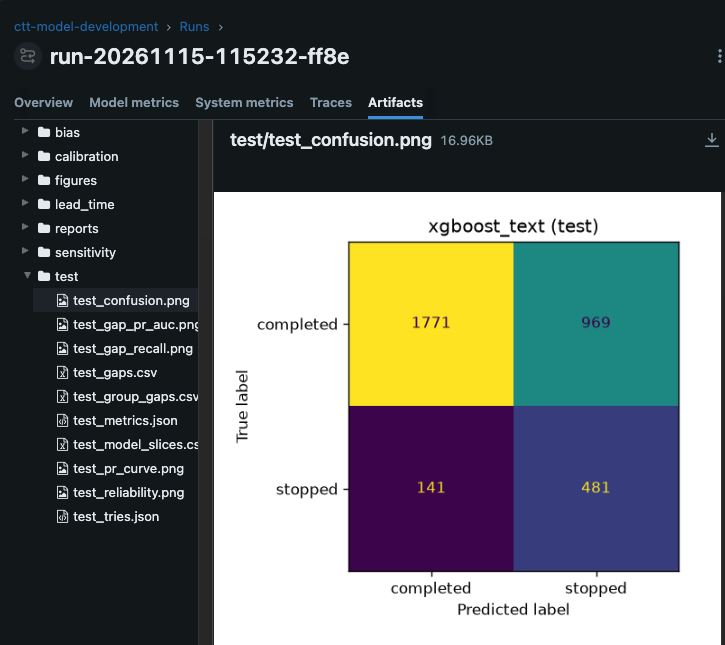
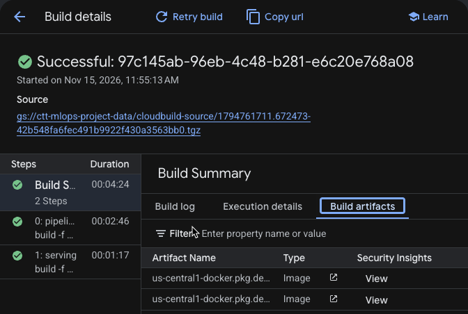
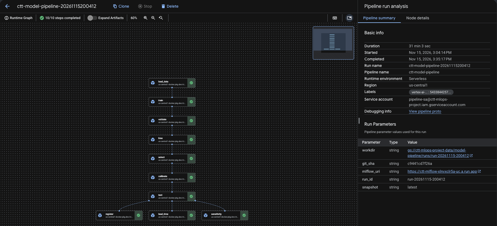
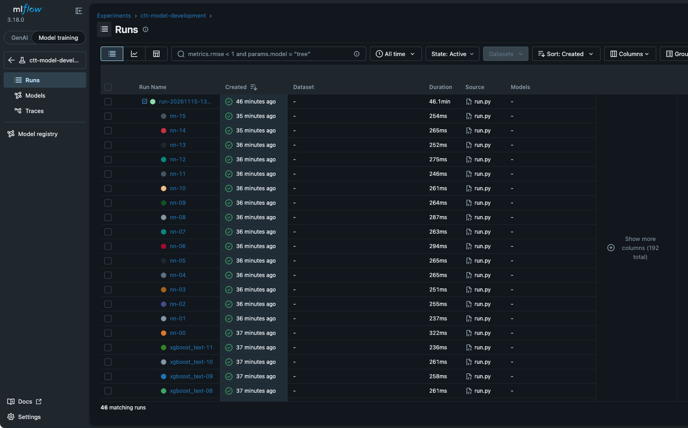
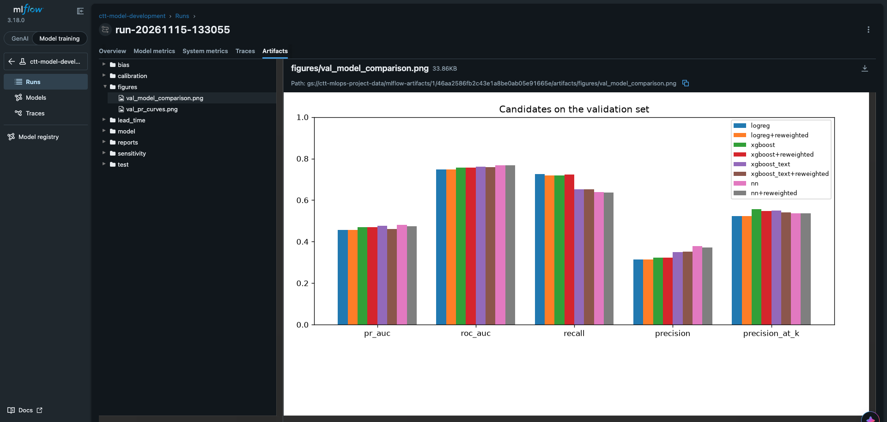
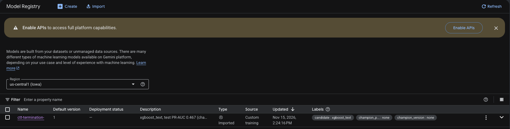
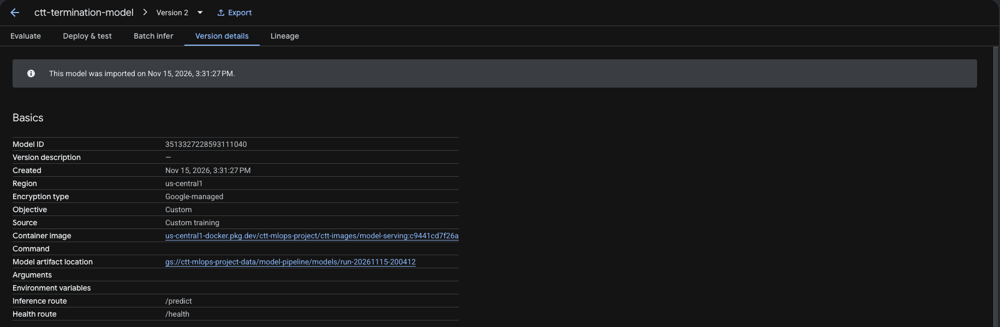
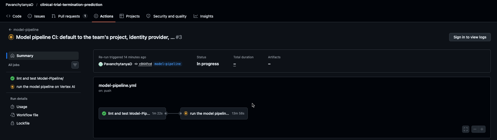

<div align="center">

# Model Pipeline: Predicting Early Termination of Clinical Trials

**Trains, tunes, validates, bias-checks, selects, calibrates and registers the model that predicts, at registration, whether a clinical trial will stop early. It reads an exact data version published by the [data pipeline](../Data-Pipeline/README.md) and runs on a laptop or on Google Cloud (Vertex AI).**


Northeastern University · MLOps (IE 7305) · Model development assignment

</div>

---

## Contents

1. [The model pipeline at a glance](#the-model-pipeline-at-a-glance)
2. [Results on the real data](#results-on-the-real-data)
3. [How we ran it: two ways](#how-we-ran-it-two-ways)
   - [Way 1: on a laptop](#way-1-on-a-laptop)
   - [Way 2: on Google Cloud](#way-2-on-google-cloud)
4. [Bias detection and mitigation](#bias-detection-and-mitigation)
5. [Hyperparameter tuning](#hyperparameter-tuning)
6. [Experiment tracking](#experiment-tracking)
7. [Sensitivity analysis](#sensitivity-analysis)
8. [Model registry, serving and rollback](#model-registry-serving-and-rollback)
9. [CI/CD and alerts](#cicd-and-alerts)
10. [Assignment checklist](#assignment-checklist)
11. [Settings, tests and adding a model](#settings-tests-and-adding-a-model)

---

## The model pipeline at a glance

Ten stages, run in order. Every stage reads and writes one work folder (a
local folder, or `gs://ctt-mlops-project-data/model-pipeline/runs/<run_id>/`
on Google Cloud), so any stage can be rerun on its own.

```
load_data → train → validate → bias → select → calibrate → test → register
                                                              ├→ lead_time
                                                              └→ sensitivity
```

| Stage | What it does | Outputs (in the run's work folder) |
|---|---|---|
| `load_data` | Reads a data version's `dvc.lock` from the bucket and downloads the features, slices, trial weights, BioBERT embeddings and AACT studies table by md5 from the DVC remote. Splits by registration date: oldest 60% train, next 20% validation, newest 20% test. Reduces each text field's 768-number embedding to 16 PCA components fitted on the training split (`txt_<field>_<i>`). | `data/`, `data/data_version.json`, `data/text_pca.joblib` |
| `train` | Hyperparameter search per model entry (logistic regression, XGBoost, XGBoost with text, neural network with text), every trial logged to MLflow; the best of each entry is kept, plus a version trained with the data pipeline's trial weights. | `models/`, `reports/tuning_results.csv` |
| `validate` | Every candidate on the validation set: PR-AUC, ROC-AUC, Brier, precision, recall, F1, precision in the top 10%. | `reports/val_metrics.json`, comparison charts |
| `bias` | Fairlearn per-group metrics on 7 slices; gap = overall minus the worst qualified group, with a bootstrap interval. Adds per-group threshold candidates (region; region then phase), fitted on the validation set with cross-fitting. | `reports/bias/` (report, tables, charts) |
| `select` | Eligible if PR-AUC and ROC-AUC pass the gate and the bias gate does not block it; ranked by PR-AUC − 0.5 × largest gating-slice gap. Stops the run if none passes. | `reports/selection.md` |
| `calibrate` | Fits sigmoid and isotonic calibrators to the selected model's validation scores and keeps the one with the lower cross-validated Brier score. | `models/calibrator.joblib`, `reports/calibration/` |
| `test` | The selected model on the untouched test set; it must pass the performance and bias gates again, otherwise the next ranked candidate is tried (up to 3). Packages the model with its calibrator and text PCA. | `reports/test/`, `artifact/` |
| `lead_time` | How long before a trial stops the model flags it; error analysis by final status and time to stop. | `reports/lead_time/` |
| `sensitivity` | SHAP feature importance (and per text field) and hyperparameter sensitivity from the search. | `reports/sensitivity/` |
| `register` | New version in the Vertex AI Model Registry with our own serving container. The current champion is rescored on this run's test set; the new version becomes `champion` only if it is not worse. | `reports/registry.json` |

> [!NOTE]
> The model never sees information recorded after a trial ends: the data
> pipeline removes those fields (actual enrollment, stop reason, results),
> and stop dates are kept beside the features only for the `lead_time`
> analysis.

---

## Results on the real data

**Data version `20261115`** in
`gs://ctt-mlops-project-data/data-pipeline/state/versions/`: the AACT
interventional trials registered in 2019. 24,235 trials, 16,808 of them
finished, 18.4% of those stopped early; all 475 validation checks passed,
no critical anomalies; BioBERT embeddings of six text fields per trial.

| Split (by registration date) | Trials | Registered | Stopped |
|---|---|---|---|
| Train | 10,084 | Jan to Jul 2019 | 18.3% |
| Validation | 3,362 | Jul to Oct 2019 | 18.8% |
| Test | 3,362 | Oct to Dec 2019 | 18.5% |

A random model's PR-AUC is 0.185 (the stop rate).

### Candidates on the validation set

| Model | Features | PR-AUC | ROC-AUC | Precision in top 10% |
|---|---|---|---|---|
| Logistic regression | structured | 0.455 | 0.747 | 0.52 |
| XGBoost | structured | 0.472 | 0.758 | 0.55 |
| XGBoost + text | structured + BioBERT | 0.475 | 0.764 | 0.53 |
| Neural network + text | structured + BioBERT | **0.480** | **0.766** | 0.54 |

Each model also has a reweighted version and two per-group threshold
versions: 16 candidates in all.

### Selection

Score = PR-AUC − 0.5 × largest gating-slice gap. The neural network is the
most accurate but serves non-US trials worse (gap 0.190) than XGBoost + text
(0.166), so **XGBoost + text** has the best score (0.392 against 0.385) and
is selected. Their PR-AUC differs by 0.005, within noise; the fairness gap
decides.

### The selected model on the test set

| | PR-AUC | ROC-AUC | Recall | Precision | Precision in top 10% | Brier raw → calibrated |
|---|---|---|---|---|---|---|
| Laptop | 0.470 | 0.785 | 0.77 | 0.33 | 0.55 | 0.204 → 0.126 |
| Google Cloud | 0.467 | 0.784 | 0.75 | 0.33 | 0.56 | 0.204 → 0.126 |

- It catches about three in four stopped test trials (481 of 622 on the
  laptop). For the 344 of them with a recorded stop date, it flags them a
  median of **35 months** before they stop (89% more than a year ahead).
- Most important features (SHAP): start year, FDA-regulated drug, the
  title and brief-summary text, healthy volunteers. Together the six text
  fields carry more of the model's SHAP attribution than all structured
  features combined.
- The last digits differ between the laptop and the cloud because
  XGBoost's multithreaded tree building is not bit-for-bit identical on
  other CPUs; the ranking and the selected model are the same.

### Bias of the selected model (test set)

| Slice | Role | Worst group | Gap | Status |
|---|---|---|---|---|
| Region | gating | non-US only | 0.17 (PR-AUC) | ⚠️ alert, below the 0.25 block level |
| Phase | gating | — | ≤ 0.08 | ✅ ok |
| Sponsor class | gating | — | ≈ 0.04 | ✅ ok |
| Therapeutic area | report | nutritional and metabolic diseases | 0.29 (recall) | ⚠️ alert |
| Start era | report | started 2010 to 2017 | 0.66 (recall) | ⚠️ alert: trials registered in 2019 that started years earlier, a data effect |
| Gender, age group | report | — | small | ✅ ok |

Details and mitigation in [Bias detection and mitigation](#bias-detection-and-mitigation).

---

## How we ran it: two ways

Both runs used the same code, the same data version (`20261115`) and the
same settings.

### Way 1: on a laptop

```bash
cd Data-Pipeline && dvc pull preprocess bias embeddings && cd ../Model-Pipeline
pip install -r requirements.txt
python -m model_pipeline.run --stage all --source local --skip-register
```

Reports go to `Model-Pipeline/runs/local/`, MLflow runs to a local folder
(`mlflow ui` shows them). The registry stage is skipped; it needs Google
Cloud.

<table>
<tr>
<td width="50%" valign="top"><b>1. MLflow runs</b>: the pipeline run with one child run per tuning trial<br></td>
<td width="50%" valign="top"><b>2. Run overview</b>: selected model <code>xgboost_text</code>, 1.2 minutes<br></td>
</tr>
<tr>
<td width="50%" valign="top"><b>3. Candidates compared</b> on the validation set<br></td>
<td width="50%" valign="top"><b>4. Confusion matrix</b> of the selected model on the test set<br></td>
</tr>
<tr>
<td width="50%" valign="top"><b>5. Bias</b>: PR-AUC gap per slice with the alert (0.1) and block (0.25) levels<br></td>
<td width="50%" valign="top"><b>6. Sensitivity</b>: the 20 most important features (SHAP)<br></td>
</tr>
</table>

### Way 2: on Google Cloud

#### What we deployed

| Component | Google Cloud service | What it does |
|---|---|---|
| Pipeline and serving images | Cloud Build → Artifact Registry (`ctt-images`) | `model-pipeline` runs every stage; `model-serving` serves every registered version |
| Pipeline | Vertex AI Pipelines (Kubeflow) | one step per stage, as `pipeline-sa` (`vertex/pipeline.py`) |
| Data and work folders | Cloud Storage `ctt-mlops-project-data` | the data version (DVC), each run's work folder, MLflow artifacts |
| Experiment tracking | MLflow on Cloud Run + Cloud SQL (PostgreSQL) | one shared server for the team (`infra/mlflow/`) |
| Model registry | Vertex AI Model Registry | versions with `champion` / `challenger` aliases |
| Alerts | Secret Manager (`ctt-pipeline-env`) + Gmail SMTP | email on failures, bias alerts, promotion, rollback |

#### Commands

```bash
# images
gcloud builds submit --config Model-Pipeline/cloudbuild.yaml \
  --gcs-source-staging-dir gs://ctt-mlops-project-data/cloudbuild-source \
  --substitutions _TAG=$(git rev-parse --short=12 HEAD) .
# shared MLflow server (once)
./Model-Pipeline/infra/mlflow/deploy_mlflow.sh all
# run the pipeline
python Model-Pipeline/vertex/submit.py --snapshot 20261115 \
  --mlflow-uri https://ctt-mlflow-xlnvxclr5a-uc.a.run.app
```

#### What we ran (run `run-20261115-133055`, 2026-11-15)

`load_data`, `train`, `validate` and `bias` ran as Vertex AI Pipelines
steps. The `select` step then waited over 20 minutes for Vertex AI to
provision a machine of its type, so the pipeline was cancelled and the
remaining stages (`select` to `register`) ran in one Vertex AI custom job on
the same work folder, without training again. The result matched the laptop
run, and `register` made the model version 1 of `ctt-termination-model`,
promoted to `champion`.

#### Proof that every component ran

<table>
<tr>
<td width="50%" valign="top"><b>1. Cloud Storage</b>: data version <code>20261115</code>, published by the data pipeline<br></td>
<td width="50%" valign="top"><b>2. Cloud Build</b>: the pipeline and serving images built<br><br><br><b>3. Artifact Registry</b>: <code>model-pipeline</code> and <code>model-serving</code> in <code>ctt-images</code><br></td>
</tr>
<tr>
<td colspan="2" valign="top"><b>4. Vertex AI Pipelines</b>: the ten-step graph; <code>load_data</code> to <code>bias</code> succeeded here, run as <code>pipeline-sa</code> on data version <code>20261115</code> with the shared MLflow server<br></td>
</tr>
<tr>
<td colspan="2" valign="top"><b>5. Vertex AI custom job</b>: <code>select</code> to <code>register</code> on one machine, same image and work folder, finished in 9 minutes<br></td>
</tr>
<tr>
<td width="50%" valign="top"><b>6. Shared MLflow server</b>: the cloud run and one child run per tuning trial<br></td>
<td width="50%" valign="top"><b>7. Shared MLflow server</b>: candidates compared; artifacts stored in Cloud Storage<br></td>
</tr>
<tr>
<td colspan="2" valign="top"><b>8. Vertex AI Model Registry</b>: <code>ctt-termination-model</code> version 1 (<code>xgboost_text</code>, test PR-AUC 0.467)<br></td>
</tr>
<tr>
<td colspan="2" valign="top"><b>9. Version 1</b>: our serving container, the model files in Cloud Storage, <code>/predict</code> and <code>/health</code><br></td>
</tr>
<tr>
<td width="50%" valign="top"><b>10. Alert email</b>: sent by the <code>register</code> stage when version 1 became champion<br></td>
<td width="50%" valign="top">The registry entry carries the aliases <code>default</code>, <code>challenger</code> and <code>champion</code> and the labels <code>candidate=xgboost_text</code>, <code>data_snapshot=20261115</code>, <code>test_pr_auc_x1000=467</code>, <code>promoted=true</code>; the decision is in <code>reports/registry.json</code> of the run.</td>
</tr>
<tr>
<td colspan="2" valign="top"><b>11. CI/CD</b>: the push to <code>model-pipeline</code> started the workflow by itself; lint and tests passed, Cloud Build built the images and the pipeline started on Vertex AI<br></td>
</tr>
</table>

---

## Bias detection and mitigation

### How bias is checked

Settings in `params.yaml` (`bias` and `gate`); code in `model_pipeline/bias.py` and `gaps.py`.

- **Slices**: region, phase, sponsor class, therapeutic area, gender,
  age group, start era. The data has one row per trial, so eligibility
  gender and age group stand in for demographics.
- **Gap** of a metric (recall, PR-AUC) for a group = overall value minus the
  group's value. Only groups with at least 100 trials and 10 stopped ones
  count (UNKNOWN never does). Worst group against overall, because best
  minus worst grows with the number of groups and often hinges on one small
  group.
- **Interval**: 90% bootstrap interval (200 seeded resamples). A gap counts
  as above a level only if its lower bound is.
- **Gating slices** (region, phase, sponsor class) **block** a model above
  0.25; any slice raises an **alert** (email) above 0.10.
- **Not enough data**: if no gating slice can be checked, the model is
  blocked rather than passing with a gap of 0.
- The same rules apply again on the test set.

### Mitigation and trade-offs

Two mitigations are trained for every model and compared like any other
candidate (numbers from the Google Cloud run):

| Mitigation | How | Effect on XGBoost + text (validation) |
|---|---|---|
| Reweighting | trained with the data pipeline's trial weights (small groups weighted up) | gap 0.166 → 0.173, PR-AUC 0.475 → 0.462 |
| Per-group thresholds (region) | one decision threshold per region so each catches the same share of stopped trials; fitted on the validation set with cross-fitting | gap 0.166 → **0.136**, PR-AUC 0.475 → 0.445 |
| Per-group thresholds (region, then phase) | the same, then per phase | gap 0.166 → 0.174, PR-AUC 0.475 → 0.427 |

Thresholds close recall gaps but cost precision and overall PR-AUC. The
selection score (PR-AUC − 0.5 × gap) weighs both: here the accuracy lost
outweighed the gap closed, so the unmitigated model was kept. Every run
writes the full comparison (per-group tables before and after) to
`reports/bias/bias_report.md`.

---

## Hyperparameter tuning

Grid search for logistic regression, random search for the others; every
trial is scored on the validation set (PR-AUC) and logged to MLflow as a
child run. The search spaces are in `params.yaml` → `models`:

| Model | Search | Trials | Space |
|---|---|---|---|
| Logistic regression | grid | 4 | `C` 0.01, 0.1, 1, 10 |
| XGBoost | random | 12 | `n_estimators` 200/400/800, `max_depth` 3/4/6/8, `learning_rate` 0.03/0.05/0.1, `subsample` 0.7/0.85/1, `colsample_bytree` 0.5/0.7/1, `min_child_weight` 1/5/10 |
| XGBoost + text | random | 12 | same as XGBoost |
| Neural network + text | random | 16 | `hidden_layer_sizes` (32), (64), (128), (256), (128, 64); `alpha` 0.3/1/3/10; `learning_rate_init` 0.0001/0.0003/0.001; `batch_size` 128/256 |

Every trial's values and score: `reports/tuning_results.csv`. More on the
models and choices in [`MODEL_DEVELOPMENT.md`](MODEL_DEVELOPMENT.md).

---

## Experiment tracking

Every pipeline run is one MLflow run in the experiment
`ctt-model-development`, with one child run per tuning trial. It records:

- hyperparameters and validation metrics of every trial;
- validation, bias and test metrics of every candidate;
- the data version (snapshot and file checksums), the selected model and the
  registry version as tags;
- the charts and reports (comparison, PR curves, confusion matrix,
  reliability, bias gaps, SHAP) and the packaged model as artifacts.

On Google Cloud all runs go to one shared MLflow server on Cloud Run
(`infra/mlflow/`), so the team compares runs in one place; on a laptop they
go to a local folder. `model_pipeline/compare_runs.py` compares runs from
the command line ([`docs/experiment_tracking.md`](docs/experiment_tracking.md)).

---

## Sensitivity analysis

- **Features (SHAP)** on the selected model: start year matters most, then
  FDA-regulated drug, then the BioBERT text of the title and brief summary,
  then healthy volunteers. Per text field: brief summary, outcomes and
  title carry the most.
- **Hyperparameters**: for each hyperparameter, the spread of the mean
  validation PR-AUC across its values. The neural network depends most on
  its layer sizes (spread 0.059), then `alpha` (0.039) and the learning
  rate (0.033); XGBoost on `max_depth` (0.021); logistic regression barely
  depends on `C` (0.001).

Charts and tables: `reports/sensitivity/`.

---

## Model registry, serving and rollback

- **Registry**: every run that passes the gates uploads a new version to the
  Vertex AI Model Registry with alias `challenger`. The current champion is
  downloaded and **rescored on this run's test set**; the new version gets
  `champion` and becomes the default only if its test PR-AUC on the same
  rows is not worse. Otherwise the champion stays and an alert says why.
- **Serving**: every version runs our own container (`serving/app.py`,
  FastAPI) with the training versions of scikit-learn and XGBoost. It
  applies the per-group thresholds, returns the calibrated probability, and
  accepts BioBERT vectors directly for a text model:

  ```json
  POST /predict
  {"instances": [{"<feature>": 0.3, "...": 1, "region": "US_only", "phase": "PHASE2",
                  "text_embeddings": {"title": [768 numbers], "...": []}}]}
  {"predictions": [{"probability": 0.71, "score": 0.66, "label": 1, "threshold": 0.5,
                    "calibrated_probability": 0.31,
                    "groups": {"region": "US_only", "phase": "PHASE2"}}]}
  ```

- **Rollback**: if a promoted model turns out worse, move `champion` back:

  ```bash
  cd Model-Pipeline
  python -m model_pipeline.registry status
  python -m model_pipeline.registry rollback --version 1
  ```

---

## CI/CD and alerts

**GitHub Actions** (`.github/workflows/model-pipeline.yml`): on every push
or pull request that changes the model code, flake8, the tests and a compile
of the Vertex AI pipeline. On pushes to `main` and `model-pipeline` (or a
manual run) it then builds both images with Cloud Build and runs the
pipeline on Vertex AI, which trains, validates, checks bias and registers;
the job fails if the validation or bias gate stops the run, and a failed job
sends an email (screenshot 11 above shows the run started by a push). Changes
to Markdown files or `Model-Pipeline/docs/` alone do not start it.

**Email alerts** (`notify.py`, same subscribers as the data pipeline) on: a
failed stage, a finished run, candidates blocked by the bias gate or without
enough data, no model passing the gate, bias above the alert level, a model
failing on the test set and the fallback to the next one, a promotion, a
model not promoted, and a manual rollback.

---

## Assignment checklist

| Guideline item | Where |
|---|---|
| Load data from the data pipeline (2.1, 8.2) | `model_pipeline/data.py` |
| Train and select the best model (2.2, 8.3) | `train.py`, `select.py` |
| Validation on a hold-out set (2.3, 8.4) | `validate.py`, `test_set.py` |
| Bias detection with slicing, Fairlearn (2.4, 2.5, 6, 8.5) | `bias.py`, `gaps.py`, `reports/bias/bias_report.md` |
| Bias mitigation and trade-offs (6.3, 6.4) | reweighted and per-group threshold candidates, `bias_report.md`, `selection.md` |
| Selection after bias checking (8.6) | `select.py` |
| Push to the Model Registry (2.6, 8.7) | `registry.py` |
| Hyperparameter tuning (3) | `params.yaml` → `models`, `train.py` |
| Experiment tracking, MLflow (4) | `tracking.py`, `infra/mlflow/` |
| Comparison charts, confusion matrix (4) | `reports/figures/`, `reports/test/` |
| Sensitivity analysis, SHAP and hyperparameters (5) | `sensitivity.py` |
| CI/CD: train, validate, bias, registry on push (7.1 to 7.4) | `.github/workflows/model-pipeline.yml` |
| Alerts (7.5) | `notify.py` |
| Rollback (7.6) | `registry.py` (champion alias, `rollback` command) |
| Docker (8.1) | `Dockerfile`, `serving/Dockerfile`, `cloudbuild.yaml` |
| Neural network on BioBERT text, calibration, lead time | `models.py`, `calibrate.py`, `lead_time.py` |
| Model development write-up | [`MODEL_DEVELOPMENT.md`](MODEL_DEVELOPMENT.md) |

---

## Settings, tests and adding a model

- **Settings**: everything is in `params.yaml`: data version, split shares,
  search spaces, threshold, slices, gate levels and registry names.
- **Tests**: `cd Model-Pipeline && pip install -r requirements-dev.txt && pytest -q tests`
  (73 tests: every stage, the bias gate, fallback, calibration, serving,
  registry promotion and rollback, MLflow login).
- **Adding a model**: write a build function in `model_pipeline/models.py`
  that returns an object with `fit(X, y, sample_weight)` and
  `predict_proba(X)`, add it to `FAMILIES`, and add its search space under
  `models` in `params.yaml`. It is then tuned, validated, bias-checked and
  compared like the others; `text_features: true` adds the BioBERT text.
