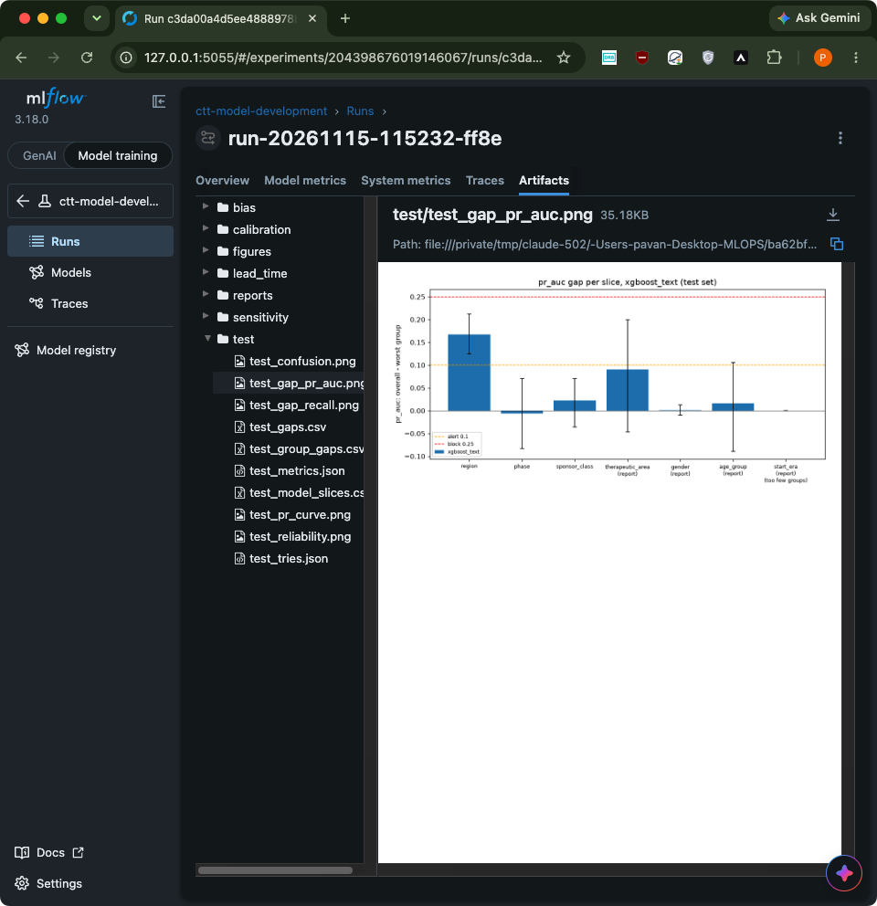
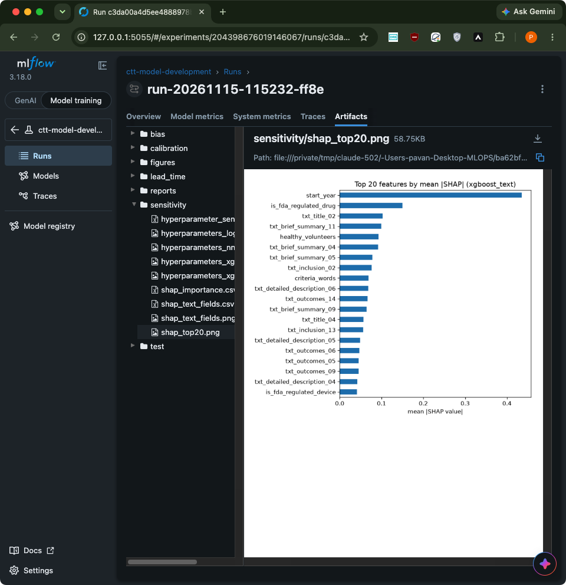
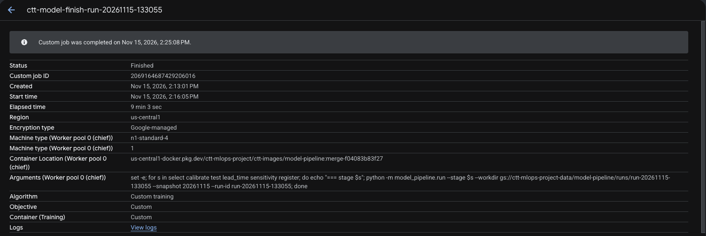
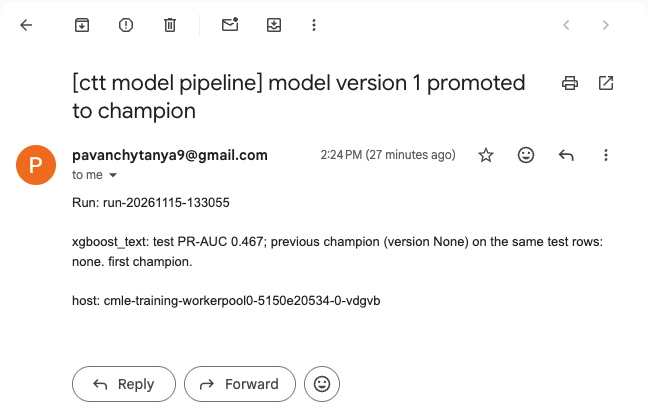

<div align="center">

# Model Pipeline: Predicting Early Termination of Clinical Trials

**Trains, tunes, validates, bias-checks, selects, calibrates and registers the model that predicts, at registration, whether a clinical trial will stop early. It reads an exact data version from the [data pipeline](../Data-Pipeline/README.md) and runs locally or on Google Cloud (Vertex AI).**


Northeastern University · MLOps (IE 7305) · Model development assignment

</div>

---

> [!TIP]
> **Run it yourself:** [`docs/SETUP.md`](docs/SETUP.md) has every step,
> locally and on Google Cloud, with a check after each: environment, data
> access, MLflow server, email alerts (with screenshots), Vertex AI, CI/CD,
> troubleshooting.

## Contents

1. [The model pipeline at a glance](#the-model-pipeline-at-a-glance)
2. [Code structure](#code-structure)
3. [Results on the real data](#results-on-the-real-data)
4. [How we ran it: two ways](#how-we-ran-it-two-ways)
   - [Way 1: locally](#way-1-locally)
   - [Way 2: on Google Cloud](#way-2-on-google-cloud)
5. [Bias detection and mitigation](#bias-detection-and-mitigation)
6. [Hyperparameter tuning](#hyperparameter-tuning)
7. [Experiment tracking](#experiment-tracking)
8. [Sensitivity analysis](#sensitivity-analysis)
9. [Model registry, serving and rollback](#model-registry-serving-and-rollback)
10. [CI/CD and alerts](#cicd-and-alerts)
11. [Settings, tests and adding a model](#settings-tests-and-adding-a-model)

---

## The model pipeline at a glance

Ten stages sharing one work folder (local, or
`gs://ctt-mlops-project-data/model-pipeline/runs/<run_id>/`), so any stage
can be rerun on its own.

```
load_data → train → validate → bias → select → calibrate → test → register
                                                              ├→ lead_time
                                                              └→ sensitivity
```

| Stage | What it does | Outputs |
|---|---|---|
| `load_data` | Reads a data version's `dvc.lock` and downloads its features, slices, trial weights, BioBERT embeddings and studies table from the DVC remote. Splits by registration date (60% train, 20% validation, 20% test). Reduces each text field's 768-number embedding to 16 PCA components fitted on train. | `data/` |
| `train` | Hyperparameter search for logistic regression, XGBoost, XGBoost + text and a neural network + text, every trial logged to MLflow. Keeps the best of each, plus a version trained with the data pipeline's trial weights. | `models/`, `reports/tuning_results.csv` |
| `validate` | Every candidate on the validation set: PR-AUC, ROC-AUC, Brier, precision, recall, F1, precision in the top 10%. | `reports/val_metrics.json`, charts |
| `bias` | Fairlearn metrics per group on 7 slices; gap = overall minus worst group, with a bootstrap interval. Adds per-group threshold candidates. | `reports/bias/` |
| `select` | Keeps candidates that pass the performance and bias gates; ranks them by PR-AUC − 0.5 × largest gating-slice gap. Stops the run if none passes. | `reports/selection.md` |
| `calibrate` | Sigmoid or isotonic calibration, whichever has the lower cross-validated Brier score. | `reports/calibration/` |
| `test` | The selected model on the untouched test set, with the same gates; if it fails, the next ranked candidate is tried (up to 3). Packages the model. | `reports/test/`, `artifact/` |
| `lead_time` | How long before a trial stops the model flags it; error analysis. | `reports/lead_time/` |
| `sensitivity` | SHAP feature importance and hyperparameter sensitivity. | `reports/sensitivity/` |
| `register` | New version in the Vertex AI Model Registry; becomes `champion` only if not worse than the current champion on the same test set. | `reports/registry.json` |

> [!NOTE]
> The model never sees information recorded after a trial ends (actual
> enrollment, stop reason, results). Stop dates are kept only for the
> `lead_time` analysis.

---

## Code structure

```
Model-Pipeline/
├── model_pipeline/              one module per stage (python -m model_pipeline.run)
│   ├── run.py                   runs one stage or all; alerts on failure
│   ├── config.py                params.yaml and the shared work folder
│   ├── data.py                  load_data: data version, date split, text PCA
│   ├── models.py                model families and how they score
│   ├── train.py                 train: hyperparameter search, one MLflow child run per trial
│   ├── validate.py              validate: candidates on the validation set
│   ├── bias.py  gaps.py         bias: per-group metrics, bootstrap gaps, bias gate, threshold candidates
│   ├── select.py                select: best model after validation and bias
│   ├── calibrate.py             calibrate: sigmoid or isotonic
│   ├── test_set.py              test: final check, fallback, packaging
│   ├── lead_time.py             lead_time: how early it warns
│   ├── sensitivity.py           sensitivity: SHAP, hyperparameters
│   ├── registry.py              register: champion / challenger, rollback
│   ├── artifact.py              the packaged model (model, calibrator, text PCA, model card)
│   ├── tracking.py  mlflow_auth.py  compare_runs.py   MLflow logging, sign-in, run comparison
│   ├── metrics.py  plots.py     metrics and charts
│   └── notify.py                email alerts
├── vertex/                      Vertex AI Pipeline: pipeline.py, submit.py, compiled JSON
├── serving/                     prediction server (app.py: /predict, /health) and its Dockerfile
├── infra/mlflow/                shared MLflow server: Cloud Run + Cloud SQL + GCS (deploy_mlflow.sh)
├── tests/                       73 tests
├── docs/                        SETUP.md, experiment_tracking.md, screenshots/
├── Dockerfile  cloudbuild.yaml  pipeline image; Cloud Build for both images
├── params.yaml                  all settings: data version, splits, search spaces, slices, gates, registry
├── requirements.txt  requirements-dev.txt
└── MODEL_DEVELOPMENT.md         model write-up: models, tuning, calibration, lead time
```

Shared with the data pipeline (and watched by this CI): `src/bias/`,
`configs/bias_config.yaml`, `Data-Pipeline/scripts/bias_model.py` and
`alerts.py`. Run outputs go to the work folder, never to Git.

---

## Results on the real data

**Data version `20261115`**: AACT interventional trials registered in 2019.
24,235 trials, 16,808 finished, 18.4% of those stopped early; all 475
validation checks passed; BioBERT embeddings of six text fields.

| Split (by registration date) | Trials | Registered | Stopped |
|---|---|---|---|
| Train | 10,084 | Jan to Jul 2019 | 18.3% |
| Validation | 3,362 | Jul to Oct 2019 | 18.8% |
| Test | 3,362 | Oct to Dec 2019 | 18.5% |

> [!IMPORTANT]
> **PR-AUC's random baseline is the share of stopped trials, not 0.5:**
> 0.188 (validation) and 0.185 (test). 0.5 is ROC-AUC's baseline. A PR-AUC
> of 0.47 is about 2.5 times random. Baselines are shown in brackets below.

### Candidates on the validation set

| Model | Features | PR-AUC (random 0.188) | ROC-AUC (random 0.5) | Precision in top 10% (random 0.188) |
|---|---|---|---|---|
| Logistic regression | structured | 0.455 | 0.747 | 0.52 |
| XGBoost | structured | 0.472 | 0.758 | 0.55 |
| XGBoost + text | structured + BioBERT | 0.475 | 0.764 | 0.53 |
| Neural network + text | structured + BioBERT | **0.480** | **0.766** | 0.54 |

Each also has a reweighted and two per-group threshold versions: 16
candidates.

### Selection

Score = PR-AUC − 0.5 × largest gating-slice gap. The neural network is the
most accurate but serves non-US trials worse (gap 0.190 vs 0.166), so
**XGBoost + text** wins (0.392 vs 0.385). Their PR-AUC differs by only
0.005; the fairness gap decides.

### The selected model on the test set

| | PR-AUC (random 0.185) | ROC-AUC (random 0.5) | Recall | Precision (random 0.185) | Precision in top 10% | Brier raw → calibrated |
|---|---|---|---|---|---|---|
| Local | 0.470 | 0.785 | 0.77 | 0.33 | 0.55 | 0.204 → 0.126 |
| Google Cloud | 0.467 | 0.784 | 0.75 | 0.33 | 0.56 | 0.204 → 0.126 |

- Catches about 3 in 4 stopped trials (481 of 622 locally), a median of
  **35 months** before they stop (89% more than a year ahead).
- Top features (SHAP): start year, FDA-regulated drug, title and summary
  text, healthy volunteers. The six text fields together outweigh all
  structured features.
- Local and cloud differ in the last digits (XGBoost multithreading on
  different CPUs); ranking and selected model are the same.

### Bias of the selected model (test set)

| Slice | Role | Worst group | Gap | Status |
|---|---|---|---|---|
| Region | gating | non-US only | 0.17 (PR-AUC) | ⚠️ alert, below the 0.25 block level |
| Phase | gating | — | ≤ 0.08 | ✅ ok |
| Sponsor class | gating | — | ≈ 0.04 | ✅ ok |
| Therapeutic area | report | nutritional and metabolic diseases | 0.29 (recall) | ⚠️ alert |
| Start era | report | started 2010 to 2017 | 0.66 (recall) | ⚠️ alert: 2019 registrations of old trials, a data effect |
| Gender, age group | report | — | small | ✅ ok |

---

## How we ran it: two ways

Same code, data version (`20261115`) and settings both ways.

### Way 1: locally

From the repository root ([SETUP 1](docs/SETUP.md#1-run-it-locally)):

```bash
python3.11 -m venv .venv && source .venv/bin/activate
pip install -r Model-Pipeline/requirements-dev.txt mlflow==3.18.0
gcloud auth application-default login            # to read the data version
cd Model-Pipeline
python -m model_pipeline.run --stage all --source lock --snapshot 20261115 --skip-register
MLFLOW_ALLOW_FILE_STORE=true mlflow ui --backend-store-uri runs/local/mlruns   # http://127.0.0.1:5000
```

About 3 minutes; reports in `runs/local/`, MLflow runs in
`runs/local/mlruns/`. The registry stage needs Google Cloud, so it is skipped.

<table>
<tr>
<td width="50%" valign="top"><b>1. MLflow runs</b>: the pipeline run with one child run per tuning trial<br></td>
<td width="50%" valign="top"><b>2. Run overview</b>: selected model <code>xgboost_text</code><br></td>
</tr>
<tr>
<td width="50%" valign="top"><b>3. Candidates compared</b> (validation)<br></td>
<td width="50%" valign="top"><b>4. Confusion matrix</b> (test)<br></td>
</tr>
<tr>
<td width="50%" valign="top"><b>5. Bias</b>: PR-AUC gap per slice, alert (0.1) and block (0.25) levels<br></td>
<td width="50%" valign="top"><b>6. Sensitivity</b>: top 20 features (SHAP)<br></td>
</tr>
</table>

### Way 2: on Google Cloud

| Component | Google Cloud service | Role |
|---|---|---|
| Images | Cloud Build → Artifact Registry (`ctt-images`) | `model-pipeline` runs the stages; `model-serving` serves every version |
| Pipeline | Vertex AI Pipelines (Kubeflow) | one step per stage, as `pipeline-sa` |
| Storage | Cloud Storage `ctt-mlops-project-data` | data versions (DVC), work folders, MLflow artifacts |
| Tracking | MLflow on Cloud Run + Cloud SQL | one shared server for the team |
| Registry | Vertex AI Model Registry | versions with `champion` / `challenger` aliases |
| Alerts | Secret Manager (`ctt-pipeline-env`) + Gmail SMTP | failure, bias, promotion and rollback emails |

From the repository root ([SETUP 2](docs/SETUP.md#2-run-it-on-google-cloud) has every step):

```bash
gcloud builds submit --config Model-Pipeline/cloudbuild.yaml \
  --gcs-source-staging-dir gs://ctt-mlops-project-data/cloudbuild-source \
  --substitutions _TAG=$(git rev-parse --short=12 HEAD) .          # images
./Model-Pipeline/infra/mlflow/deploy_mlflow.sh all                  # MLflow server (once)
python Model-Pipeline/vertex/submit.py --snapshot 20261115 \
  --mlflow-uri https://ctt-mlflow-xlnvxclr5a-uc.a.run.app          # run the pipeline
```

#### What we ran (2026-11-15)

| Run | Started by | How it ran | Result |
|---|---|---|---|
| `run-20261115-133055` | `submit.py` | `load_data` to `bias` as pipeline steps; Vertex AI had no machine for `select` for 20+ minutes, so `select` to `register` ran in one custom job on the same work folder (no retraining) | version 1, `champion` |
| `run-20261115-200412` | GitHub Actions (push) | all ten steps, 31 minutes | version 2; tied version 1 on the same 3,362 test trials ("not worse"), so it became `champion` |

Both picked `xgboost_text` with identical test metrics (PR-AUC 0.467
(random 0.185), ROC-AUC 0.784, precision 0.327, recall 0.754, bias gap
0.174): the run is reproducible.

#### Proof that every component ran

<table>
<tr>
<td width="50%" valign="top"><b>1. Cloud Storage</b>: data version <code>20261115</code> from the data pipeline<br></td>
<td width="50%" valign="top"><b>2. Cloud Build</b>: both images built<br><br><br><b>3. Artifact Registry</b>: <code>model-pipeline</code> and <code>model-serving</code><br></td>
</tr>
<tr>
<td colspan="2" valign="top"><b>4. Vertex AI Pipelines</b>: the CI run, 10/10 steps in 31 minutes, as <code>pipeline-sa</code> with the shared MLflow server<br></td>
</tr>
<tr>
<td colspan="2" valign="top"><b>5. Vertex AI custom job</b> (first run): <code>select</code> to <code>register</code> on one machine, 9 minutes<br></td>
</tr>
<tr>
<td width="50%" valign="top"><b>6. Shared MLflow server</b>: the run and one child run per trial<br></td>
<td width="50%" valign="top"><b>7. Shared MLflow server</b>: candidates compared; artifacts in Cloud Storage<br></td>
</tr>
<tr>
<td colspan="2" valign="top"><b>8. Vertex AI Model Registry</b>: versions 1 and 2 (default); labels <code>promoted=true</code>, <code>champion_version=1</code> (the one it was compared with), <code>champion_pr_auc_x1000=467</code><br></td>
</tr>
<tr>
<td colspan="2" valign="top"><b>9. Version 2</b>: our serving container (tag = commit <code>c9441cd7f26a</code>), model files in Cloud Storage, <code>/predict</code> and <code>/health</code><br></td>
</tr>
<tr>
<td width="50%" valign="top"><b>10. Alert email</b> from <code>register</code> when a version becomes champion<br></td>
<td width="50%" valign="top">Version 2 has the aliases <code>default</code>, <code>challenger</code> and <code>champion</code>. Decision in <code>reports/registry.json</code>: <i>"test PR-AUC 0.4668 >= champion 0.4668"</i> on 3,362 test trials. Rollback: <code>python -m model_pipeline.registry rollback --version 1</code>.</td>
</tr>
<tr>
<td colspan="2" valign="top"><b>11. CI/CD</b>: started by a push; lint and tests (1 min 22 s), images, then the full Vertex AI run (35 min 45 s); Success<br></td>
</tr>
</table>

---

## Bias detection and mitigation

### How bias is checked

Settings: `params.yaml` (`bias`, `gate`). Code: `bias.py`, `gaps.py`.

- **Slices**: region, phase, sponsor class, therapeutic area, gender, age
  group, start era. Eligibility gender and age stand in for demographics
  (one row per trial).
- **Gap** (recall, PR-AUC) = overall minus a group's value. Only groups with
  ≥ 100 trials and ≥ 10 stopped count (never UNKNOWN). Worst group vs
  overall, because best minus worst grows with the number of groups.
- **Interval**: 90% bootstrap (200 resamples); a gap is above a level only
  if its lower bound is.
- **Levels**: gating slices (region, phase, sponsor class) **block** above
  0.25; any slice sends an **alert** above 0.10. A model with no checkable
  gating slice is blocked, not passed. Applied again on the test set.

### Mitigation and trade-offs

Two mitigations are trained for every model and compared as candidates
(cloud run, XGBoost + text, validation):

| Mitigation | How | Effect |
|---|---|---|
| Reweighting | data pipeline's trial weights (small groups up) | gap 0.166 → 0.173, PR-AUC 0.475 → 0.462 (random 0.188) |
| Per-group thresholds (region) | one threshold per region so each catches the same share of stopped trials; cross-fitted on validation | gap 0.166 → **0.136**, PR-AUC 0.475 → 0.445 |
| Per-group thresholds (region, then phase) | the same, then per phase | gap 0.166 → 0.174, PR-AUC 0.475 → 0.427 |

Thresholds close recall gaps but cost precision and PR-AUC. The selection
score weighs both; here the accuracy lost outweighed the gap closed, so the
unmitigated model was kept. Full before/after tables:
`reports/bias/bias_report.md`.

---

## Hyperparameter tuning

Grid search for logistic regression, random search for the rest; each
trial scored by validation PR-AUC and logged to MLflow. Spaces in
`params.yaml` → `models`:

| Model | Search | Trials | Space |
|---|---|---|---|
| Logistic regression | grid | 4 | `C` 0.01, 0.1, 1, 10 |
| XGBoost | random | 12 | `n_estimators` 200/400/800, `max_depth` 3/4/6/8, `learning_rate` 0.03/0.05/0.1, `subsample` 0.7/0.85/1, `colsample_bytree` 0.5/0.7/1, `min_child_weight` 1/5/10 |
| XGBoost + text | random | 12 | same as XGBoost |
| Neural network + text | random | 16 | `hidden_layer_sizes` (32), (64), (128), (256), (128, 64); `alpha` 0.3/1/3/10; `learning_rate_init` 0.0001/0.0003/0.001; `batch_size` 128/256 |

All trials: `reports/tuning_results.csv`. Model choices:
[`MODEL_DEVELOPMENT.md`](MODEL_DEVELOPMENT.md).

---

## Experiment tracking

Each pipeline run is one MLflow run in `ctt-model-development`, with a child
run per trial. It logs every trial's hyperparameters and metrics, every
candidate's validation, bias and test metrics, the data version, selected
model and registry version (tags), and the charts, reports and packaged
model (artifacts). On Google Cloud all runs go to the team's shared server;
`compare_runs.py` compares runs from the command line
([`docs/experiment_tracking.md`](docs/experiment_tracking.md)).

---

## Sensitivity analysis

- **Features (SHAP)**: start year, then FDA-regulated drug, title and
  summary text, healthy volunteers. Top text fields: brief summary,
  outcomes, title.
- **Hyperparameters**: spread of mean validation PR-AUC across each
  hyperparameter's values. Neural network: layer sizes 0.059, `alpha`
  0.039, learning rate 0.033; XGBoost: `max_depth` 0.021; logistic
  regression: `C` 0.001.

Charts and tables: `reports/sensitivity/`.

---

## Model registry, serving and rollback

- **Registry**: each passing run uploads a version as `challenger`. The
  champion is **rescored on this run's test set**; the new version becomes
  `champion` (and default) only if its PR-AUC is not worse, otherwise an
  alert says why.
- **Serving**: our container (`serving/app.py`, FastAPI) applies the
  per-group thresholds, returns the calibrated probability and accepts
  BioBERT vectors for text models:

  ```json
  POST /predict
  {"instances": [{"<feature>": 0.3, "...": 1, "region": "US_only", "phase": "PHASE2",
                  "text_embeddings": {"title": [768 numbers], "...": []}}]}
  {"predictions": [{"probability": 0.71, "score": 0.66, "label": 1, "threshold": 0.5,
                    "calibrated_probability": 0.31,
                    "groups": {"region": "US_only", "phase": "PHASE2"}}]}
  ```

- **Rollback**:

  ```bash
  cd Model-Pipeline
  python -m model_pipeline.registry status
  python -m model_pipeline.registry rollback --version 1
  ```

---

## CI/CD and alerts

**GitHub Actions** (`.github/workflows/model-pipeline.yml`): every push or
pull request that changes model code runs flake8, the tests and a pipeline
compile. Pushes to `main` and `model-pipeline` (or a manual run) then build
the images and run the full pipeline on Vertex AI; the job fails if a gate
stops the run and emails on failure. Markdown and `docs/` changes alone do
not start it. Setup: [SETUP 3](docs/SETUP.md#3-email-alerts) (alert
subscribers, Gmail app password) and [SETUP 4](docs/SETUP.md#4-cicd-with-github-actions) (CI in a fork).

**Email alerts** (`notify.py`, same subscribers as the data pipeline): failed
stage, finished run, candidates blocked or without enough data, no model
passing, bias above the alert level, test-set failure and fallback,
promotion, no promotion, manual rollback.

---

## Settings, tests and adding a model

- **Settings**: all in `params.yaml`.
- **Tests**: `cd Model-Pipeline && pip install -r requirements-dev.txt && pytest -q tests`
  (73 tests: every stage, bias gate, fallback, calibration, serving,
  registry, MLflow sign-in).
- **Adding a model**: add a build function returning an object with
  `fit(X, y, sample_weight)` and `predict_proba(X)` to `FAMILIES` in
  `models.py`, and its search space under `models` in `params.yaml`. It is
  then tuned, validated, bias-checked and compared like the others
  (`text_features: true` adds the BioBERT text).
