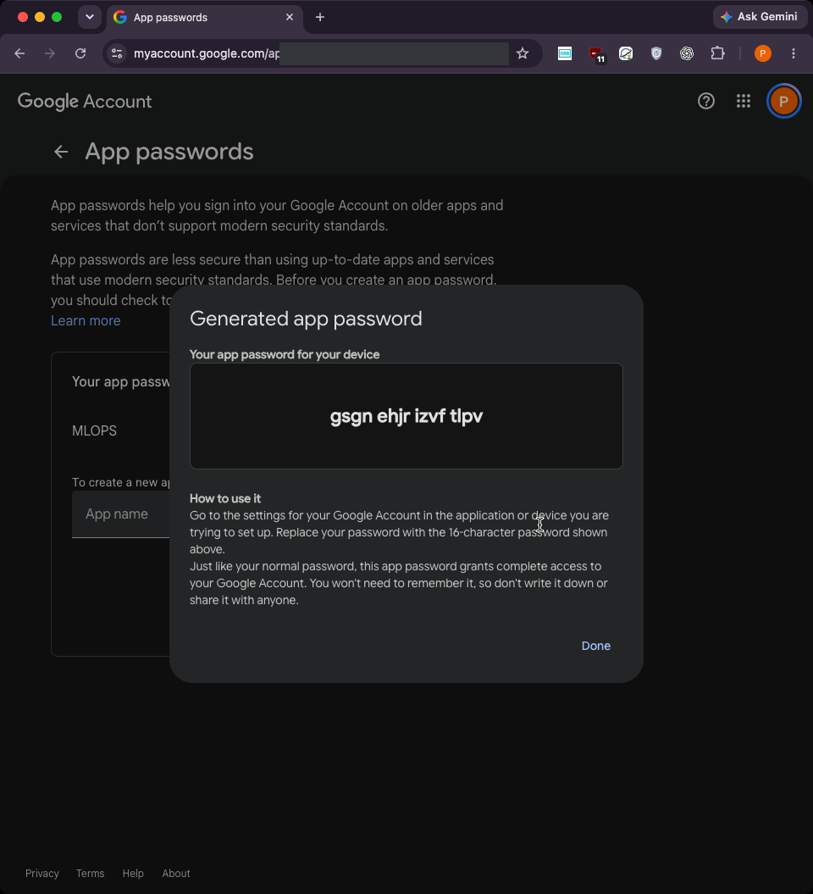
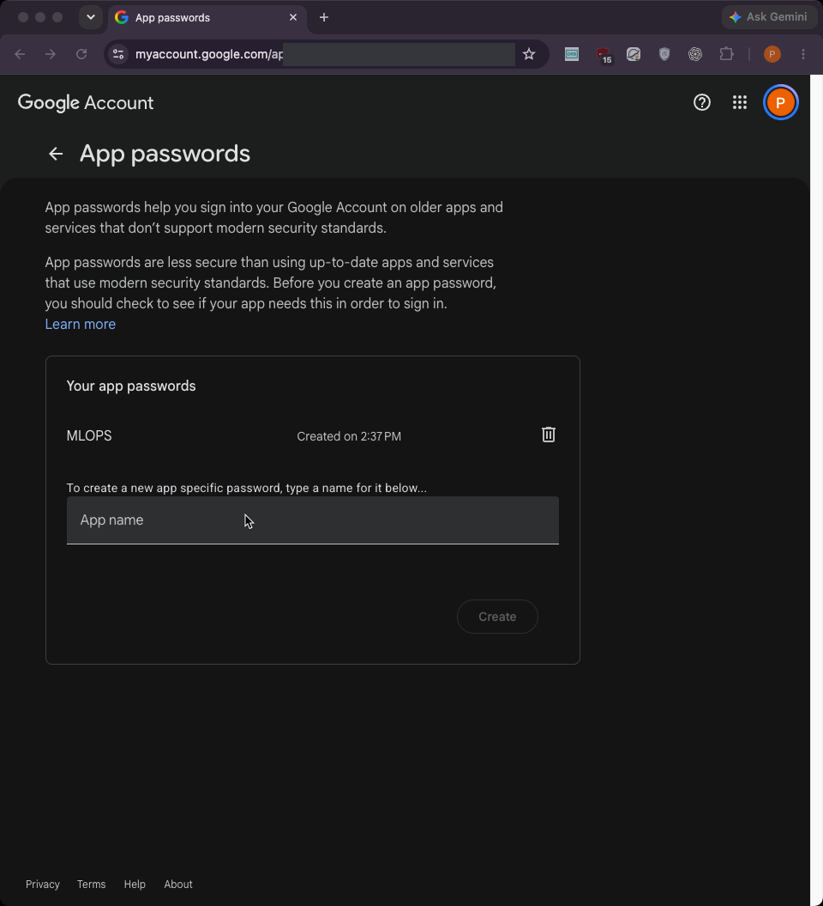
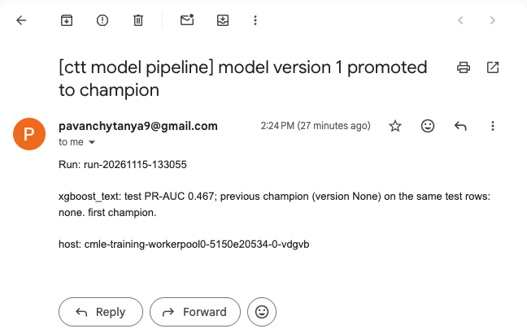

# Model pipeline: setup and run guide

Every step to run the model pipeline yourself, locally or on Google Cloud,
from a fresh clone. Work through the sections in order; every step ends with
a **Check** that tells you it worked. All commands are copy and paste: run
them exactly as written, from the folder named above them.

| Section | What you get | Time |
|---|---|---|
| [1. Run it locally](#1-run-it-locally) | the whole pipeline on your machine, reports and MLflow runs in a local folder | 15 min |
| [2. Run it on Google Cloud](#2-run-it-on-google-cloud) | images, a shared MLflow server, the pipeline on Vertex AI, the model in the Model Registry | 1 to 2 hours (mostly waiting) |
| [3. Email alerts](#3-email-alerts) | an email when a stage fails, bias is flagged or a model is promoted | 5 min |
| [4. CI/CD with GitHub Actions](#4-cicd-with-github-actions) | every push that changes the model code runs the pipeline automatically | 10 min |
| [5. Troubleshooting](#5-troubleshooting) | what to do when something fails | |

> [!NOTE]
> The model pipeline reads a data version published by the data pipeline.
> Our project already has one (`20261115`: the AACT trials registered in
> 2019). In your own Google Cloud project, run the data pipeline first
> ([README, Way 2](../../README.md#way-2-on-google-cloud)).

---

## 1. Run it locally

### 1.1 What you need

| Tool | Version | Check |
|---|---|---|
| Git | any | `git --version` |
| Python | 3.11 | `python3.11 --version` |
| Google Cloud CLI | any recent | `gcloud --version` ([install](https://cloud.google.com/sdk/docs/install)) |
| Read access to the bucket `ctt-mlops-project-data` | | section 1.4 |

### 1.2 Get the code

```bash
git clone https://github.com/PavanchytanyaD/clinical-trial-termination-prediction.git
cd clinical-trial-termination-prediction
git checkout model-pipeline
```

**Check:** `ls Model-Pipeline` lists `model_pipeline`, `params.yaml`, `README.md`.

### 1.3 Create a Python environment

From the repository root:

```bash
python3.11 -m venv .venv
source .venv/bin/activate
pip install -r Model-Pipeline/requirements-dev.txt
pip install mlflow==3.18.0
```

`requirements-dev.txt` has the pipeline's pinned libraries (scikit-learn,
XGBoost, Fairlearn, SHAP, MLflow client), the serving libraries and the test
tools. The last line adds the MLflow UI, to look at the runs.

**Check:**

```bash
cd Model-Pipeline && pytest -q tests && cd ..
```

ends with `73 passed`.

### 1.4 Sign in to Google Cloud (to read the data)

The data version lives in the project's bucket. Sign in with a Google
account that can read it (ask the project owner to grant it **Storage
Object Viewer** on `ctt-mlops-project-data`):

```bash
gcloud auth login
gcloud auth application-default login
gcloud config set project ctt-mlops-project
```

The second command lets the Python code use your login.

**Check:**

```bash
gcloud storage ls gs://ctt-mlops-project-data/data-pipeline/state/versions/
```

lists `20261115/` (and older versions).

### 1.5 Run the whole pipeline

From `Model-Pipeline/`:

```bash
cd Model-Pipeline
python -m model_pipeline.run --stage all --source lock --snapshot 20261115 --skip-register
```

| Flag | Meaning |
|---|---|
| `--stage all` | all stages, a new run (old outputs in the work folder are removed) |
| `--source lock --snapshot 20261115` | read data version `20261115` from the bucket (`--snapshot latest` takes the newest) |
| `--skip-register` | do not push to the Vertex AI Model Registry (that needs section 2) |

It takes about 3 minutes and logs every stage (`stage train: done in 54 s`,
...). The work folder is `Model-Pipeline/runs/local/`.

**Check:** the last lines say `stage sensitivity: done`, and

```bash
cat runs/local/reports/selection.md
```

shows the ranked candidates and `Final model: xgboost_text`.

### 1.6 Look at the results

| Where | What |
|---|---|
| `runs/local/reports/selection.md` | the candidates ranked, and why the final model was chosen |
| `runs/local/reports/bias/bias_report.md` | per-group metrics, gaps, mitigation and trade-offs |
| `runs/local/reports/test/` | test metrics, confusion matrix, PR curve, reliability chart |
| `runs/local/reports/sensitivity/` | SHAP and hyperparameter sensitivity |
| `runs/local/reports/tuning_results.csv` | every tuning trial |
| `runs/local/artifact/` | the packaged model (what the registry would get) |

The MLflow UI shows the same run, with one child run per tuning trial:

```bash
MLFLOW_ALLOW_FILE_STORE=true mlflow ui --backend-store-uri runs/local/mlruns --port 5000
```

Open <http://127.0.0.1:5000>, click **Model training** at the top left,
then the experiment `ctt-model-development`.

**Check:** the run `run-<date>-<time>` is listed; the **+** next to it
expands the trials (`nn-00` ... `nn-15`, `xgboost-00` ...).

### 1.7 Run one stage again

A single stage continues the run in the work folder (nothing else is
recomputed):

```bash
python -m model_pipeline.run --stage bias --skip-register
```

The stages, in order: `load_data`, `train`, `validate`, `bias`, `select`,
`calibrate`, `test`, `lead_time`, `sensitivity`, `register`.

### 1.8 Serve the packaged model locally (optional)

Needs Docker. From the repository root:

```bash
docker build -f Model-Pipeline/serving/Dockerfile -t model-serving .
docker run -p 8080:8080 -e MODEL_DIR=/model \
  -v "$PWD/Model-Pipeline/runs/local/artifact:/model:ro" model-serving
```

**Check:** in another terminal, `curl http://127.0.0.1:8080/health` returns
`{"status": "ok", "model": "xgboost_text", ...}`.

---

## 2. Run it on Google Cloud

### 2.1 What you need

- [ ] A Google Cloud project with **billing enabled**, where you are **Owner**
- [ ] The Google Cloud CLI and the Python environment from section 1.3
- [ ] A data version published by the data pipeline in that project
- [ ] The repository cloned (section 1.2)

Our project is `ctt-mlops-project`; replace it with yours everywhere below
if you use another one.

### 2.2 Sign in and choose the project

```bash
gcloud auth login
gcloud auth application-default login
gcloud config set project ctt-mlops-project
export PROJECT=ctt-mlops-project
```

**Check:** `gcloud config get-value project` prints the project.

### 2.3 One-time project setup

The data pipeline's setup creates the bucket and the two service accounts
the model pipeline also uses: `pipeline-sa` (runs every Vertex AI stage) and
`cicd-sa` (builds images, used by CI). From the repository root:

```bash
./Data-Pipeline/composer/deploy.sh setup
```

Then the model pipeline's own additions (APIs and four permissions):

```bash
gcloud services enable aiplatform.googleapis.com iamcredentials.googleapis.com \
  run.googleapis.com sqladmin.googleapis.com secretmanager.googleapis.com
# pipeline-sa signs its own ID token to reach the MLflow server on Cloud Run
gcloud iam service-accounts add-iam-policy-binding \
  pipeline-sa@${PROJECT}.iam.gserviceaccount.com \
  --member serviceAccount:pipeline-sa@${PROJECT}.iam.gserviceaccount.com \
  --role roles/iam.serviceAccountTokenCreator
# cicd-sa reads the bucket's settings when Cloud Build stages the source
gcloud storage buckets add-iam-policy-binding gs://${PROJECT}-data \
  --member serviceAccount:cicd-sa@${PROJECT}.iam.gserviceaccount.com \
  --role roles/storage.legacyBucketReader
```

**Check:** `gcloud iam service-accounts list` shows `pipeline-sa` and
`cicd-sa`.

### 2.4 The shared MLflow server

One MLflow server for the whole team, on Cloud Run, with its runs in Cloud
SQL (PostgreSQL) and its artifacts in the bucket. Only the accounts you list
in `MEMBERS` (and `pipeline-sa`) can open it. From the repository root:

```bash
MEMBERS="user:you@gmail.com,user:teammate@gmail.com" \
  ./Model-Pipeline/infra/mlflow/deploy_mlflow.sh all
```

It enables the APIs, builds the server image, creates the Cloud SQL
instance (about 10 minutes the first time), deploys the service (1 worker,
4 GiB) and prints the address:

```
MLFLOW_TRACKING_URI=https://ctt-mlflow-xxxxxxxxxx-uc.a.run.app
```

Keep that address for 2.6. To open the MLflow UI in your browser:

```bash
./Model-Pipeline/infra/mlflow/deploy_mlflow.sh proxy
```

then open <http://localhost:8080>.

**Check:**

```bash
curl -s -o /dev/null -w "%{http_code}\n" \
  -H "Authorization: Bearer $(gcloud auth print-identity-token)" \
  https://ctt-mlflow-xxxxxxxxxx-uc.a.run.app/health
```

prints `200`.

> [!WARNING]
> Cloud SQL bills about 9 USD a month while it runs. Pause it when nobody
> needs the MLflow UI, and start it before the next run:
> `./Model-Pipeline/infra/mlflow/deploy_mlflow.sh stop` (or `start`).

### 2.5 Email alerts on Google Cloud

The Vertex AI stages read the email settings from the Secret Manager secret
`ctt-pipeline-env`. Fill in `Data-Pipeline/.env` first (section 3), then
from the repository root:

```bash
grep -E '^(SMTP|ALERT)_' Data-Pipeline/.env | \
  gcloud secrets create ctt-pipeline-env --data-file=- --replication-policy=automatic
gcloud secrets add-iam-policy-binding ctt-pipeline-env \
  --member serviceAccount:pipeline-sa@${PROJECT}.iam.gserviceaccount.com \
  --role roles/secretmanager.secretAccessor
```

After changing `.env` later, add a new version instead:

```bash
grep -E '^(SMTP|ALERT)_' Data-Pipeline/.env | gcloud secrets versions add ctt-pipeline-env --data-file=-
```

**Check:** `gcloud secrets versions list ctt-pipeline-env` shows an
`enabled` version.

### 2.6 Build the images

Two images, built by Cloud Build from your checkout and pushed to Artifact
Registry (`ctt-images`): `model-pipeline` (every stage) and `model-serving`
(the prediction server of every registered version). From the repository
root (about 5 minutes):

```bash
gcloud builds submit --config Model-Pipeline/cloudbuild.yaml \
  --gcs-source-staging-dir gs://${PROJECT}-data/cloudbuild-source \
  --substitutions _TAG=$(git rev-parse --short=12 HEAD) .
```

**Check:** the command ends with `STATUS: SUCCESS`, and

```bash
gcloud artifacts docker tags list us-central1-docker.pkg.dev/${PROJECT}/ctt-images/model-pipeline
```

lists the tag (the commit id).

### 2.7 Run the pipeline on Vertex AI

From the repository root, with the address from 2.4:

```bash
TAG=$(git rev-parse --short=12 HEAD)
export CTT_MODEL_IMAGE=us-central1-docker.pkg.dev/${PROJECT}/ctt-images/model-pipeline:${TAG}
export CTT_SERVING_IMAGE=us-central1-docker.pkg.dev/${PROJECT}/ctt-images/model-serving:${TAG}
python Model-Pipeline/vertex/submit.py --snapshot 20261115 --git-sha ${TAG} \
  --mlflow-uri https://ctt-mlflow-xxxxxxxxxx-uc.a.run.app
```

It prints the run id (`run-<date>-<time>`) and a console link. Each stage
starts its own machine, so the run takes 30 to 45 minutes. Add `--wait` to
keep the command running until the pipeline ends.

**Follow it:** Google Cloud console → **Vertex AI** → **Pipelines** →
**Runs** → `ctt-model-pipeline-<date><time>`. The graph shows each stage
turning green.

**Check:** all ten stages are green. Then:

| Where | What |
|---|---|
| `gs://${PROJECT}-data/model-pipeline/runs/<run_id>/reports/` | the same reports as section 1.6 |
| MLflow UI (2.4), experiment `ctt-model-development` | the run and its trials |
| Console → Vertex AI → **Model Registry** → `ctt-termination-model` | the new version, with alias `champion` if it beat the previous one |
| Your inbox | "model version N promoted to champion" (or "not promoted") |

If a stage waits for a machine for more than 10 minutes, see
[section 5](#5-troubleshooting).

### 2.8 Look at the registry, roll back

From `Model-Pipeline/`:

```bash
python -m model_pipeline.registry status
```

lists every version with its aliases, test PR-AUC (×1000), the champion's
score at the time, and data version. If the
current champion turns out worse than an older version, move `champion`
back (this also sends an alert email):

```bash
python -m model_pipeline.registry rollback --version 1
```

**Check:** `status` shows `champion` on the version you chose.

### 2.9 Clean up

| What | Bills | Stop it with |
|---|---|---|
| Vertex AI runs | only while running | nothing to do |
| MLflow on Cloud Run | only while answering | nothing to do |
| Cloud SQL (MLflow runs) | about 9 USD a month | `./Model-Pipeline/infra/mlflow/deploy_mlflow.sh stop` |
| Bucket and images | a few cents a month | keep them |
| Everything | | `gcloud projects delete ${PROJECT}` |

---

## 3. Email alerts

The pipeline emails every subscriber when something needs a person:

| Alert | Sent when | Example subject |
|---|---|---|
| Stage failed | any stage fails | `[ctt model pipeline] stage train failed` |
| Run finished | a full run ends | `[ctt model pipeline] training run finished` |
| Bias | a model's gap is above the alert level, or a model is blocked | `[ctt model pipeline] bias flagged for xgboost_text` |
| Test set | the selected model fails on the test set (and the next is tried) | `[ctt model pipeline] fell back to nn on the test set` |
| Registry | a new champion, a model kept back, a manual rollback | `[ctt model pipeline] model version 1 promoted to champion` |
| CI | the GitHub Actions job fails | `[ctt model pipeline] CI model pipeline job failed on model-pipeline` |

One Gmail account sends them, signed in with an **app password** (a
16-letter password Google makes for one app, so the account's real password
is never stored). The same settings serve the data pipeline and the model
pipeline. Setting it up takes 5 minutes and needs a Gmail account with
2-Step Verification on.

**3.1 Open App passwords** at <https://myaccount.google.com/apppasswords>
with the Gmail account that should send the alerts. If the page says app
passwords are not available, turn on 2-Step Verification (Google Account →
Security) and come back.



**3.2 Create one.** Type a name such as `ctt-pipeline-alerts` and click
**Create**. Google shows the password once, as four groups of four letters:
copy it before clicking **Done**.

**3.3 Check it is listed** under "Your app passwords". Deleting it there
cuts off the pipeline's access at any time.



**3.4 Fill in `Data-Pipeline/.env`.** From the repository root:

```bash
cp Data-Pipeline/.env.example Data-Pipeline/.env
```

then edit these lines:

```
SMTP_USER=you@gmail.com
SMTP_PASSWORD="abcd efgh ijkl mnop"
ALERT_EMAIL_FROM=you@gmail.com
ALERT_EMAIL_TO=you@gmail.com,teammate@example.com
```

| Line | Value |
|---|---|
| `SMTP_USER`, `ALERT_EMAIL_FROM` | the Gmail account from 3.1 |
| `SMTP_PASSWORD` | the app password from 3.2: exactly 16 letters, in quotes |
| `ALERT_EMAIL_TO` | the subscribers, comma-separated |

`SMTP_HOST=smtp.gmail.com`, `SMTP_PORT=587` and `SMTP_STARTTLS=true` are
already set. `.env` is in `.gitignore` and is never committed.

**3.5 Send a test email.** From `Data-Pipeline/`, in the environment of
section 1.3:

```bash
cd Data-Pipeline
python -c "from scripts.alerts import send_alert; print(send_alert('Test alert', 'Email alerts work.'))"
cd ..
```

| You see | Meaning |
|---|---|
| `True`, and the email arrives (check spam) | done |
| `False` and `Username and Password not accepted` | the password is the account's normal password, has a typo (it must be exactly 16 letters), or was deleted |
| `False` and `SMTP not configured` | a line in 3.4 is empty |

**3.6 Turn them on where the pipeline runs.**

| Where | What to do |
|---|---|
| Locally | nothing: a local run reads `Data-Pipeline/.env` |
| Vertex AI | update the secret (section 2.5) |
| GitHub Actions | update the repository secrets (section 4.3) |

**3.7 Subscribe or unsubscribe someone.** Edit `ALERT_EMAIL_TO` in
`Data-Pipeline/.env`, then apply it as in 3.6. Every subscriber gets every
alert; nothing to install on their side.

**3.8 What an alert looks like.** The email the `register` stage sent when
version 1 became champion (run `run-20261115-133055`):



---

## 4. CI/CD with GitHub Actions

### 4.1 What runs, and when

`.github/workflows/model-pipeline.yml`:

| Trigger | What runs |
|---|---|
| Every push or pull request that changes `Model-Pipeline/` code, `src/bias/`, `configs/` or the workflow | style check (flake8), the 73 tests, a compile of the Vertex AI pipeline |
| A push to `main` or `model-pipeline`, or **Run workflow** in the Actions tab | then: both images built with Cloud Build, the pipeline run on Vertex AI (train, validate, bias, select, test, register), waiting for the result |
| A failed job | an email to the subscribers |

Changes to Markdown files (`*.md`) or `Model-Pipeline/docs/` alone do **not**
start it, so documentation can be edited freely. To skip CI for any other
commit, put `[skip ci]` in its message.

### 4.2 Google Cloud sign-in

In our repository nothing needs to be set up: the workflow signs in as
`cicd-sa` through Workload Identity Federation (no key file), with the
project, provider and MLflow address written in as defaults.

In a fork or another project, create the federation once (replace
`OWNER/REPO` with your repository):

```bash
gcloud iam workload-identity-pools create github-pool --location global
gcloud iam workload-identity-pools providers create-oidc github-provider \
  --location global --workload-identity-pool github-pool \
  --issuer-uri https://token.actions.githubusercontent.com \
  --attribute-mapping "google.subject=assertion.sub,attribute.repository=assertion.repository" \
  --attribute-condition "assertion.repository=='OWNER/REPO'"
gcloud iam service-accounts add-iam-policy-binding cicd-sa@${PROJECT}.iam.gserviceaccount.com \
  --role roles/iam.workloadIdentityUser \
  --member "principalSet://iam.googleapis.com/projects/$(gcloud projects describe ${PROJECT} --format='value(projectNumber)')/locations/global/workloadIdentityPools/github-pool/attribute.repository/OWNER/REPO"
```

then set the repository variables (GitHub → **Settings** → **Secrets and
variables** → **Actions** → **Variables**, or with the GitHub CLI):

```bash
gh variable set GCP_PROJECT --body "${PROJECT}"
gh variable set WIF_PROVIDER --body "projects/$(gcloud projects describe ${PROJECT} --format='value(projectNumber)')/locations/global/workloadIdentityPools/github-pool/providers/github-provider"
gh variable set CICD_SA --body "cicd-sa@${PROJECT}.iam.gserviceaccount.com"
gh variable set MLFLOW_TRACKING_URI --body "https://ctt-mlflow-xxxxxxxxxx-uc.a.run.app"
```

### 4.3 Email on a failed job

The job emails the subscribers when it fails. Copy the settings from
`Data-Pipeline/.env` into the repository secrets, from the repository root:

```bash
grep -E '^(SMTP|ALERT)_' Data-Pipeline/.env | while IFS='=' read -r k v; do
  v="${v%\"}"; v="${v#\"}"; gh secret set "$k" --body "$v"; done
```

**Check:** `gh secret list` shows `SMTP_HOST`, `SMTP_PASSWORD`, ...,
`ALERT_EMAIL_TO`.

### 4.4 Check that it works

Push a commit that changes the model code to `model-pipeline`, then open
GitHub → **Actions** → **model-pipeline**. The run shows the two jobs: *lint
and test* and *run the model pipeline on Vertex AI* (screenshot 11 in the
[README](../README.md#proof-that-every-component-ran)).

---

## 5. Troubleshooting

| You see | Cause | Fix |
|---|---|---|
| `BILLING_DISABLED` on any `gcloud` command | the project has no billing account | console → **Billing** → link a billing account |
| A Vertex AI stage stays "Waiting for job to be provisioned" for more than 10 minutes | Google has no free machine of that type in the region right now | wait, or cancel the run and finish it on one machine (below) |
| MLflow `503 Service Unavailable`, or "Memory limit exceeded" in the Cloud Run logs | the MLflow server ran out of memory | `gcloud run services update ctt-mlflow --region us-central1 --memory 4Gi --update-env-vars WORKERS=1` |
| `403` from the MLflow server | your account is not an invoker | rerun `deploy_mlflow.sh invokers` with `MEMBERS="user:you@gmail.com"` |
| Cloud Build: "forbidden from accessing the bucket" | `cicd-sa` cannot read the bucket's settings | the `legacyBucketReader` command in 2.3 |
| Email: `Username and Password not accepted` | wrong or deleted app password | create a new one (3.1 to 3.4), then 2.5 and 4.3 again |

**Finishing a run on one machine.** Every stage reads and writes the run's
work folder in the bucket, so the stages left can run together in one
Vertex AI custom job, without training again. With `RUN` the run id
(`run-<date>-<time>`) and `TAG` the image tag from 2.7:

```bash
cat > finish-job.yaml <<EOF
workerPoolSpecs:
  - machineSpec:
      machineType: n1-standard-4
    replicaCount: 1
    containerSpec:
      imageUri: us-central1-docker.pkg.dev/${PROJECT}/ctt-images/model-pipeline:${TAG}
      command: ["sh", "-c"]
      args:
        - "set -e; for s in select calibrate test lead_time sensitivity register; do python -m model_pipeline.run --stage \$s --workdir gs://${PROJECT}-data/model-pipeline/runs/${RUN} --snapshot 20261115 --run-id ${RUN}; done"
      env:
        - name: MLFLOW_TRACKING_URI
          value: https://ctt-mlflow-xxxxxxxxxx-uc.a.run.app
        - name: CTT_SERVING_IMAGE
          value: us-central1-docker.pkg.dev/${PROJECT}/ctt-images/model-serving:${TAG}
serviceAccount: pipeline-sa@${PROJECT}.iam.gserviceaccount.com
EOF
gcloud ai custom-jobs create --region us-central1 --display-name finish-${RUN} --config finish-job.yaml
```

Put the stages that did not finish in the `for` list. Follow it in the
console under **Vertex AI** → **Training** → **Custom jobs**.
