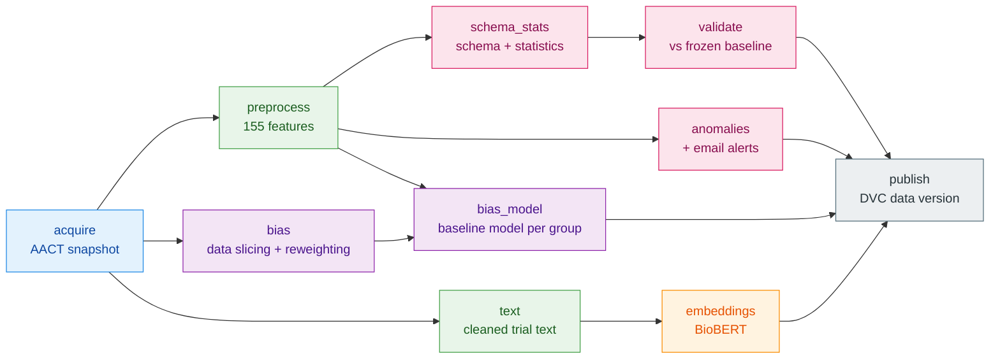
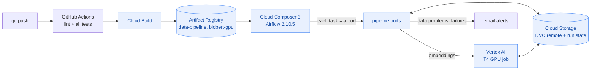
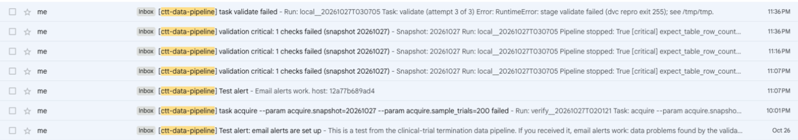
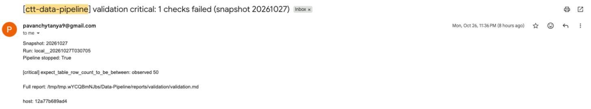

<div align="center">

# Predicting Early Termination of Clinical Trials

**An MLOps pipeline that turns the public ClinicalTrials.gov registry into versioned, validated, bias-checked training data, orchestrated by Airflow and versioned by DVC, on your laptop or on Google Cloud.**

[](https://github.com/PavanchytanyaD/clinical-trial-termination-prediction/actions/workflows/ci.yml)


Northeastern University · MLOps (IE 7305) · Data pipeline assignment

</div>

---

## Contents

1. [The project](#the-project)
2. [The data pipeline at a glance](#the-data-pipeline-at-a-glance)
3. [How to run the pipeline: two ways](#how-to-run-the-pipeline-two-ways)
   - [Way 1: on your machine (Docker)](#way-1-on-your-machine-docker)
   - [Way 2: on Google Cloud](#way-2-on-google-cloud)
4. [Bias detection and mitigation](#bias-detection-and-mitigation)
5. [Changing how often it runs](#changing-how-often-it-runs)
6. [Email alerts](#email-alerts)
7. [Environment setup](#environment-setup)
8. [Data versioning and reproducibility](#data-versioning-and-reproducibility)
9. [Tests and code quality](#tests-and-code-quality)
10. [Code structure](#code-structure)
11. [Component details](#component-details)

---

## The project

Clinical trials are expensive, and many are stopped early (terminated, withdrawn or suspended). The project predicts **the probability that a registered trial will be stopped early**, from what is known when it is registered. An agentic AI system then explains why a flagged trial is at risk, by citing similar past trials that were stopped.

| | In short |
|---|---|
| **Data** | [ClinicalTrials.gov](https://clinicaltrials.gov) through the [AACT](https://aact.ctti-clinicaltrials.org/) database (about 600,000 trials, refreshed daily). One row is one trial (NCT ID). |
| **Label** | 1 = terminated, withdrawn or suspended; 0 = completed; trials still running are left out of training |
| **Features** | 155 structured design features (phase, design, sponsor, sites, eligibility, conditions) plus BioBERT embeddings of the trial text |
| **Models (next assignments)** | a classical baseline on the structured features, then BioBERT embeddings + structured features in a neural network; an agent that explains predictions |
| **This assignment** | the **data pipeline** that produces that data, monthly, versioned and checked |

---

## The data pipeline at a glance

One Airflow DAG, `ctt_data_pipeline`, runs ten tasks. Each task is one DVC stage, so every output is versioned and a stage whose inputs did not change is skipped.



| Stage | What it does | Assignment item |
|---|---|---|
| `acquire` | Downloads one AACT snapshot (12 tables) from the AACT database or a monthly export, or writes a seeded test snapshot | 1. Data acquisition |
| `preprocess` | Cleans the data and builds 155 leakage-checked features per trial | 2. Preprocessing |
| `text` / `embeddings` | Cleans the registration text; BioBERT embeddings (GPU on the cloud, CPU locally) | 2. Preprocessing |
| `schema_stats` | Statistics per column and a Great Expectations schema (475 expectations) | 7. Schema and statistics |
| `anomalies` | Duplicates, invalid values, missing-value spikes, outliers, bad dates; emails an alert | 8. Anomalies and alerts |
| `validate` | Checks each snapshot against a frozen baseline (schema + drift); stops the run on critical problems | 7. Data quality over time |
| `bias` | Slices trials by phase, sponsor, region, area, gender, age and era; reweights small groups | Bias detection and mitigation |
| `bias_model` | Trains a baseline model and checks it per group with Fairlearn; mitigates the gaps | Bias detection and mitigation |
| `publish` | Pushes every output to the DVC remote and records the data version | 5. Data versioning |

**Around the stages:** retries and timeouts (4. orchestration), logs and run records for every step (6. tracking), email alerts on data problems and failures (8. alerts), parallel branches found with the Gantt chart (9. optimization, [14% faster](Data-Pipeline/docs/pipeline_optimization.md)), tests for every module (3. tests), and CI/CD on every push.

> [!NOTE]
> Every stage, check and threshold is explained in [Data-Pipeline/README.md](Data-Pipeline/README.md). The bias findings are in [docs/bias_report.md](docs/bias_report.md).

---

## How to run the pipeline: two ways

The same code and the same DAG run in two places. **Pick one:**

| | **Way 1: on your machine** | **Way 2: on Google Cloud** |
|---|---|---|
| Airflow | Docker Compose (scheduler, web server, Postgres) | Cloud Composer 3 |
| Each task runs | in a fresh copy of the code in the container | as a Kubernetes pod from the pipeline image |
| BioBERT embeddings | on your CPU | Vertex AI job on an NVIDIA T4 GPU |
| Data versions and run state | folders in `Data-Pipeline/local/output/` | a Cloud Storage bucket |
| You need | Docker | a Google Cloud project with billing, and the gcloud CLI |
| Cost | free | Composer is billed per hour while it exists |
| Time to the first result | about 15 minutes | about 1 hour |

> [!TIP]
> Both ways run on a **seeded test snapshot** in the AACT format by default, so you need no AACT account. To use the live AACT database, add your AACT login to `Data-Pipeline/.env` ([docs/SETUP.md](docs/SETUP.md)) and trigger with `SOURCE=db`.

### Way 1: on your machine (Docker)

**You need:** Git, Bash (on Windows: WSL or Git Bash), and [Docker Desktop](https://www.docker.com/products/docker-desktop/) (or Docker Engine on Linux) with about **4 GB of memory and 6 GB of disk**. Nothing else: the image installs every dependency and the BioBERT weights.

**Step 1. Get the code**

```bash
git clone https://github.com/PavanchytanyaD/clinical-trial-termination-prediction.git
cd clinical-trial-termination-prediction/Data-Pipeline
```

**Step 2. Start Airflow**

```bash
./local/pipeline.sh up
```

The first time, this builds the image: Airflow 2.10.5, the pipeline's libraries, CPU-only PyTorch and BioBERT (about 3 GB to download). It then starts Postgres, the Airflow scheduler and the web server, waits until both DAGs are loaded, and prints:

```
Airflow is up: http://localhost:8080 (admin / admin)
```

**Step 3. Open the Airflow UI**

Open **<http://localhost:8080>** and sign in with user `admin`, password `admin`. You see the two DAGs: `ctt_data_pipeline` (the pipeline) and `ctt_freeze_baseline`.

**Step 4. Run the pipeline**

```bash
./local/pipeline.sh trigger
```

This runs `ctt_data_pipeline` once on a 500-trial test snapshot, waits until it ends (about 2 minutes), and prints every task's state and where the reports are. Watch it live in the UI: click the DAG, then **Graph**, **Gantt** or a task's **Logs**.

**Step 5. Look at the results**

```bash
ls local/output/state/runs/                     # one folder per run
cat local/output/state/runs/*/validate/reports/validation/validation.md
```

Each run folder has the run's parameters and, per task, its logs and reports (statistics, anomalies, validation, bias, baseline model). Every data version is in `local/output/dvc-store/`.

**Step 6. Freeze a validation baseline**

```bash
REASON="first run" ./local/pipeline.sh freeze
```

This run's schema and statistics become the baseline that every later run is validated against.

**Step 7. Run it again**

```bash
./local/pipeline.sh trigger
```

DVC skips the stages whose code, data and parameters did not change, and `validate` now compares the data with the baseline.

**Step 8. Stop Airflow**

```bash
./local/pipeline.sh down      # stop; local/output/ and the run history stay
./local/pipeline.sh clean     # or: stop and delete everything
```

<details>
<summary><b>More options</b>: bigger snapshot, other date, live AACT data, another port</summary>

```bash
SAMPLE_TRIALS=2000 ./local/pipeline.sh trigger    # a bigger test snapshot
SNAPSHOT=20261101 ./local/pipeline.sh trigger     # another snapshot date
SOURCE=db ./local/pipeline.sh trigger             # live AACT database (needs Data-Pipeline/.env)
CTT_UI_PORT=8081 ./local/pipeline.sh up           # the UI on another port, if 8080 is taken
./local/pipeline.sh status                        # list the runs
```

More (how it works, troubleshooting): [Data-Pipeline/local/README.md](Data-Pipeline/local/README.md).
</details>

**Our test run (2026-10-27): all ten tasks succeeded in 2 minutes 5 seconds.**

<table>
<tr>
<td width="50%"><br><sub>Graph view: all ten tasks succeeded.</sub></td>
<td width="50%"><br><sub>Gantt view: the branches run in parallel; <code>embeddings</code> (BioBERT on the CPU) is the longest.</sub></td>
</tr>
</table>

<details>
<summary><b>Terminal output of step 4</b></summary>

```
$ ./local/pipeline.sh trigger
started ctt_data_pipeline run local__20261027T024530; follow it at http://localhost:8081
dag_id            | execution_date            | task_id      | state   | start_date                       | end_date
ctt_data_pipeline | 2026-10-27T02:45:33+00:00 | acquire      | success | 2026-10-27T02:45:34.050163+00:00 | 2026-10-27T02:45:36.959945+00:00
ctt_data_pipeline | 2026-10-27T02:45:33+00:00 | text         | success | 2026-10-27T02:45:38.103299+00:00 | 2026-10-27T02:45:44.183714+00:00
ctt_data_pipeline | 2026-10-27T02:45:33+00:00 | preprocess   | success | 2026-10-27T02:45:38.002411+00:00 | 2026-10-27T02:45:44.316001+00:00
ctt_data_pipeline | 2026-10-27T02:45:33+00:00 | bias         | success | 2026-10-27T02:45:38.045454+00:00 | 2026-10-27T02:45:44.829778+00:00
ctt_data_pipeline | 2026-10-27T02:45:33+00:00 | anomalies    | success | 2026-10-27T02:45:45.926004+00:00 | 2026-10-27T02:45:56.481892+00:00
ctt_data_pipeline | 2026-10-27T02:45:33+00:00 | schema_stats | success | 2026-10-27T02:45:45.957692+00:00 | 2026-10-27T02:45:57.434567+00:00
ctt_data_pipeline | 2026-10-27T02:45:33+00:00 | bias_model   | success | 2026-10-27T02:45:58.293475+00:00 | 2026-10-27T02:46:16.678938+00:00
ctt_data_pipeline | 2026-10-27T02:45:33+00:00 | validate     | success | 2026-10-27T02:45:58.324913+00:00 | 2026-10-27T02:46:19.482924+00:00
ctt_data_pipeline | 2026-10-27T02:45:33+00:00 | embeddings   | success | 2026-10-27T02:45:45.906417+00:00 | 2026-10-27T02:47:25.412588+00:00
ctt_data_pipeline | 2026-10-27T02:45:33+00:00 | publish      | success | 2026-10-27T02:47:25.718909+00:00 | 2026-10-27T02:47:38.828531+00:00
ctt_data_pipeline local__20261027T024530: success
reports and logs: .../Data-Pipeline/local/output/state/runs/local__20261027T024530/
```

(The UI was on port 8081 in this test, because another program used 8080.)
</details>

### Way 2: on Google Cloud

#### 2.1 What we deployed



| Resource | Our value |
|---|---|
| **Project** | `ctt-mlops` (ID `ctt-mlops-project`), region `us-central1` |
| **Bucket** | `gs://ctt-mlops-project-data`: `dvc-store/` (every data version), `data-pipeline/state/` (each run's parameters, `dvc.lock`, logs, reports, baseline, version records), `composer-snapshots/` (Airflow's history) |
| **Images** | `us-central1-docker.pkg.dev/ctt-mlops-project/ctt-images/`: `data-pipeline` (every task), `biobert-gpu` (the embeddings job) |
| **Airflow** | Cloud Composer 3 `ctt-composer` (Airflow 2.10.5, small); every task is a `KubernetesPodOperator` pod |
| **GPU** | Vertex AI custom job `ctt-biobert-<run>` on `n1-standard-8` + 1 × NVIDIA T4 |
| **Identities** | `pipeline-sa` (Composer, pods, Vertex AI job), `cicd-sa` (image builds) |
| **CI/CD** | GitHub Actions: style check and all tests on every push; on `main`, both images built with Cloud Build and the DAG uploaded. Signs in through Workload Identity Federation (no key). |

> [!IMPORTANT]
> Composer is billed for every hour it exists and cannot be paused, so we create it for a working session and delete it afterwards (`up` / `down`). The data, the history and the images stay. It is **not running now**; the screenshots in 2.5 show it running.

#### 2.2 Requirements in your Google Cloud project

- [ ] A project with **billing enabled**, where you are **Owner** (setup creates service accounts and grants roles)
- [ ] The **[Google Cloud CLI](https://cloud.google.com/sdk/docs/install)**, Git and Bash ([Cloud Shell](https://shell.cloud.google.com) has all three)
- [ ] **GPU quota** for Vertex AI custom training: one NVIDIA T4 in your region (IAM & Admin → Quotas → "Custom model training Nvidia T4 GPUs"). No quota? Set `accelerator: ""` in the `embeddings` section of `Data-Pipeline/params.yaml` and commit it; the job then runs on CPU.
- [ ] Optional: `Data-Pipeline/.env` with AACT login and alert-email settings ([docs/SETUP.md](docs/SETUP.md))

The APIs (Composer, Artifact Registry, Cloud Build, Vertex AI, IAM, Storage) are enabled by `setup`; nothing else is set up by hand.

#### 2.3 Commands to deploy it in your project

Run every command from the `Data-Pipeline/` folder of the repository.

**Step 1. Sign in and choose your project** (1 minute)

```bash
gcloud auth login
gcloud config set project YOUR_PROJECT_ID
export PROJECT=YOUR_PROJECT_ID
```

Everything else follows from `PROJECT`: the bucket `${PROJECT}-data`, the image names and the service accounts. Optionally set `REGION` (default `us-central1`), `BUCKET` or `ENV_NAME` the same way.

**Step 2. Set up the project, once** (2 minutes)

```bash
./composer/deploy.sh setup
```

Enables the APIs, creates the bucket and the service accounts `pipeline-sa` and `cicd-sa`, and grants their roles. Safe to run again.

**Step 3. Build the two images** (about 15 minutes)

```bash
./composer/deploy.sh image        # the pipeline image: every Airflow task runs it
./composer/deploy.sh gpu-image    # the BioBERT image: the Vertex AI GPU job runs it
```

Cloud Build builds them from the committed code and pushes them to Artifact Registry.

**Step 4. Create Composer** (about 25 minutes)

```bash
./composer/deploy.sh up
```

Creates the Composer environment running as `pipeline-sa`, sets the DAG's settings (images, bucket, state folder, DVC remote) and the secret from `.env`, uploads the DAGs, and prints the Airflow UI address.

**Step 5. Run the pipeline** (about 25 minutes)

```bash
./composer/deploy.sh trigger                           # test snapshot
SOURCE=db ./composer/deploy.sh trigger                 # or: live AACT data (needs .env)
SNAPSHOT=20261101 SAMPLE_TRIALS=2000 ./composer/deploy.sh trigger   # or: choose date and size
```

Follow the run in the Airflow UI (`./composer/deploy.sh ui` prints the address).

**Step 6. Look at the results**

```bash
gcloud storage ls -r gs://${PROJECT}-data/data-pipeline/state/
```

Each run's logs and reports are in `state/runs/<run_id>/`, its data version in `state/versions/<snapshot>/`, and the data itself in `gs://${PROJECT}-data/dvc-store/`. The BioBERT job is in Vertex AI → Training → Custom jobs.

**Step 7. Freeze a baseline and record the data version** (optional)

```bash
REASON="first run" ./composer/deploy.sh freeze     # later runs are validated against this one
./composer/deploy.sh lock                          # copy the run's dvc.lock into the repository
git commit -m "Data version of the first run" dvc.lock
```

**Step 8. Delete Composer: billing stops** (about 10 minutes)

```bash
./composer/deploy.sh down
```

Saves Airflow's history to the bucket and deletes the environment. The data and images stay; the next `up` restores the history.

> [!WARNING]
> Always run `down` when you finish: a forgotten Composer environment keeps billing. To remove everything: `gcloud projects delete ${PROJECT}`.

#### 2.4 What we ran on our project

Our session of **2026-10-26** on `ctt-mlops-project`, with the real outputs (shortened):

```console
$ cd Data-Pipeline
$ gcloud config set project ctt-mlops-project
$ ./composer/deploy.sh setup                  # once per project
# images: built by GitHub Actions on every push (screenshot 1 below)

$ ./composer/deploy.sh up
Waiting for [projects/ctt-mlops-project/locations/us-central1/environments/ctt-composer] to be created ...
https://f3c7d1003b414cc6bd3aa7d79c31315a-dot-us-central1.composer.googleusercontent.com

$ SNAPSHOT=20261026 ./composer/deploy.sh trigger
Executing the command: [ airflow dags trigger ctt_data_pipeline -c {"snapshot": "20261026", "source": "sample", "zip": "", "sample_trials": ""} ]...
Command has been started.

$ ./composer/deploy.sh down
snapshotPath: gs://ctt-mlops-project-data/composer-snapshots/ctt-mlops-project_us-central1_ctt-composer_2026-10-26T16-18-26
Delete in progress for environment [projects/ctt-mlops-project/locations/us-central1/environments/ctt-composer] ...
```

The run took **24 minutes and every task succeeded**. The data version of this session is the `dvc.lock` committed in this repository.

#### 2.5 Proof that every component ran

Screenshots from that session (2026-10-26). The DAG had nine tasks then; `bias_model` was added on 2026-10-27 and is shown in the local run above.

<table>
<tr>
<td width="50%" valign="top"><b>1. GitHub Actions</b>: lint, three test suites, both image builds and the DAG upload passed<br></td>
<td width="50%" valign="top"><b>2. Artifact Registry</b>: both images in <code>ctt-images</code><br><br><br><b>3. Cloud Build</b>: the builds that made them<br></td>
</tr>
<tr>
<td width="50%" valign="top"><b>4. Composer</b>: <code>up</code> creating <code>ctt-composer</code> (Airflow 2.10.5, us-central1)<br><br><br><b>5. Composer settings</b> set by <code>deploy.sh</code><br></td>
<td width="50%" valign="top"><b>6. Composer environment</b>: running as <code>pipeline-sa</code><br></td>
</tr>
<tr>
<td width="50%" valign="top"><b>7. Airflow</b>: both DAGs loaded<br></td>
<td width="50%" valign="top"><b>8. The run</b>: every task a <code>KubernetesPodOperator</code> pod, all green<br></td>
</tr>
<tr>
<td width="50%" valign="top"><b>9. Gantt view</b>: parallel branches; the red bar is a failed first attempt of <code>bias</code> that Airflow's retry fixed<br></td>
<td width="50%" valign="top"><b>10. Task log</b>: <code>embeddings</code> waiting for Vertex AI, then DVC pushing the result<br></td>
</tr>
<tr>
<td width="50%" valign="top"><b>11. Vertex AI</b>: the BioBERT jobs on the T4 (the stopped one was cancelled on purpose, to test that a stopped task cancels its GPU job)<br></td>
<td width="50%" valign="top"><b>12. Cloud Storage</b>: the bucket, and the run-state folder with <code>dvc.lock</code>, <code>runs/</code> and <code>versions/</code><br><br></td>
</tr>
<tr>
<td width="50%" valign="top"><b>13. Runs</b>: both triggered runs succeeded<br></td>
<td width="50%" valign="top"><b>14. Timeline</b> of the run from Airflow's task times (1,435 s; <code>embeddings</code> includes Vertex AI starting the GPU machine)<br></td>
</tr>
</table>

More: [Data-Pipeline/composer/README.md](Data-Pipeline/composer/README.md). CI/CD from a fork: set the repository variables `GCP_PROJECT`, `WIF_PROVIDER` and `CICD_SA` (top of [.github/workflows/ci.yml](.github/workflows/ci.yml)).

---

## Bias detection and mitigation

> [!IMPORTANT]
> **The bias report is [docs/bias_report.md](docs/bias_report.md).** It is the only report: what bias we found, how we mitigated it, and the trade-offs. [docs/bias_report_evidence/](docs/bias_report_evidence/) holds the raw pipeline output it quotes, so every number can be checked.

Bias is checked in every pipeline run, at two levels. The data is trial-level (no patients), so the slices are trial attributes: phase, study type, sponsor class, region, therapeutic area, eligible gender, eligible age group and start era.

| Level | Stage | What it checks | Main finding | Mitigation |
|---|---|---|---|---|
| Data | `bias` | Groups too small to learn from; stopped rates far from the overall 13.8% | Several groups under 1% of finished trials (e.g. early phase 1, individual sponsors); US-only trials stop twice as often as non-US | 5 of them reweighted up to a 1% share (`trial_weights.csv`; groups under 100 trials are too small to boost); real rate differences left as they are |
| Model | `bias_model` | A baseline model's recall and PR-AUC in each group (Fairlearn) | Recall differs by 0.32 between regions | One decision threshold per region: gap 0.32 → 0.13, at a cost of 0.03 PR-AUC |

Sections 1–6 of the report use the full AACT pull (608,221 trials); section 7 uses the trials registered in 2019 (24,236), the data the pipeline runs on.

---

## Changing how often it runs

Airflow's scheduler starts the pipeline on a schedule. **By default: monthly, on the 5th at 06:00 UTC**, after AACT's monthly export. The schedule is not hard-coded: it is the Airflow Variable `ctt_schedule`, which can be changed **while Airflow runs, with nothing to redeploy**. The scheduler picks up a change within about a minute.

**On your machine:**

```bash
./local/pipeline.sh schedule                 # show the current schedule
./local/pipeline.sh schedule "@weekly"       # weekly
./local/pipeline.sh schedule "0 6 * * 1"     # any cron: Mondays at 06:00 UTC
./local/pipeline.sh schedule none            # manual runs only
./local/pipeline.sh schedule default         # back to monthly
```

**On Google Cloud:**

```bash
./composer/deploy.sh schedule                          # show the current schedule
SCHEDULE="@weekly" ./composer/deploy.sh schedule       # weekly
SCHEDULE="0 6 * * 1" ./composer/deploy.sh schedule     # any cron: Mondays at 06:00 UTC
SCHEDULE=none ./composer/deploy.sh schedule            # manual runs only
SCHEDULE=default ./composer/deploy.sh schedule         # back to monthly
```

It can also be edited in the Airflow UI (Admin → Variables → `ctt_schedule`). If it is not set, the environment variable `CTT_SCHEDULE` is used, and if that is not set either, monthly.

<table><tr>
<td width="55%"></td>
<td valign="top"><sub>Our test: right after <code>schedule "@weekly"</code>, the DAG list shows <code>@weekly</code>; <code>schedule default</code> brought back <code>0 6 5 * *</code>, with Airflow running the whole time.</sub></td>
</tr></table>

> [!NOTE]
> Scheduled runs only happen while Airflow is running: locally while the containers are up, on Google Cloud while Composer exists. Because we delete Composer between sessions to save credits, our cloud runs are triggered by hand. With `catchup=False`, switching to a more frequent schedule starts one run for the most recent interval that has already ended, then follows the new schedule.

---

## Email alerts

The pipeline emails every subscriber when **data looks wrong** (anomalies, failed validation checks, drift) or **a task fails** its last retry, with the error and the end of the log. It sends through a Gmail account with an app password; the subscriber list is one line in `Data-Pipeline/.env`.

We tested it end to end: a local run on a snapshot that is too small (50 trials, `SAMPLE_TRIALS=50`) failed the row-count check in `validate`. The pipeline stopped before `publish`, and the subscriber got one "validation critical" email per attempt and a final "task validate failed" email with the error and the end of the log.

<table><tr>
<td width="50%"><br><sub>The alerts in the subscriber's inbox</sub></td>
<td width="50%"><br><sub>A "validation critical" email: which check failed and where the report is</sub></td>
</tr></table>

**Set it up and subscribe someone:** [docs/SETUP.md, section 2](docs/SETUP.md#2-email-alerts) (5 minutes, with screenshots).

---

## Environment setup

| To | You need |
|---|---|
| Run the pipeline on your machine | Git, Bash, Docker with Compose v2 (about 4 GB of memory for Docker). The image installs the Python dependencies (`Data-Pipeline/requirements.txt`) and the BioBERT weights. |
| Run it on Google Cloud | Git, Bash, the [Google Cloud CLI](https://cloud.google.com/sdk/docs/install), a project with billing. Cloud Build builds the images from `Data-Pipeline/docker/`. |
| Run the tests | Python 3.11+: `pip install -r requirements.txt -r Data-Pipeline/requirements.txt -r requirements-dev.txt` |
| Real AACT data or email alerts (optional) | `cp Data-Pipeline/.env.example Data-Pipeline/.env`, then fill it in with [docs/SETUP.md](docs/SETUP.md) |

All dependencies are pinned: `requirements.txt` (shared code in `src/`), `Data-Pipeline/requirements.txt` (pipeline stages), `Data-Pipeline/docker/requirements-gpu.txt` (BioBERT GPU image), `requirements-dev.txt` (tests and style).

---

## Data versioning and reproducibility

| | How |
|---|---|
| **Stages** | `Data-Pipeline/dvc.yaml` declares each stage's code, inputs, parameters and outputs. |
| **Data versions** | `Data-Pipeline/dvc.lock` stores the md5 of every output, so a `dvc.lock` is one exact data version. The data itself is in the DVC remote (`gs://ctt-mlops-project-data/dvc-store`, or `local/output/dvc-store/` locally). |
| **No `.dvc` files** | every dataset (snapshot, features, text, embeddings, reports) is a stage output, which DVC tracks in `dvc.lock` instead of `.dvc` files. |
| **History in Git** | `dvc.lock` is committed; after a cloud run, `./composer/deploy.sh lock` copies that run's `dvc.lock` into the repository. The committed one is from the Composer session of 2026-10-26 (before `bias_model` existed). `git log -p Data-Pipeline/dvc.lock` shows how the data changed. |
| **Restore a version** | `git checkout <commit> -- Data-Pipeline/dvc.lock`, then `dvc pull` in `Data-Pipeline` (needs read access to the bucket). |
| **Every run** | writes its `dvc.lock` and a version record (output hashes + validation summary) to `state/versions/<snapshot>/`. |
| **Same input, same output** | the test snapshot is seeded, so the same parameters give the same data and the same hashes. |
| **From scratch** | [way 1](#way-1-on-your-machine-docker) on any machine with Docker, or [way 2](#way-2-on-google-cloud) in any Google Cloud project. |

---

## Tests and code quality

```bash
pip install -r requirements.txt -r Data-Pipeline/requirements.txt -r requirements-dev.txt
pytest                          # src/ code
cd Data-Pipeline && pytest      # pipeline stages, DAG and DVC runner (DAG tests need Airflow)
```

- **Unit tests for every module:** about 100 for `src/` and 86 for the pipeline (features and edge cases, missing values, schema and drift checks, every anomaly check, bias, the baseline model, alerts, the DVC runner, the DAG on both runners). Google Cloud is faked, so no credentials are needed.
- **CI on every push** ([.github/workflows/ci.yml](.github/workflows/ci.yml)): flake8 (PEP 8), the `src/` tests, the pipeline tests, and the DAG tests under Airflow 2.10.5.
- **Error handling:** typed errors (`src/error_handling.py`), retries with backoff, timeouts, and an alert email with the end of the log when a task fails. Conventions: [CONTRIBUTING.md](CONTRIBUTING.md).

---

## Code structure

```
clinical-trial-termination-prediction/
├── .github/workflows/ci.yml       CI/CD: tests on every push, then images → Artifact Registry
├── Data-Pipeline/                 the data pipeline (folder layout from the guidelines)
│   ├── dags/                      the Airflow DAG
│   ├── scripts/                   one module per stage + tracking, alerts, DVC stage runner
│   ├── tests/                     tests for the stages, DAG and DVC runner
│   ├── data/  reports/  logs/     written by each run (data versioned by DVC, not Git)
│   ├── schema/baseline/           how the validation baseline is frozen
│   ├── docs/                      pipeline optimization (Gantt charts)
│   ├── local/                     way 1: Airflow in Docker
│   │   ├── pipeline.sh            up / trigger / schedule / down
│   │   ├── docker-compose.yaml
│   │   └── Dockerfile             local image: Airflow + pipeline + BioBERT on CPU
│   ├── composer/deploy.sh         way 2: Google Cloud (Composer, GCS, Vertex AI)
│   ├── docker/                    cloud images, built by Cloud Build
│   │   ├── Dockerfile             pipeline image (every task pod on Composer)
│   │   ├── Dockerfile.gpu         BioBERT image (Vertex AI GPU job)
│   │   └── requirements-gpu.txt   packages for Dockerfile.gpu
│   ├── requirements.txt           packages for the pipeline images
│   ├── dvc.yaml  params.yaml      DVC stages and parameters
│   ├── dvc.lock                   the current data version
│   ├── .env.example               template for AACT login and email alerts
│   └── README.md                  pipeline details
├── src/                           shared code the stages call
│   ├── ingestion/                 AACT download / database export, table checks
│   ├── features/                  text cleaning, structured features, BioBERT
│   ├── bias/                      slicing, bias reports, mitigation, per-group metrics
│   ├── error_handling.py          typed pipeline errors
│   └── logging_utils.py           logging for src scripts
├── tests/                         tests for src/
├── configs/bias_config.yaml       bias settings (read by the bias stages)
├── docs/                          setup guide, bias report (+ its evidence), screenshots
├── requirements.txt               packages for src/ and its tests
├── requirements-dev.txt           flake8, black (code style)
├── .flake8  pyproject.toml        code style settings (flake8 runs in CI)
└── CONTRIBUTING.md                logging, error handling and code style rules
```

---

## Component details

<details>
<summary><b>1. Data acquisition</b> (<code>src/ingestion/fetch_aact.py</code>, stage <code>acquire</code>)</summary>

Saves one AACT snapshot, keeping only the 12 tables the project uses, and writes a `manifest.json` (source, snapshot date, file sizes); DVC then stores it. Sources:

- `SOURCE=sample` (default): a seeded test snapshot in the AACT format, no account needed.
- `SOURCE=db`: the AACT cloud database (`AACT_USER`, `AACT_PASSWORD` from `Data-Pipeline/.env`, or Composer's secret made from it). By default the interventional trials registered in 2019 (about 24,000), set in `params.yaml`.
- `SOURCE=zip ZIP=gs://...`: the monthly flat-file export.

Each table is checked for an `nct_id` column and at least one row. Downloads retry up to 3 times and never leave a partial file.
</details>

<details>
<summary><b>2. Text preprocessing</b> (<code>src/features/text_cleaning.py</code>, <code>build_text_sample.py</code>, stage <code>text</code>)</summary>

Cleans the free text: turns AACT's `~` back into line breaks, removes markdown escapes (`\>=` → `>=`), normalizes Unicode, collapses whitespace, drops boilerplate lines, and splits eligibility criteria into inclusion and exclusion items (handling header variants such as "Key Inclusion Criteria"). One row per trial: title, brief summary, detailed description, inclusion, exclusion and planned outcomes (written at registration, not results).
</details>

<details>
<summary><b>3. Structured features</b> (<code>src/features/structured_features.py</code>, stage <code>preprocess</code>)</summary>

155 features per trial: phase and study type, design (allocation, masking, purpose), arms, age range, gender, inclusion and exclusion counts, sponsor class and collaborators, sites and countries, intervention types, conditions and MeSH therapeutic areas.

- **Label:** 1 for terminated, withdrawn or suspended; 0 for completed; empty for trials still running.
- **Encoding:** categoricals are one-hot encoded against fixed category lists (every snapshot gets the same columns), with `_unlisted` and `_missing` columns; numeric fields get a `_missing` flag and are filled with 0, so nothing is fitted on the full data.
- **Leakage:** fields filled in after a trial ends are excluded (actual enrollment, completion dates, `why_stopped`, results). Facility and country columns are kept but flagged as a leakage risk, because sites are often removed from withdrawn trials. Both lists are in the output's `.meta.json`.
</details>

<details>
<summary><b>4. BioBERT embeddings</b> (<code>src/features/biobert_embeddings.py</code>, stage <code>embeddings</code>)</summary>

768-number vectors from BioBERT (`dmis-lab/biobert-base-cased-v1.2`, not fine-tuned) for each text field. Text longer than 512 tokens is split into overlapping windows (64 tokens of overlap), each window is mean-pooled, and the windows are averaged by length, so no text is cut off. Empty text gets a zero vector; on a GPU out-of-memory error the batch is halved and retried. On Google Cloud it runs as a Vertex AI job on a T4 (`docker/Dockerfile.gpu`), locally on the CPU.
</details>

<details>
<summary><b>5. Bias detection and mitigation</b> (<code>src/bias/</code>, stages <code>bias</code> and <code>bias_model</code>)</summary>

- **Data level** (`bias`): slices the finished trials by phase, study type, sponsor class, region, therapeutic area, gender, age group and start era; flags groups that are too small or whose stopped rate is far from the overall rate; reweights under-represented groups.
- **Model level** (`bias_model`): trains a baseline logistic regression on the structured features, evaluates it per group with Fairlearn, and mitigates the gaps two ways (training with the reweighting weights, and one decision threshold per region). On the real 2019 AACT data, per-region thresholds cut the recall gap between regions from **0.32 to 0.13**, at a cost of 0.03 PR-AUC.

Findings, both mitigations and the trade-offs: [docs/bias_report.md](docs/bias_report.md).
</details>

---

## Team

| Name | GitHub |
|---|---|
| Atharva Nilesh Mahadik | [@atharvamahadik](https://github.com/atharvamahadik) |
| Danush Gopinath | [@danushgopinath](https://github.com/danushgopinath) |
| Nithish Bhat | [@NithishBhat](https://github.com/NithishBhat) |
| Pavanchytanya Dharmapuri | [@PavanchytanyaD](https://github.com/PavanchytanyaD) |
| Sathyasai Rajan | [@sathyaa23](https://github.com/sathyaa23) |
| Sivapriya Sugumaran | [@Sivapriya2123](https://github.com/Sivapriya2123) |

## Data rights

ClinicalTrials.gov and AACT (CTTI) data are public. The data is trial-level and contains no patient-level personal data.
