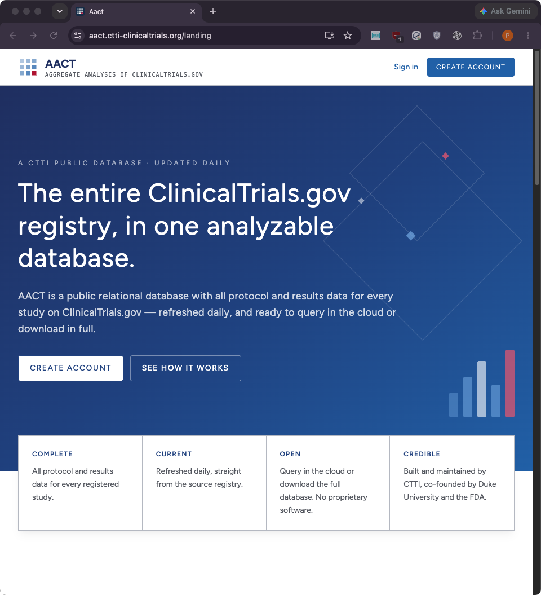
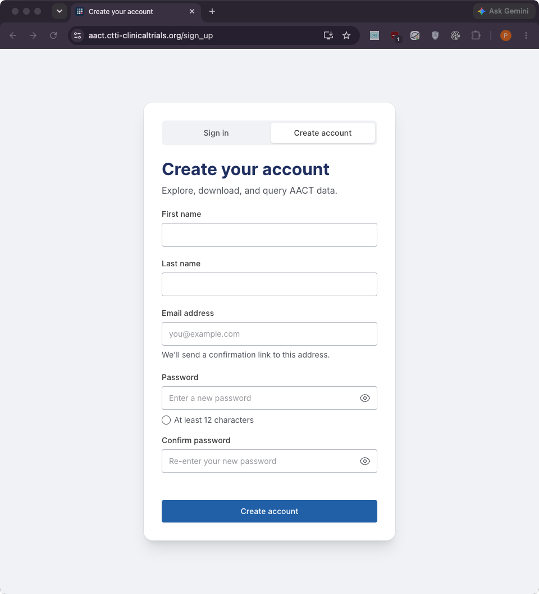
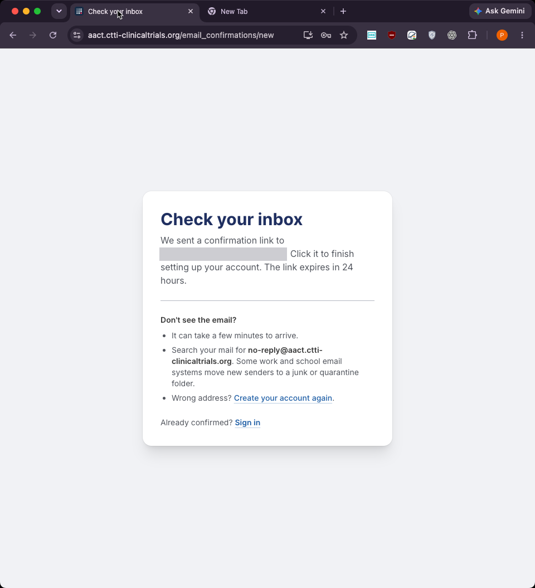
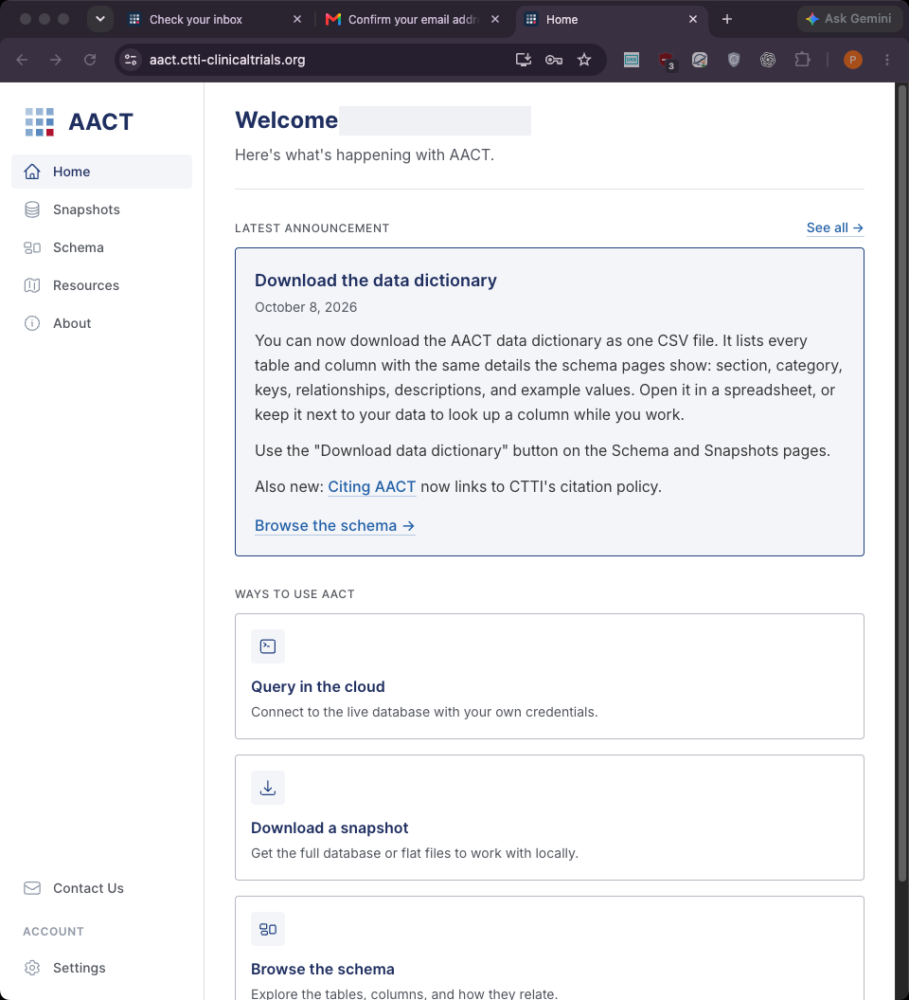
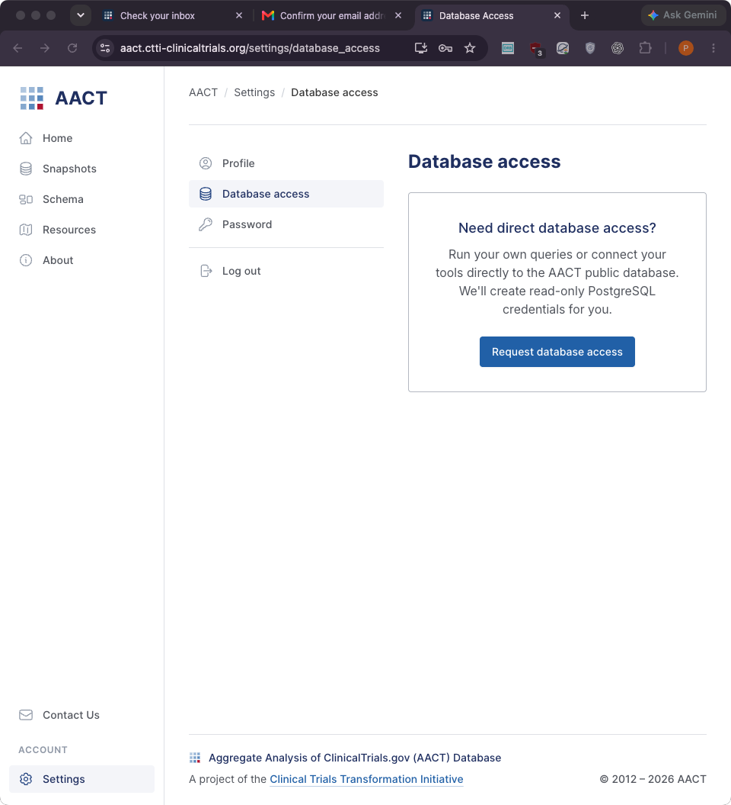
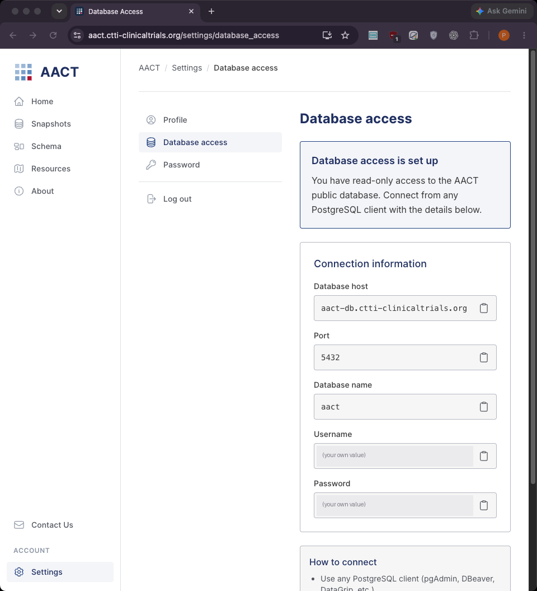
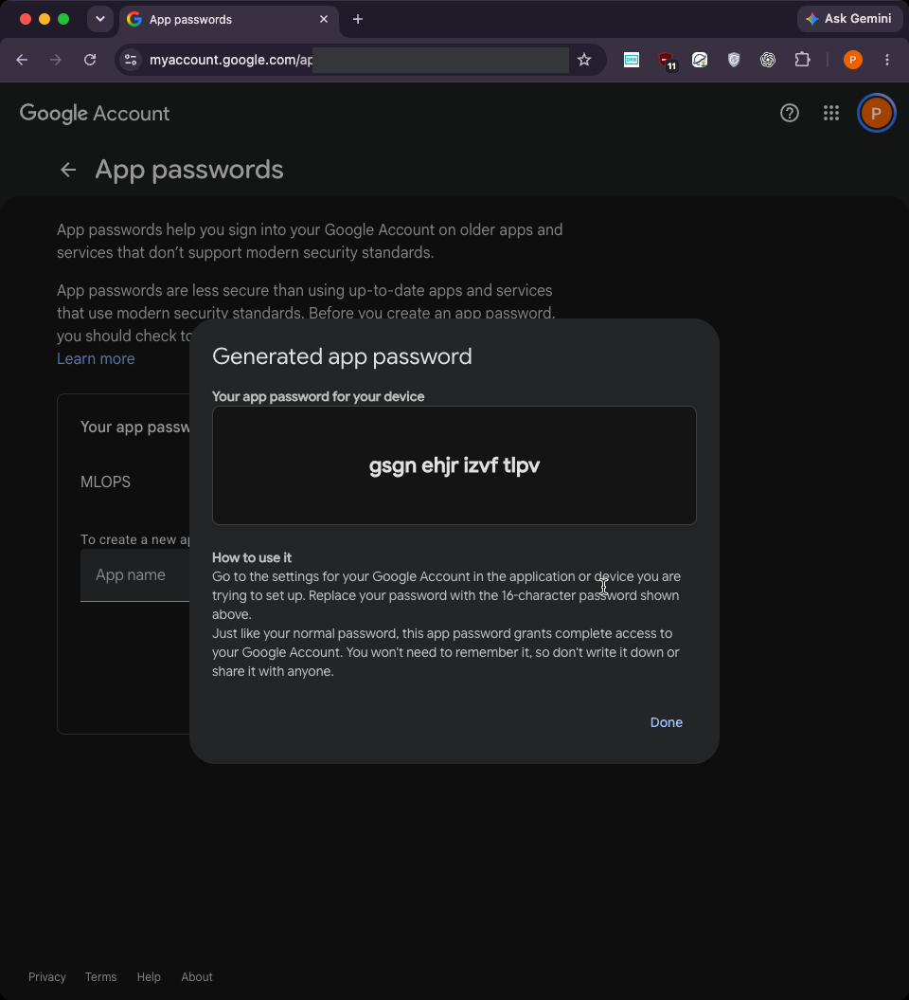
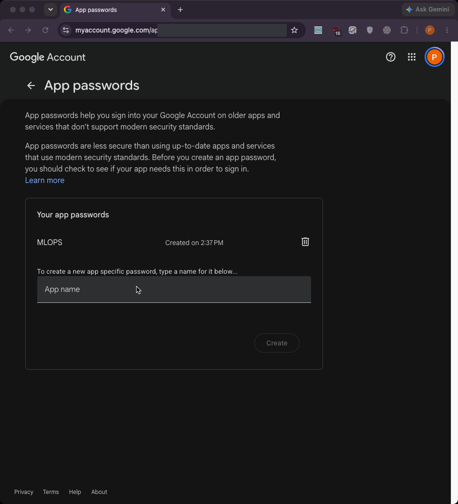

# Setup checklist

Everything someone who clones this repository needs before running the
pipeline. Work through the sections in order; each ends with a check that
tells you it worked.

| Step | What you get | Needed for |
|---|---|---|
| [1. AACT database access](#1-aact-database-access) | the real clinical-trial data | real runs (the test snapshot needs nothing) |
| [2. Email alerts](#2-email-alerts) | an email when data looks wrong or a task fails | every run |

**Only want the alert emails?** You do not need to set anything up: send
your address to whoever runs the pipeline (on this project, Pavanchytanya).
They add it to the subscriber list (`ALERT_EMAIL_TO`, section 2.4) and you
get every alert from the next run on.

All secrets go into one file, `Data-Pipeline/.env`, created from the example
and never committed (it is in `.gitignore`):

```bash
cp Data-Pipeline/.env.example Data-Pipeline/.env
```

## 1. AACT database access

The pipeline reads the trials from AACT (Aggregate Analysis of
ClinicalTrials.gov), a free public PostgreSQL database run by CTTI that holds
every study registered on ClinicalTrials.gov (about 608,000 trials, refreshed
daily). Access needs a free account and takes about 5 minutes.

**1.1 Open AACT and click "Create account"** at
<https://aact.ctti-clinicaltrials.org/>.



**1.2 Fill in the form.** First and last name, an email address you can open
(a confirmation link is sent to it), and a password of at least 12
characters. This password is for the AACT website only; the pipeline does not
use it.



**1.3 Confirm your email.** AACT sends a link from
`no-reply@aact.ctti-clinicaltrials.org`; it can take a few minutes and may
land in spam. The link expires after 24 hours.



**1.4 Open "Query in the cloud".** After confirming you are signed in; the
home page offers ways to use AACT. The pipeline uses the live database
("Query in the cloud").



**1.5 Click "Request database access"** (Settings, Database access). AACT
creates read-only PostgreSQL credentials for your account.



**1.6 Copy the database username and password.** The page now shows the
connection information. The username and password here are **not** your
website email and password: the username looks like `aact_u12345`, and the
password is generated by AACT.



| Field on the page | Where it goes |
|---|---|
| Database host `aact-db.ctti-clinicaltrials.org`, port `5432`, database `aact` | already built into the pipeline (`src/ingestion/fetch_aact.py`) |
| Username | `AACT_USER=` in `Data-Pipeline/.env` |
| Password | `AACT_PASSWORD=` in `Data-Pipeline/.env` |

```
AACT_USER=aact_u12345
AACT_PASSWORD=the-password-AACT-generated
```

No quotes, no spaces around `=`. Do not share these or paste them anywhere
else; the repository never needs them except through `.env`.

**Check:** with the pipeline's requirements installed
(`pip install -r Data-Pipeline/requirements.txt`), this prints the number of
trials in AACT:

```bash
python - <<'EOF'
import psycopg2
env = dict(l.strip().split("=", 1) for l in open("Data-Pipeline/.env")
           if l.strip() and not l.startswith("#") and "=" in l)
conn = psycopg2.connect(host="aact-db.ctti-clinicaltrials.org", port=5432,
                        dbname="aact", user=env["AACT_USER"],
                        password=env["AACT_PASSWORD"])
cur = conn.cursor()
cur.execute("select count(*) from ctgov.studies")
print(f"connected: {cur.fetchone()[0]:,} trials")
EOF
```

| You see | Meaning |
|---|---|
| `connected: 608,408 trials` (or more) | done |
| `password authentication failed` | the website email and password were used instead of the database username and password from step 1.6 |
| `could not connect` / timeout | network blocks port 5432 (some campus or company networks do); try another network |

## 2. Email alerts

The pipeline emails every subscriber when something needs a person:

| Alert | Sent when | Example subject |
|---|---|---|
| Data problem | the anomaly check or the validation finds a critical problem or a warning (missing values, outliers, invalid formats, schema violations, drift) | `[ctt-data-pipeline] anomalies warning: 2 found`, `[ctt-data-pipeline] validation critical: 3 checks failed (snapshot 20261101)` |
| Failed task | a pipeline task fails its last attempt (each task is retried twice first) | `[ctt-data-pipeline] task bias failed` |

A failed-task email names the run, the task and the error, and includes the
last lines of the task's log. Alerts are sent through a Gmail account with
an app password: a 16-character password Google generates for one app, so
the account's own password is never stored. It needs about 3 minutes and a
Gmail account with 2-Step Verification on.

**2.1 Open App passwords** at <https://myaccount.google.com/apppasswords>
with the Gmail account that should send the alerts. Google asks for that
account's password first. If the page says app passwords are not available,
turn on 2-Step Verification (Google Account, Security) and come back.



**2.2 Create one.** Type a name such as `ctt-pipeline-alerts` and click
**Create**. Google shows the 16-character password once (as
`abcd efgh ijkl mnop`): copy it before clicking **Done**.

**2.3 Check it is listed.** The name now appears under "Your app
passwords"; delete it here at any time to cut off the pipeline's access.



**2.4 Fill in `Data-Pipeline/.env`:**

```
SMTP_USER=you@gmail.com
SMTP_PASSWORD=abcd efgh ijkl mnop
ALERT_EMAIL_FROM=you@gmail.com
ALERT_EMAIL_TO=you@gmail.com,teammate@example.com
```

| Line | Value |
|---|---|
| `SMTP_USER`, `ALERT_EMAIL_FROM` | the Gmail account from 2.1 |
| `SMTP_PASSWORD` | the app password from 2.2 (the spaces may stay) |
| `ALERT_EMAIL_TO` | the subscribers, comma-separated; to add someone later, append their address and run `./composer/deploy.sh secret` (Google Cloud) or `./local/pipeline.sh up` (local) |

`SMTP_HOST=smtp.gmail.com`, `SMTP_PORT=587` and `SMTP_STARTTLS=true` are
already set for Gmail.

**Check:** from `Data-Pipeline/`, with its requirements installed, this sends
one test email to every subscriber:

```bash
python -c "from scripts.alerts import send_alert; print(send_alert('Test alert', 'Email alerts work.'))"
```

| You see | Meaning |
|---|---|
| `True`, and the email arrives (check spam) | done |
| `False` with `Username and Password not accepted` | the account's normal password was used, or the app password belongs to another account |
| `False` with `alert not emailed (SMTP not configured)` | a line in 2.4 is empty |
