# Running the pipeline on Google Cloud

The data pipeline runs in two places, from the same code and the same DAG:

| | Where | Needs | Guide |
|---|---|---|---|
| **Local** | Airflow in Docker on your machine | Docker | [Data-Pipeline/local/README.md](../Data-Pipeline/local/README.md) |
| **Google Cloud** | Cloud Composer, Vertex AI, Cloud Storage | a Google Cloud project with billing | this page |

This page has two parts:

1. [Our deployment](#1-our-deployment): what we run in our own project, with
   screenshots and logs from a real run.
2. [Deploy it in your own project](#2-deploy-it-in-your-own-project): the
   commands that build the same setup in a Google Cloud project of yours.

We do not keep our environment running between work sessions, so you cannot
reach it. A Cloud Composer environment is billed for every hour it exists and
cannot be paused, so we create it for a session and delete it afterwards. The
data, the run history and the images stay in the bucket and in Artifact
Registry. Part 1 shows what it looked like when it was running.

## 1. Our deployment

### What runs where

```
 git push --> GitHub Actions: style check, tests, then Cloud Build
                   |                 builds two images
                   v
 Artifact Registry  ctt-images/data-pipeline   ctt-images/biobert-gpu
                   |                                   |
                   v                                   v
 Cloud Composer 3 (Airflow 2.10.5)           Vertex AI custom job
 ctt-composer: each task is a pod  --------> n1-standard-8 + 1 x T4
 from data-pipeline, one DVC stage           (the embeddings task)
                   |
                   v
 Cloud Storage  gs://ctt-mlops-project-data
   dvc-store/            DVC remote: every data version
   data-pipeline/state/  run state: params, dvc.lock, logs, reports,
                         baseline, data-version records
   composer-snapshots/   Airflow's history between sessions
```

| Resource | Our value |
|---|---|
| Project | `ctt-mlops` (project ID `ctt-mlops-project`) |
| Region | `us-central1` (Iowa) |
| Bucket | `gs://ctt-mlops-project-data` (Standard, not public) |
| DVC remote | `gs://ctt-mlops-project-data/dvc-store` (`Data-Pipeline/.dvc/config`) |
| Run state | `gs://ctt-mlops-project-data/data-pipeline/state` |
| Images | `us-central1-docker.pkg.dev/ctt-mlops-project/ctt-images/data-pipeline` and `.../biobert-gpu` |
| Airflow | Cloud Composer 3 environment `ctt-composer`, image `composer-3-airflow-2.10.5`, size small |
| GPU step | Vertex AI custom job, `n1-standard-8` with one NVIDIA T4 |
| Identities | `pipeline-sa` (Composer, its pods and the Vertex AI job), `cicd-sa` (GitHub Actions and Cloud Build) |
| CI sign-in | Workload Identity Federation (pool `github-pool`), so no service-account key exists |

All of it is created by [`Data-Pipeline/composer/deploy.sh`](../Data-Pipeline/composer/deploy.sh)
and [`.github/workflows/ci.yml`](../.github/workflows/ci.yml). None of it was
set up by hand in the console.

### CI/CD: GitHub Actions

Every push runs the style check and three test suites: `src/`, the pipeline
stages, and the DAGs under Airflow 2.10.5. On `main` and `pavan/integration`
it then builds both images with Cloud Build and, if Composer is up, uploads
the new DAG.

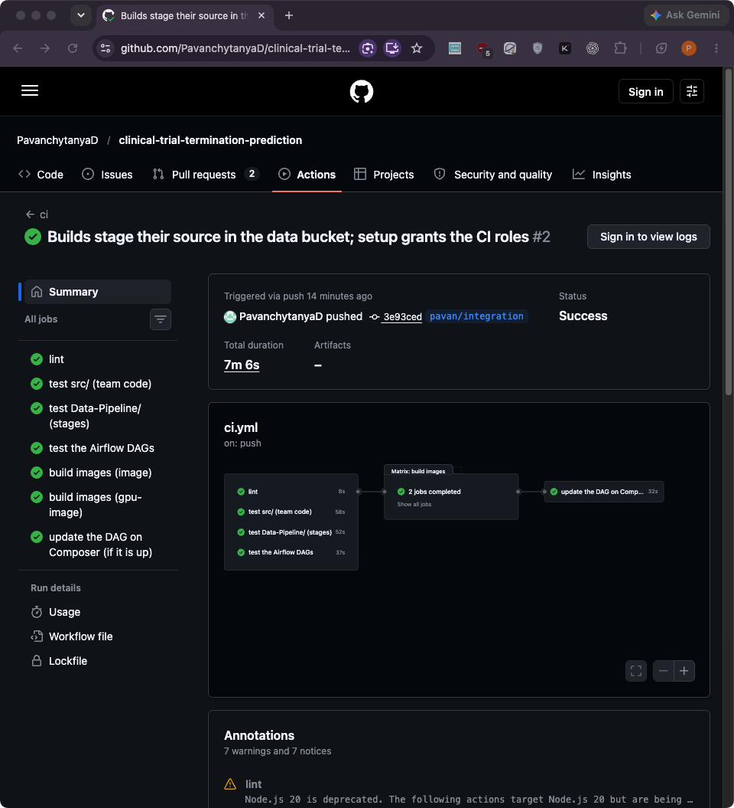

### Images: Cloud Build and Artifact Registry

Cloud Build builds the images as `cicd-sa` and pushes them to the
`ctt-images` repository, tagged `:latest` and with the commit.

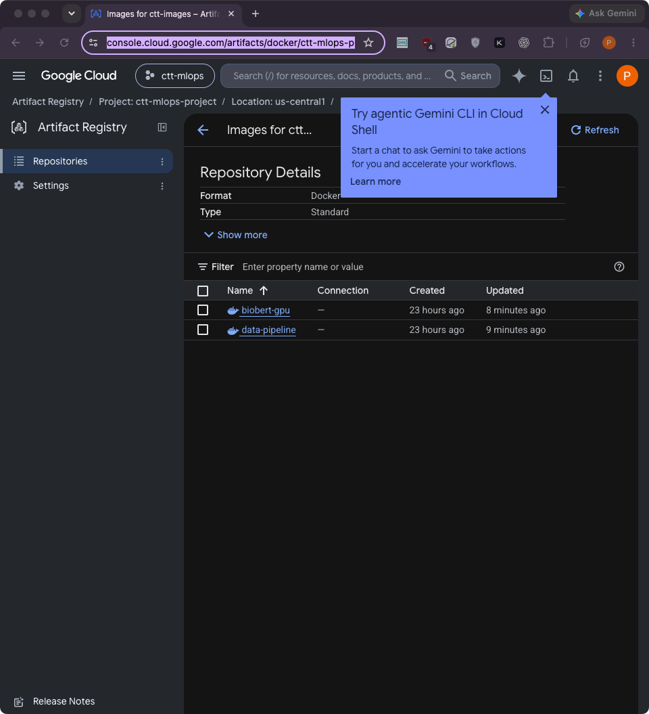

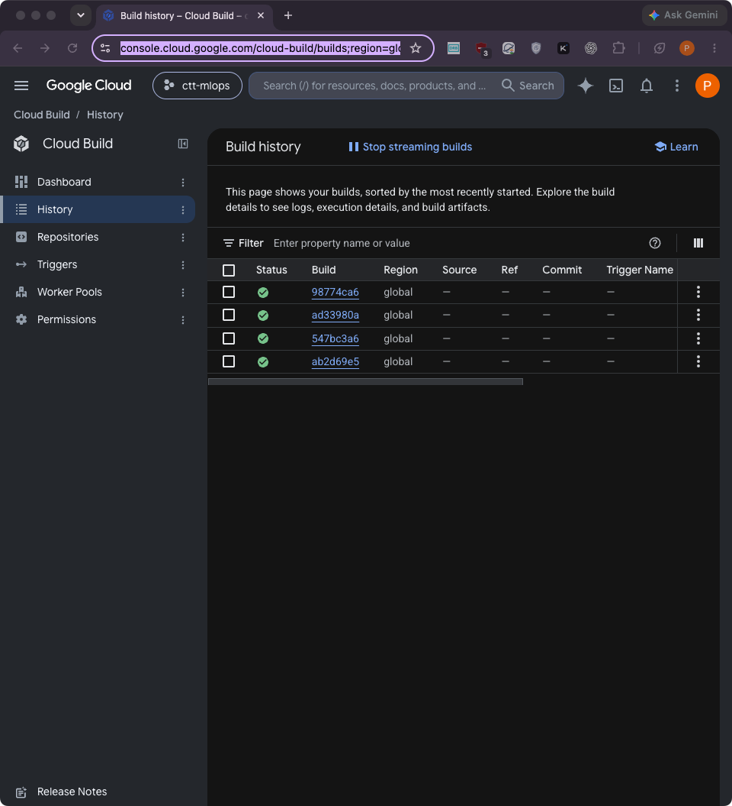

### Storage: the bucket

`dvc-store/` is the DVC remote. `data-pipeline/` holds the run state and the
text that is handed to the GPU job.

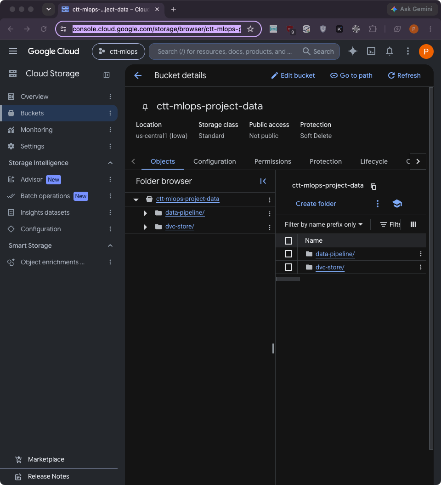

The state folder holds the shared `dvc.lock` and, for each run, its
parameters, logs and reports (`runs/<run_id>/`). It also holds one
data-version record per snapshot (`versions/<snapshot>/`).

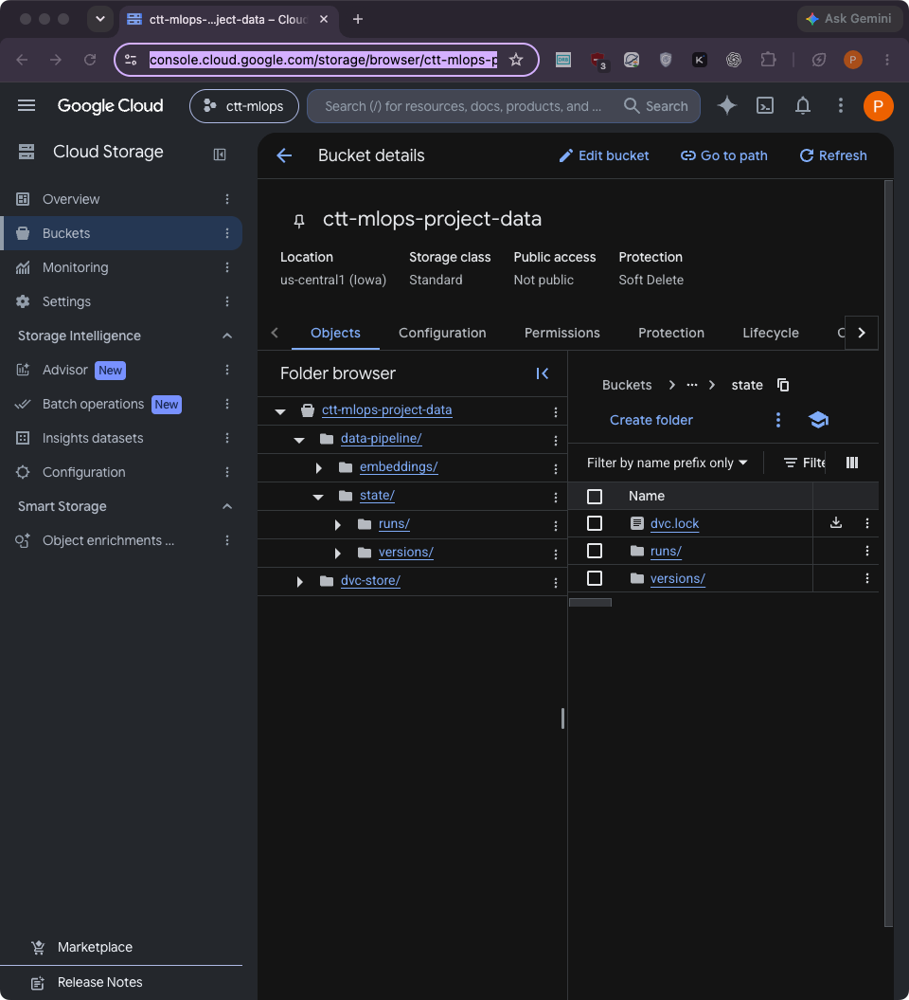

### Orchestration: Cloud Composer

`./composer/deploy.sh up` creates the environment, which takes about 25
minutes:

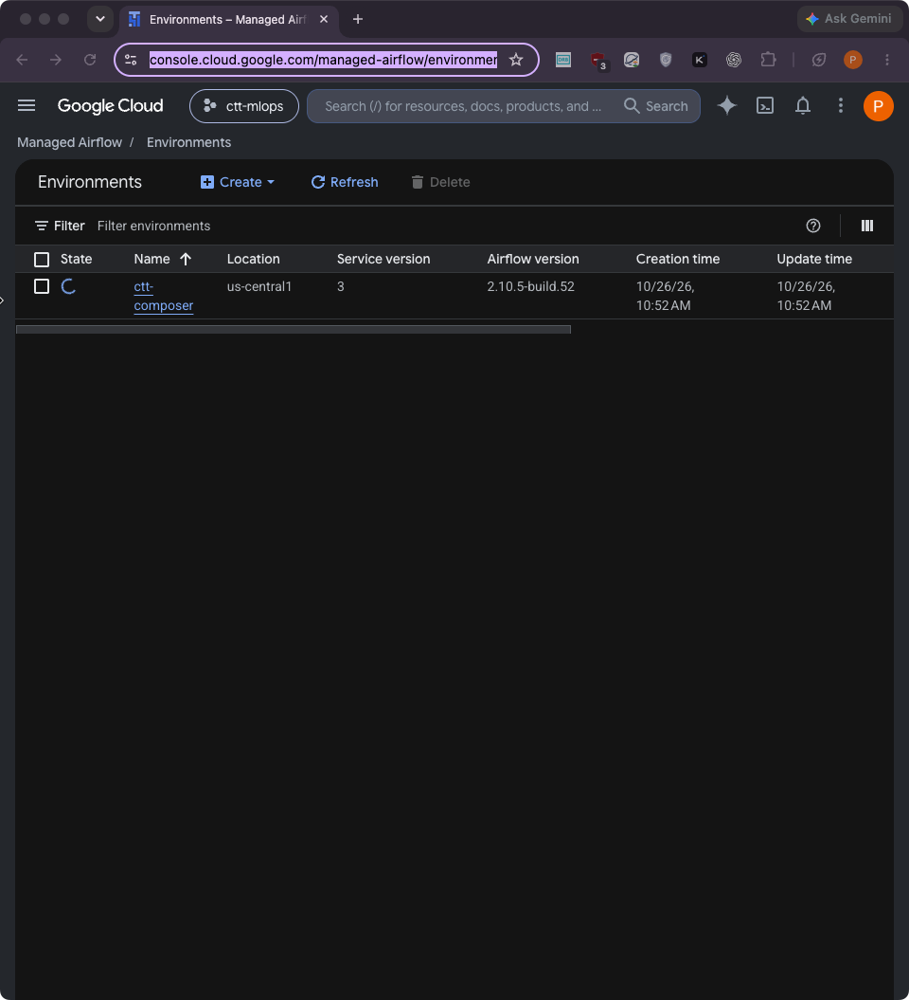

The environment runs as `pipeline-sa`:

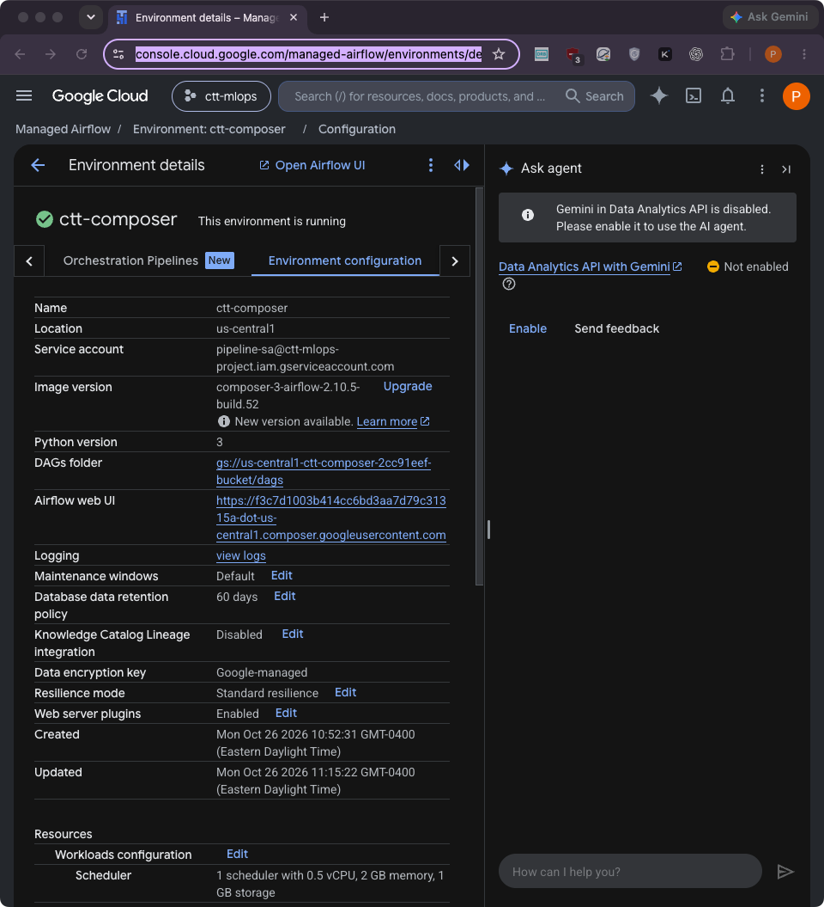

`deploy.sh config` sets the DAG's settings as environment variables. These
are the pipeline image, the state folder, the SMTP/AACT secret name and the
default source:

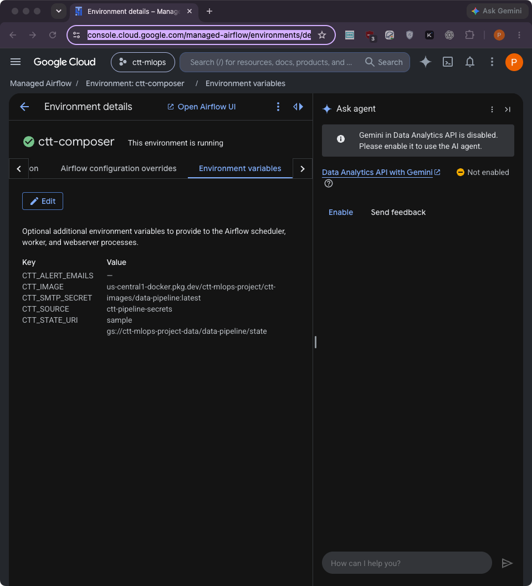

Both DAGs are loaded: the monthly `ctt_data_pipeline` and the manual
`ctt_freeze_baseline`.

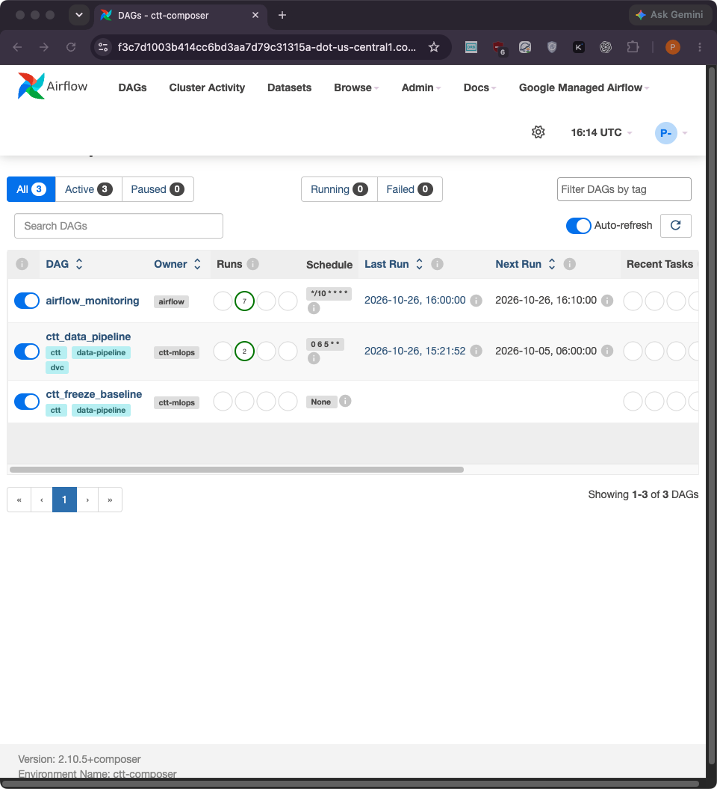

### A run on Composer

The run of 2026-10-26 15:20 UTC used 500 trials of the seeded test snapshot.
All nine tasks succeeded, and every task ran as a `KubernetesPodOperator`
pod:

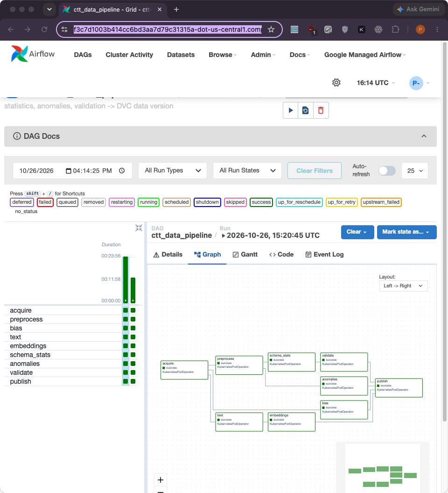

The Gantt view shows the parallel branches. `preprocess`, `bias` and `text`
start together after `acquire`, and the feature checks run while the GPU job
runs. The red bar is the first attempt of `bias`, which failed. Airflow
retried it automatically, and the retry succeeded:

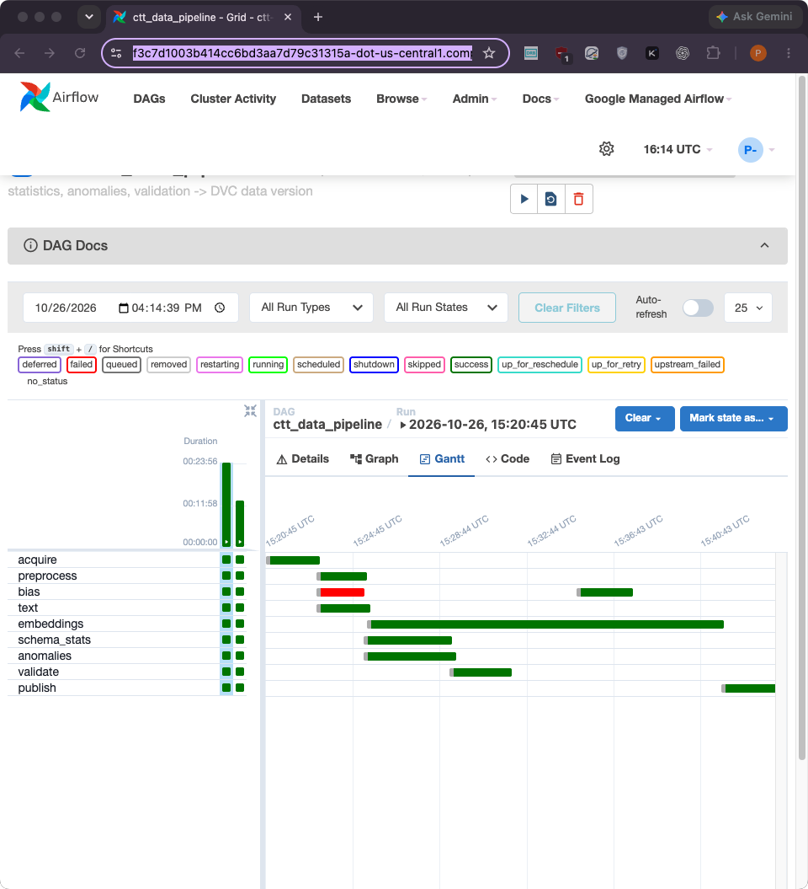

The same run drawn from Airflow's task times (`Data-Pipeline/docs/gantt.py`)
took 1,435 seconds. `embeddings` (971 s) includes Vertex AI starting the T4
machine:

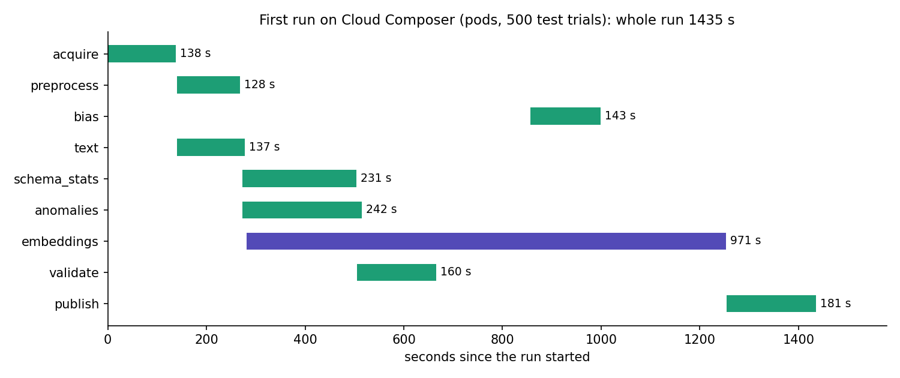

The `embeddings` task log shows the pod waiting for the Vertex AI job, then
DVC updating `dvc.lock` and pushing the embeddings:

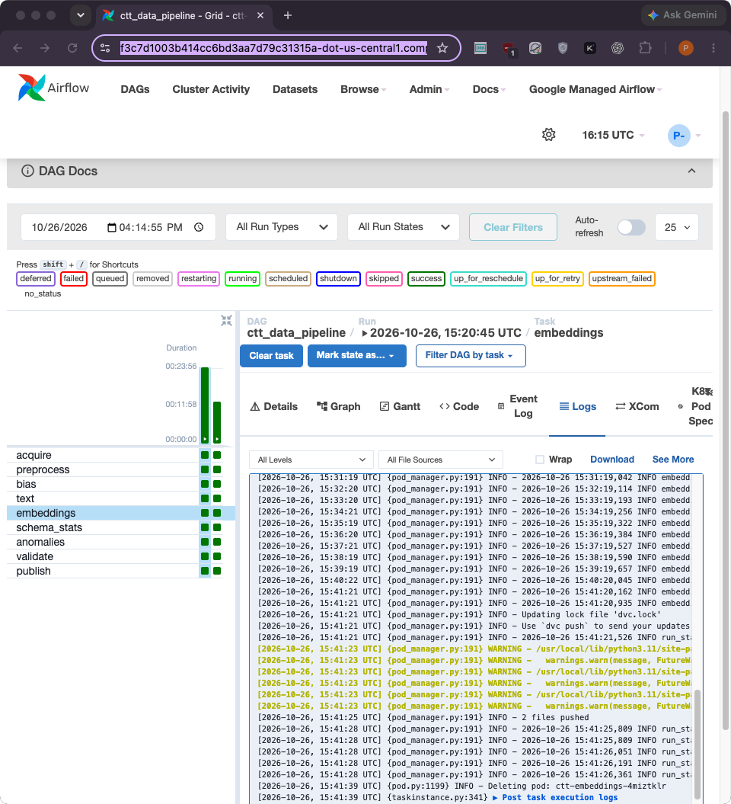

Both manual runs of `ctt_data_pipeline` succeeded:

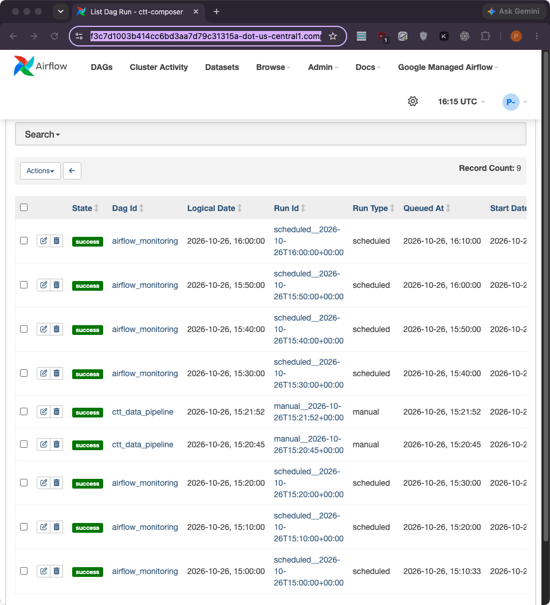

### The GPU step: Vertex AI

Each run's `embeddings` task starts a custom job `ctt-biobert-<run_id>` on
an `n1-standard-8` with a T4. If the task is stopped or times out, the job is
cancelled, so no GPU is left running. The stopped job at the bottom of the
list was cancelled this way during testing.

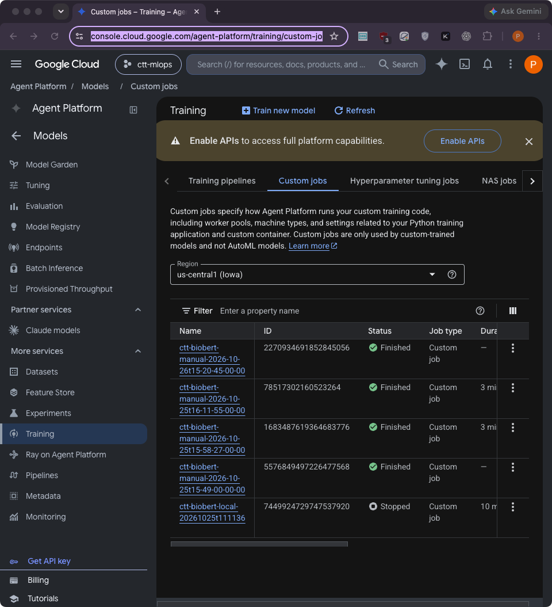

### Between sessions

`./composer/deploy.sh down` saves a snapshot of Airflow's history to
`gs://ctt-mlops-project-data/composer-snapshots/` and deletes the
environment, which stops the billing. The next `up` restores that snapshot,
so earlier runs show up in the Airflow UI again. The data versions never
leave the bucket.

## 2. Deploy it in your own project

This builds the same setup in a Google Cloud project you own. Every resource
name is derived from the project ID, so nothing has to be edited in the code.

### What you need

- A Google Cloud project with billing enabled, where you are Owner. A new
  project keeps everything separate and is easy to delete afterwards.
- The [Google Cloud CLI](https://cloud.google.com/sdk/docs/install)
  (`gcloud`), Git and Bash. Linux, macOS, WSL and
  [Cloud Shell](https://shell.cloud.google.com) all work. Cloud Shell
  already has everything installed.
- For the GPU step, Vertex AI quota for one T4 GPU in your region (custom
  model training). New projects sometimes have 0. To check, open IAM & Admin >
  Quotas and search for "Custom model training Nvidia T4 GPUs". Without it,
  use the CPU option in step 3.
- Optional, for real AACT data and email alerts: `Data-Pipeline/.env`
  ([docs/SETUP.md](SETUP.md)). Without it, the pipeline runs on the seeded
  test snapshot.

**Cost:** Composer is billed for every hour the environment exists. The
Vertex AI job is billed only while a run's `embeddings` task runs (a few
minutes on the test snapshot). Storage and images cost cents. Run `down` when
you finish (step 6).

### Step 1: get the code and sign in

```bash
git clone https://github.com/PavanchytanyaD/clinical-trial-termination-prediction.git
cd clinical-trial-termination-prediction/Data-Pipeline
gcloud auth login
gcloud config set project YOUR_PROJECT_ID
export PROJECT=YOUR_PROJECT_ID     # every deploy.sh step uses it
```

`deploy.sh` derives everything else from `PROJECT`. You can override any
setting:

| Variable | Default |
|---|---|
| `REGION` | `us-central1` |
| `BUCKET` | `${PROJECT}-data` (bucket names are global; pick another if it is taken) |
| `ENV_NAME` | `ctt-composer` |
| `ALERT_EMAILS` | none (comma-separated failure-email recipients) |

### Step 2: one-time setup (about 2 minutes)

```bash
./composer/deploy.sh setup
```

This enables the APIs (Composer, Artifact Registry, Cloud Build, Vertex AI,
IAM, Storage) and creates the bucket. It also creates two service accounts
and gives them their roles:

- `pipeline-sa`: Composer worker, Storage object admin, Artifact Registry
  reader, Vertex AI user, service account user and log writer.
- `cicd-sa`: Cloud Build editor, Artifact Registry writer, Storage object
  admin, log writer and Composer user.

It also lets Composer's own service agent act as `pipeline-sa`.

### Step 3: build the two images (about 15 minutes)

```bash
./composer/deploy.sh image       # pipeline image, the Composer pods run it
./composer/deploy.sh gpu-image   # BioBERT image, the Vertex AI job runs it
```

Cloud Build builds them from the committed code (`git archive HEAD`) and
pushes them to `REGION-docker.pkg.dev/PROJECT/ctt-images/`.

No T4 quota? Run the Vertex AI job on CPU only. Set `accelerator: ""` in
the `embeddings` section of `params.yaml` and commit it. A CPU job is slower,
so a small `max_trials` (for example `200`) keeps it short.

### Step 4: create Composer and run the pipeline (about 25 + 25 minutes)

```bash
./composer/deploy.sh up          # create the environment, set its settings,
                                 # upload the DAGs; prints the Airflow UI URL
./composer/deploy.sh trigger     # one run on the seeded test snapshot
```

`up` sets the environment variables the DAG passes to every pod:
`CTT_GCP_PROJECT`, `CTT_BUCKET`, `CTT_DVC_REMOTE=gs://BUCKET/dvc-store`,
`CTT_STATE_URI`, the image names and `CTT_SERVICE_ACCOUNT`. That is how the
same image writes to your bucket and starts the GPU job in your project.

Other runs:

```bash
SNAPSHOT=20261101 SAMPLE_TRIALS=2000 ./composer/deploy.sh trigger   # bigger test snapshot
SOURCE=db ./composer/deploy.sh trigger                              # live AACT database (needs .env)
```

### Step 5: check the result

- **Airflow UI** (`./composer/deploy.sh ui` prints the address): DAG
  `ctt_data_pipeline`, its Graph, Gantt and task logs, as in part 1.
- **Reports and logs**: `gs://BUCKET/data-pipeline/state/runs/<run_id>/<task>/`.
  For example, `validate/reports/validation/validation.md` and
  `anomalies/reports/anomalies/anomalies.md`.
- **Data version**: `gs://BUCKET/data-pipeline/state/versions/<snapshot>/`
  holds the run's `dvc.lock` and a record with every output's hash and the
  validation summary. The data itself is in `gs://BUCKET/dvc-store/`.
- **GPU job**: Vertex AI > Training > Custom jobs, `ctt-biobert-<run_id>`.

```bash
gcloud storage ls -r "gs://${PROJECT}-data/data-pipeline/state/versions/"
```

To make a trusted run the validation baseline that later runs are checked
against:

```bash
REASON="first test run" ./composer/deploy.sh freeze
```

### Step 6: stop the billing

```bash
./composer/deploy.sh down        # save Airflow's history, delete Composer
```

The bucket and the images remain, and the next `up` picks up where you left
off. To remove everything, delete the bucket and the `ctt-images` repository,
or delete the whole project:

```bash
gcloud projects delete "${PROJECT}"
```

### Optional: CI/CD from your fork

GitHub Actions builds the images on every push to `main`. It runs in our
repository, and in a fork only after you connect it to your project:

1. Create a Workload Identity pool and a GitHub provider for your fork. Let
   it impersonate `cicd-sa`. See
   [google-github-actions/auth](https://github.com/google-github-actions/auth#workload-identity-federation-through-a-service-account).
2. In the fork, add three repository variables (Settings > Secrets and
   variables > Actions > Variables): `GCP_PROJECT`, `WIF_PROVIDER` (the
   provider's full resource name) and `CICD_SA`
   (`cicd-sa@PROJECT.iam.gserviceaccount.com`).

Without these, the test jobs still run in the fork, and you build the images
with step 3.
